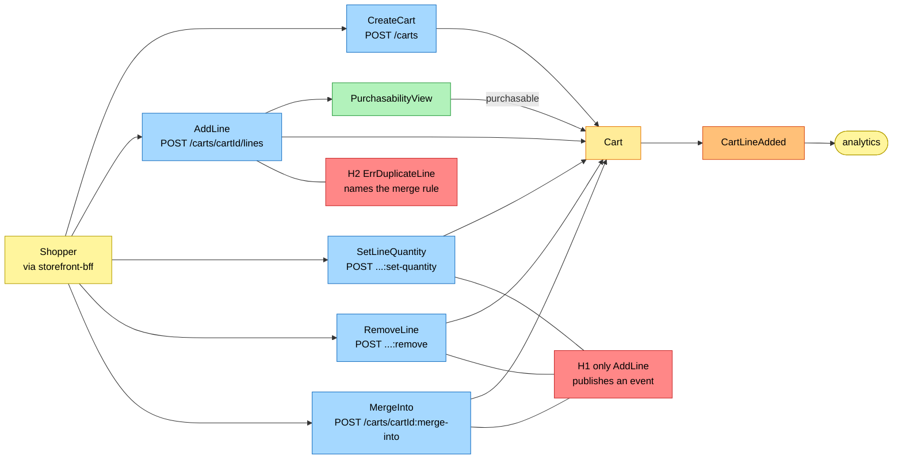
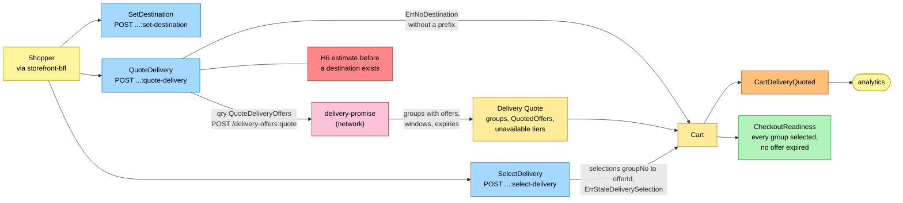
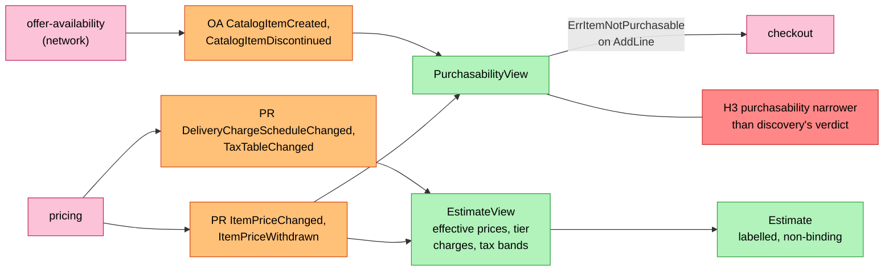
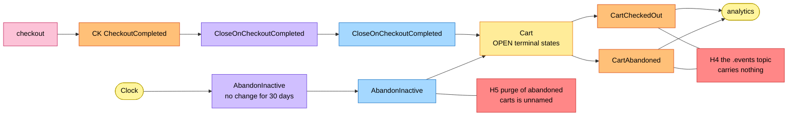

# EventStorming

:::info[Proposed design, docs only]
Derived from [`model/model.yaml`](https://github.com/IQVO/warehouse-docs/blob/main/storefront/model/model.yaml). Nothing in this context is built; the model is the canonical design, and identifiers (`Err...` names, routes, CloudEvents types) are the names a future implementation must use.
:::

Process-level boards in the ddd-crew
[EventStorming glossary & cheat sheet](https://github.com/ddd-crew/eventstorming-glossary-cheat-sheet)
notation. Every sticky comes from `model.yaml`. Events published by a
neighbour are drawn as orange stickies prefixed with the producer. Every
hotspot is a gap or a risk the model itself shows, and its source is given
in the hotspot table. Boards are drawn left to right; each stays within the
page width.

## Legend

| Colour | Sticky | Meaning here |
| --- | --- | --- |
| Pale yellow `#fff59d` | Actor | The shopper (through the BFF), the clock |
| Blue `#a5d8ff` | Command | A command from `aggregates[Cart].commands` |
| Yellow `#ffec99` | Aggregate | The `Cart` aggregate and its held quote |
| Orange `#ffc078` | Domain Event | Ours (`publishes`) or a neighbour's (`consumes`, prefixed with the producer) |
| Lilac `#d0bfff` | Policy | `policies`, or the reaction a command takes to an event |
| Green `#b2f2bb` | Read Model | `PurchasabilityView`, `EstimateView`, `CheckoutReadiness`, a read route |
| Pink `#fcc2d7` | External System | A sibling context or the network (`pricing`, `offer-availability`, `delivery-promise`, `checkout`, analytics) |
| Red `#ff8787` | Hotspot | A gap or risk in the model (see the table at the end) |

## 1. Cart building

Derived from: `model.yaml → contexts[shopping-cart].inbound` (BFF cmd row),
`.aggregates[Cart].commands` + `.invariants`, `.publishes[CartLineAdded]`,
`.read_models[PurchasabilityView]`.

Omitted: the invariant errors on the add path
(`ErrQuantityOutOfRange`, `ErrTooManyLines`, `ErrItemNotPurchasable`,
`ErrCartClosed` on a closed cart, `ErrMergeTarget` on a bad merge target)
and the outbox. Every mutating command on this board also clears the quote
and the selections (business decision 3; board 2).

## 2. Destination, quote and selection

Derived from: `model.yaml → contexts[shopping-cart].sync_calls`,
`.aggregates[Cart]` (`QuotedOffer`, `DeliverySelection` value objects,
`ErrNoDestination`, `ErrStaleDeliverySelection`),
`.publishes[CartDeliveryQuoted]`, `.read_models[CheckoutReadiness]`;
`network/model/model.yaml → contexts[delivery-promise].inbound`.

Omitted: the estimate arithmetic (board 3) and the offer expiry clock
(readiness compares `expiresAt`; no event announces an expiry). A quote
holds no capacity: the offers are `delivery-promise` facts frozen at quote
time, and capacity is held only when checkout places the order.

## 3. The estimate and the views

Derived from: `model.yaml → contexts[shopping-cart].consumes`,
`.read_models[PurchasabilityView, EstimateView]`;
`contexts[product-discovery].ul[Purchasable]` (the comparison behind H3).

Omitted: `CheckoutReadiness` (derived from the cart itself, board 2) and
the inbox. No pricing or catalogue event touches the `Cart` aggregate: a
price move never clears a quote — it moves the estimate, which is why the
estimate can be labelled non-binding (gap S2, answered by the binding
`PriceQuote` at checkout).

## 4. Cart lifecycle

Derived from: `model.yaml → contexts[shopping-cart].policies`,
`.aggregates[Cart]` (`states`, `transitions`, `ErrCartClosed`),
`.publishes`, `.size_estimate`; `contexts[checkout].publishes[CheckoutCompleted]`.

Omitted: `MergeInto` (board 1) and the inbox. `CHECKED_OUT`, `ABANDONED`
and `MERGED` are terminal: `ErrCartClosed` rejects every later change. A
`CheckoutCompleted` for a cart that is not `OPEN` has no transition in the
model — in practice the race needs a session to outlive 30 idle days.

## Hotspots

| # | Hotspot | Where it comes from in the model |
| --- | --- | --- |
| H1 | Only `AddLine` publishes an event. `SetLineQuantity`, `RemoveLine`, `SetDestination`, `SelectDelivery`, `MergeInto` and `CreateCart` raise nothing, so analytics sees adds, quotes, abandons and checkouts but never a removal or a merge. | `aggregates[Cart].commands` vs `publishes` |
| H2 | `ErrDuplicateLine` names a rule whose stated behaviour is a merge ("adding an existing item merges quantities"); the REST contract reads it as "the invariant behind the merge". No input in the model is ever rejected with it. | `aggregates[Cart].invariants`, `storefront/apis/shopping-cart/openapi.yaml` (`addCartLine`) |
| H3 | `PurchasabilityView` is fed by catalogue and price events only; `product-discovery`'s `Purchasable` also requires content `PUBLISHED` and a `LIVE` listing with stock. The cart can accept an item discovery would refuse; the gap surfaces later at checkout's quote. | `read_models[PurchasabilityView]` vs `contexts[product-discovery].ul[Purchasable]` |
| H4 | All four published events are analytics-only, so `retailnetwork.shopping-cart.events` carries nothing and no sibling or network context consumes a cart fact; checkout reads the cart synchronously instead. | `publishes` rows ("analytics only"); `conventions.integration_rules` |
| H5 | The size estimate says "abandoned carts purged", but no command or policy names the purge, its retention or its visible effect. | `aggregates[Cart].size_estimate` vs `.commands`, `.policies` |
| H6 | The estimate is defined as effective prices plus selected tier charges plus tax band; with no destination there is no quote, no charge and no band, and the model does not say what the estimate shows before a destination is set. | `purpose`, `business_decisions` (estimate bullet), `invariants[ErrNoDestination]` |
