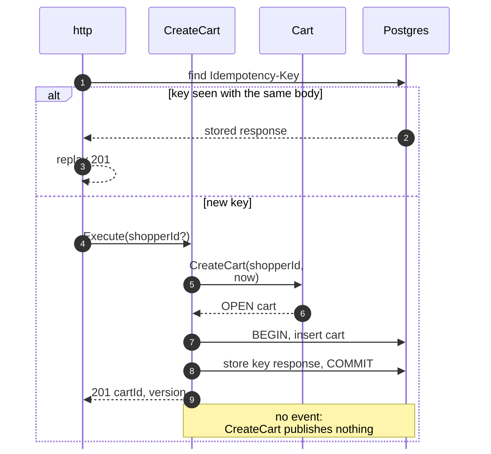
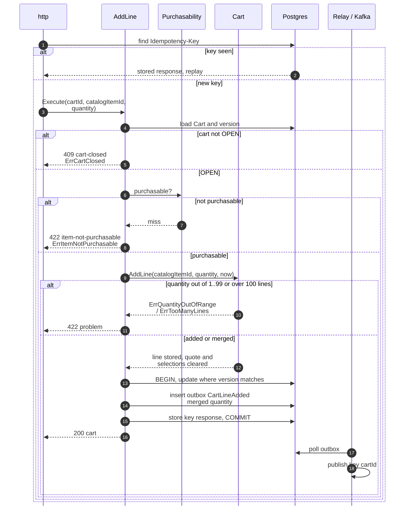
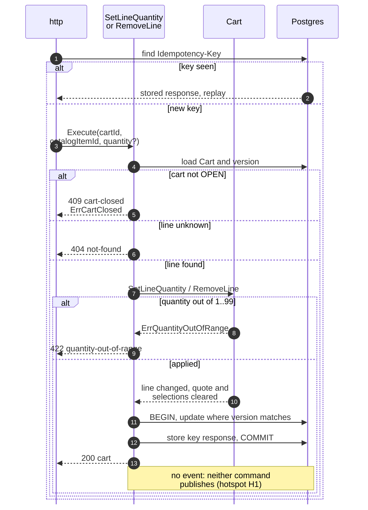
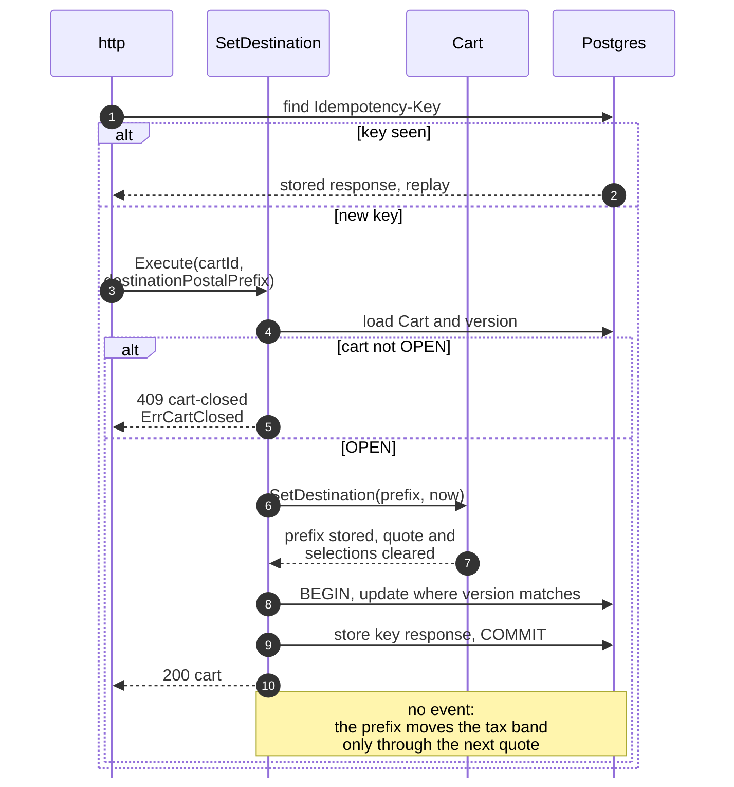
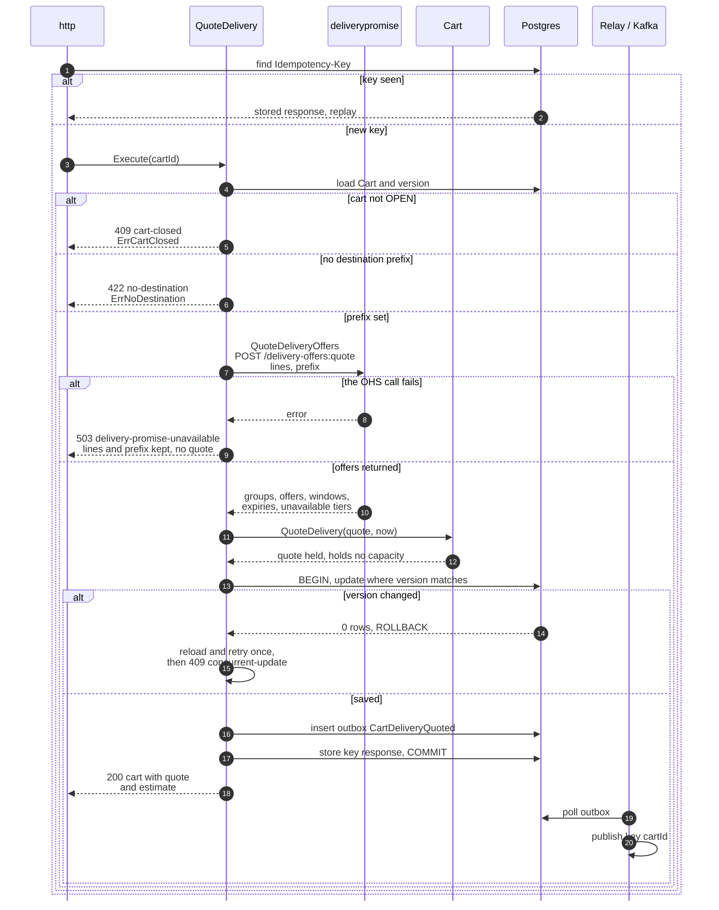
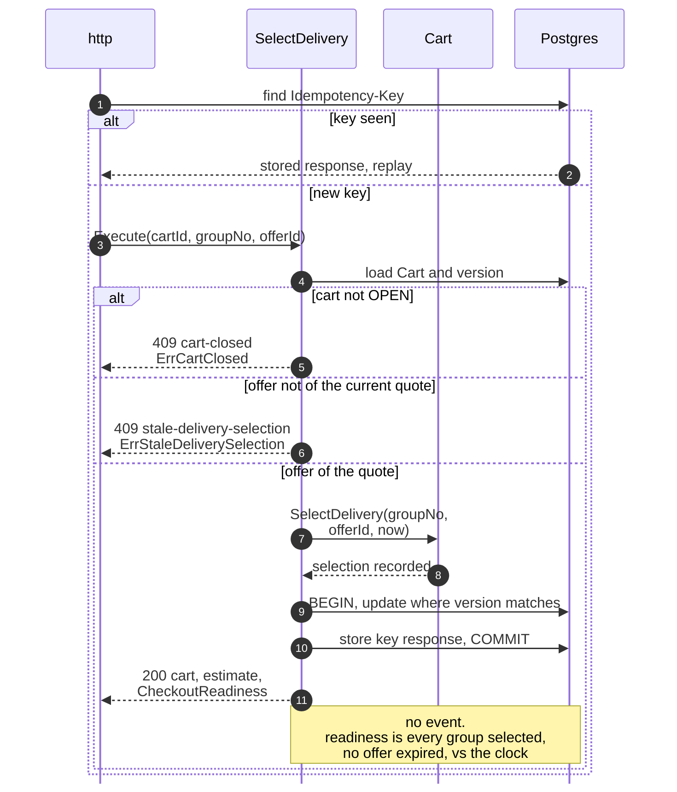
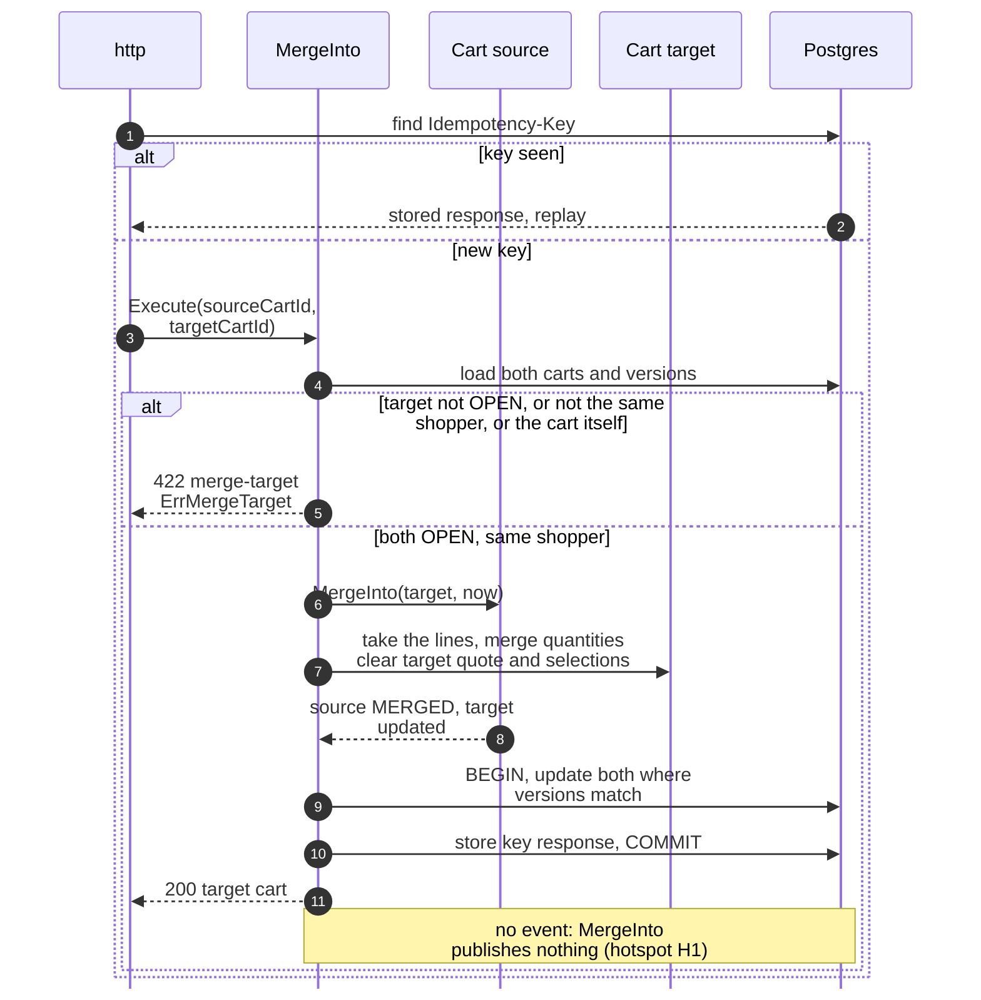
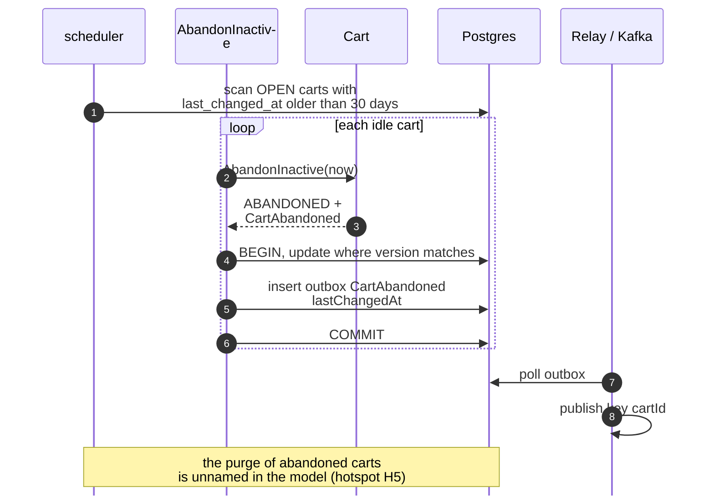
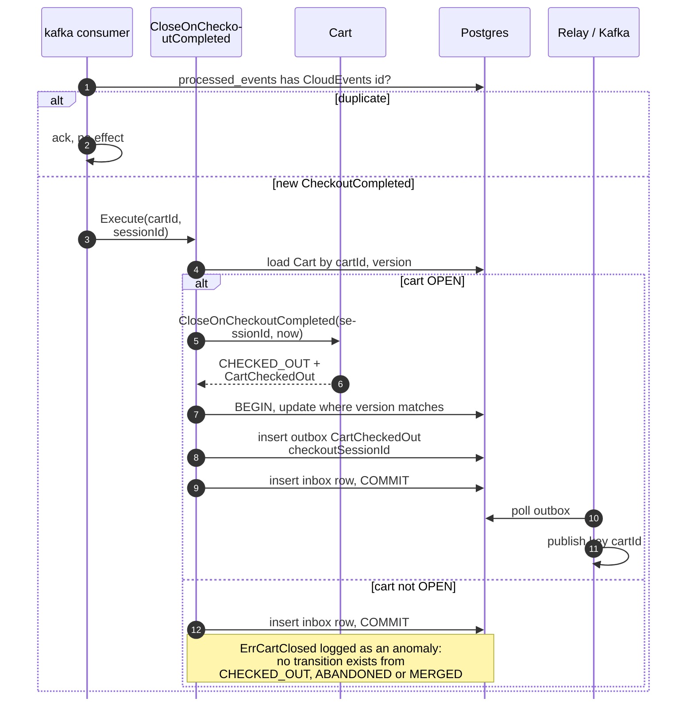
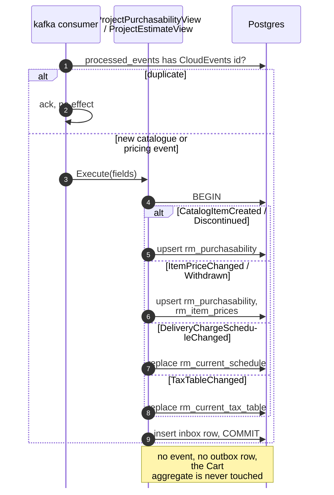

# Sequence Diagrams

:::info[Built on develop, not deployed]
Derived from [`model/model.yaml`](https://github.com/IQVO/warehouse-docs/blob/main/storefront/model/model.yaml). The `shopping-cart` service is built on develop ([`IQVO/shopping-cart`](https://github.com/IQVO/shopping-cart) at `95bc5bc`, checked 2026-10-27) and not deployed (no warehouse-infra entry). Every `Err...` name, REST route and CloudEvents type of this context named on this page exists in the service; where the built service differs from the model's design, the page says so (**As built**) or the context's [Service and operations](/storefront/contexts/shopping-cart#service-and-operations) section lists it.
:::

One UML sequence diagram per command use case on
[Use Cases](/storefront/contexts/shopping-cart/use-cases). Participant
names are the proposed packages and ports from the
[Class Diagram](/storefront/contexts/shopping-cart/class-diagram):

- `http`, `kafka consumer` and `scheduler` are the inbound adapters.
- The use case is in `internal/application/usecases`.
- `Purchasability` stands for the `PurchasabilityStore` port behind
  `PurchasabilityView`.
- `deliverypromise` is the outbound REST adapter behind the `QuoteOffers`
  port — the cart's only synchronous dependency.
- `Postgres` stands for the repository, the views, the outbox, the inbox
  and the idempotency store. They share one transaction through
  `UnitOfWork`.
- `Relay / Kafka` is the outbox relay. It reads committed `outbox_events`
  rows and publishes them to `retailnetwork.shopping-cart.analytics` — the
  only topic the cart writes to (all four events are analytics-only).

Every save is conditional on the loaded `version` (optimistic concurrency)
— one shopper's rapid edits are the hot path. Full CloudEvents types are on
[Domain Events](/storefront/contexts/shopping-cart/domain-events).

## 1. CreateCart (REST POST /carts)

Derived from: `model.yaml → contexts[shopping-cart].aggregates[Cart].commands[CreateCart]`,
`.rest["POST /carts"]`, `conventions.integration_rules`.

Omitted: nothing. `shopperId` is optional (guest-first, D4); the BFF mints
the `Idempotency-Key` and keeps the returned `cartId` in its cookie.

## 2. AddLine (REST POST /carts/cartId/lines)

Derived from: `model.yaml → contexts[shopping-cart].aggregates[Cart]`
(`AddLine`, invariants), `.read_models[PurchasabilityView]`,
`.publishes[CartLineAdded]`; `conventions.integration_rules`.

Omitted: the version-conflict retry (reload once, then 409
`concurrent-update`; as in diagram 5). Re-adding an existing item merges
quantities — the event carries the merged line, and
`ErrDuplicateLine` is the invariant behind the merge (hotspot H2).

## 3. SetLineQuantity and RemoveLine (REST)

Derived from: `model.yaml → contexts[shopping-cart].aggregates[Cart].commands`,
`.publishes` (no event for either command).

One diagram covers both commands: the shape is identical; only the line
mutation differs. Omitted: the version-conflict retry and the relay.

## 4. SetDestination (REST POST /carts/cartId:set-destination)

Derived from: `model.yaml → contexts[shopping-cart].aggregates[Cart].commands[SetDestination]`,
`business_decisions` (clearing rule).

Omitted: the version-conflict retry. The destination is a prefix, never an
address; `EstimateView`'s tax band is keyed on it at read time.

## 5. QuoteDelivery (REST POST /carts/cartId:quote-delivery)

Derived from: `model.yaml → contexts[shopping-cart].sync_calls[QuoteDeliveryOffers]`,
`.aggregates[Cart].commands[QuoteDelivery]`, `.invariants[ErrNoDestination]`,
`.publishes[CartDeliveryQuoted]`;
`network/model/model.yaml → contexts[delivery-promise].inbound` (caller
`shopper / storefront`).

Omitted: the network's own quote mechanics (feasible witness paths,
capacity — `delivery-promise`'s pages). The cart consumes the offer set as
returned and stores the unavailable tiers with their constraints. A failed
OHS call leaves the cart's lines and prefix intact: the shopper retries the
quote, not the cart.

## 6. SelectDelivery (REST POST /carts/cartId:select-delivery)

Derived from: `model.yaml → contexts[shopping-cart].aggregates[Cart].commands[SelectDelivery]`,
`.invariants[ErrStaleDeliverySelection]`, `.read_models[CheckoutReadiness]`.

Omitted: the version-conflict retry and the estimate arithmetic
(`EstimateView`: effective prices plus the selected tiers' charges plus the
band of the destination prefix). Expiry is checked by comparing
`expiresAt` with the clock; no event announces an expiry.

## 7. MergeInto (REST POST /carts/cartId:merge-into)

Derived from: `model.yaml → contexts[shopping-cart].aggregates[Cart].commands[MergeInto]`,
`.invariants[ErrMergeTarget]`, `business_decisions` (guest-first bullet).

Omitted: the version-conflict retry and the relay. The typical caller is
the sign-in moment (D4): the BFF merges the guest cart into the shopper's
open cart. Both writes share one transaction; `MERGED` is terminal
(`ErrCartClosed` afterwards).

## 8. AbandonInactive (scheduler)

Derived from: `model.yaml → contexts[shopping-cart].policies[AbandonInactive]`,
`.publishes[CartAbandoned]`, `.size_estimate`.

Omitted: nothing. The sweep is idempotent: an already-`ABANDONED` cart
fails no rule because the scan selects `OPEN` carts only.

## 9. CloseOnCheckoutCompleted (Kafka)

Derived from: `model.yaml → contexts[shopping-cart].policies[CloseOnCheckoutCompleted]`,
`.consumes[CheckoutCompleted]`, `.publishes[CartCheckedOut]`;
`contexts[checkout].publishes[CheckoutCompleted]`.

Omitted: the version-conflict retry (redeliver). The upstream event is
keyed by `sessionId`, not `cartId`; the cart looks itself up by the
`cartId` in the data and relies on the inbox, not the partition, for
exactly-once effect.

## 10. Project the views (Kafka)

Derived from: `model.yaml → contexts[shopping-cart].consumes`,
`.read_models[PurchasabilityView, EstimateView]`.

Omitted: nothing. All five event types land in one consumer flow with three
consumer groups; per-item order comes from pricing's `catalogItemId` keying,
and the schedule and table events carry the versions the views store.
