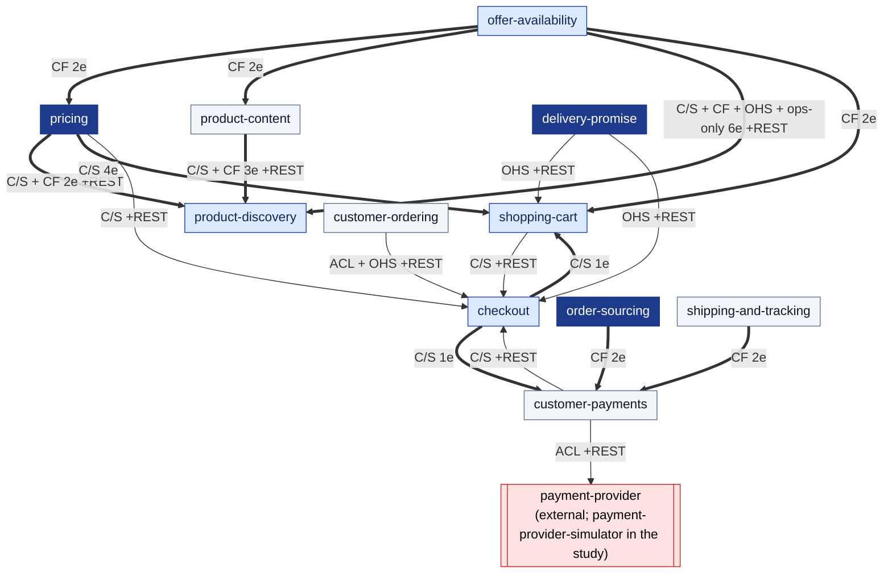
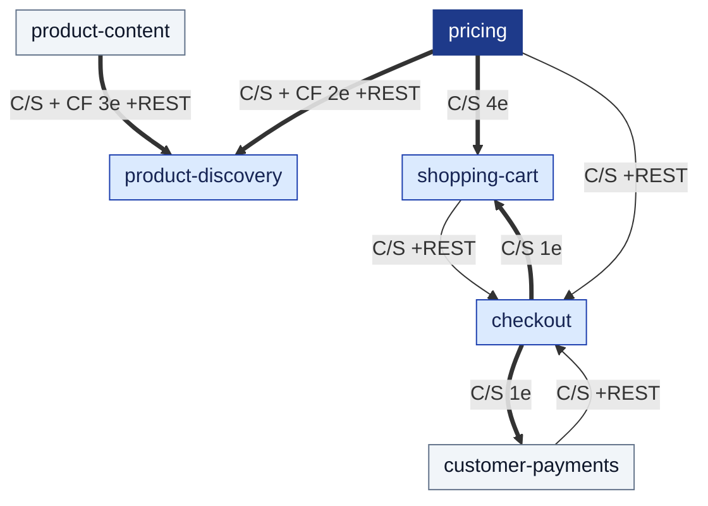

# Context Map

:::info[Generated from the model]
This page is generated from [`model/model.yaml`](https://github.com/IQVO/warehouse-docs/blob/main/storefront/model/model.yaml) by `scripts/gen_pages.py`. Edit the model, then regenerate; CI fails when the page and the model disagree.
:::

Following the ddd-crew [Context Mapping](https://github.com/ddd-crew/context-mapping)
notation. On every edge, **U** is upstream and **D** downstream; the pattern
names how the downstream relates to the upstream's model: **OHS** Open Host
Service, **PL** Published Language, **CF** Conformist, **ACL** Anti-Corruption
Layer, **C/S** Customer/Supplier. Thick arrows are Kafka events (CloudEvents
1.0), thin arrows synchronous calls. The storefront is in-org with the retail
network (decision D1): it may consume `retailnetwork.*` topics and call the
network's OHS storefront routes, and **the network never depends on the
storefront** (no network context consumes a storefront topic or calls a
storefront route). The storefront never calls an in-org or restricted network
route (`GET /orders/{id}/ship-to`, `POST /promises`, promise `:confirm` /
`:cancel`, `POST /inventory-feeds`, policy routes).

## The seam to the retail network

Derived from: `model.yaml` → `contexts[*].consumes` (network producers),
`contexts[*].sync_calls` (network targets), `external`. The experience layer
(`storefront-bff`, `storefront-web`) is not a bounded context: the browser reaches
only the BFF under `/api/storefront` (the Storefront Edge), and the BFF composes
the six contexts and the network OHS routes.

## Inside the storefront

Derived from: `model.yaml` → `contexts[*].publishes[*].consumers`,
`contexts[*].sync_calls`, `contexts[*].inbound[*].relationship`. Omitted:
analytics-only events, which have no integration consumer.

## Every edge

| Upstream | Downstream | Pattern | Events (Kafka) | Synchronous calls |
| --- | --- | --- | --- | --- |
| `checkout` | `customer-payments` | C/S | `CheckoutCompleted` | - |
| `checkout` | `shopping-cart` | C/S | `CheckoutCompleted` | - |
| `customer-ordering` | `checkout` | ACL + OHS | - | cmd PlaceOrder (`REST POST /checkout`) |
| `customer-payments` | `checkout` | C/S | - | cmd AuthorizePayment (`REST POST /payment-authorizations`); cmd VoidAuthorization (`REST POST /payment-authorizations/{authorizationId}:void`) |
| `delivery-promise` | `checkout` | OHS | - | qry GetDeliveryOffer (`REST GET /delivery-offers/{offerId}`) |
| `delivery-promise` | `shopping-cart` | OHS | - | qry QuoteDeliveryOffers (`REST POST /delivery-offers:quote`) |
| `offer-availability` | `pricing` | CF | `CatalogItemCreated`, `CatalogItemDiscontinued` | - |
| `offer-availability` | `product-content` | CF | `CatalogItemCreated`, `CatalogItemDiscontinued` | - |
| `offer-availability` | `product-discovery` | C/S + CF + OHS + ops-only | `CatalogItemCreated`, `CatalogItemDiscontinued`, `ListingCreated`, `ListingAvailabilityChanged`, `ListingSuppressed`, `ListingRestored` | qry ListCatalog (`REST GET /catalog`); qry ListListings (`REST GET /listings?nodeId=&catalogItemId=`) |
| `offer-availability` | `shopping-cart` | CF | `CatalogItemCreated`, `CatalogItemDiscontinued` | - |
| `order-sourcing` | `customer-payments` | CF | `FulfillmentShipped`, `FulfillmentCancelled` | - |
| `pricing` | `checkout` | C/S | - | cmd IssuePriceQuote (`REST POST /price-quotes`) |
| `pricing` | `product-discovery` | C/S + CF | `ItemPriceChanged`, `ItemPriceWithdrawn` | qry ListItemPrices (`REST GET /item-prices`) |
| `pricing` | `shopping-cart` | C/S | `ItemPriceChanged`, `ItemPriceWithdrawn`, `DeliveryChargeScheduleChanged`, `TaxTableChanged` | - |
| `product-content` | `product-discovery` | C/S + CF | `ProductContentPublished`, `ProductContentRetired`, `CategoryTreePublished` | qry ListProductContents (`REST GET /product-contents`); qry ListCategories (`REST GET /categories`) |
| `shipping-and-tracking` | `customer-payments` | CF | `PackageLost`, `PackageReturned` | - |
| `shopping-cart` | `checkout` | C/S | - | qry GetCart (`REST GET /carts/{cartId}`) |
| `customer-payments` | `payment-provider` (external) | ACL | none | provider port: Authorize, Capture, Void, Refund, Reauthorize |

## Why these patterns

- **`offer-availability` → storefront consumers is Conformist (Published
  Language).** Network item and listing facts are taken as is; only
  `catalogItemId` is the join key.
- **`delivery-promise` → `shopping-cart` is OHS / PL, Conformist.** The quote
  contract is open to any client; the cart stores what the quote returned.
- **`customer-ordering` → `checkout` is OHS + ACL.** The checkout ACL
  translates the network's "Checkout", `offer-not-quotable` and
  `requotedOffers` into storefront terms (place-order step, requote required).
- **`order-sourcing`, `shipping-and-tracking` → `customer-payments` is
  Conformist.** Shipment, cancellation, lost and returned facts drive capture,
  release and refund.
- **`pricing` → cart, discovery and checkout is Customer/Supplier.** Same
  domain, negotiated contract.
- **`customer-payments` → `payment-provider` is ACL.** The provider vocabulary
  stays in one adapter package; the storefront never sees a card number.
- **Sibling data used in a decision is a local, event-fed read model.**
  Synchronous calls exist only where a user request needs an answer, plus the
  declared ops-only bootstrap reads of `product-discovery`.

