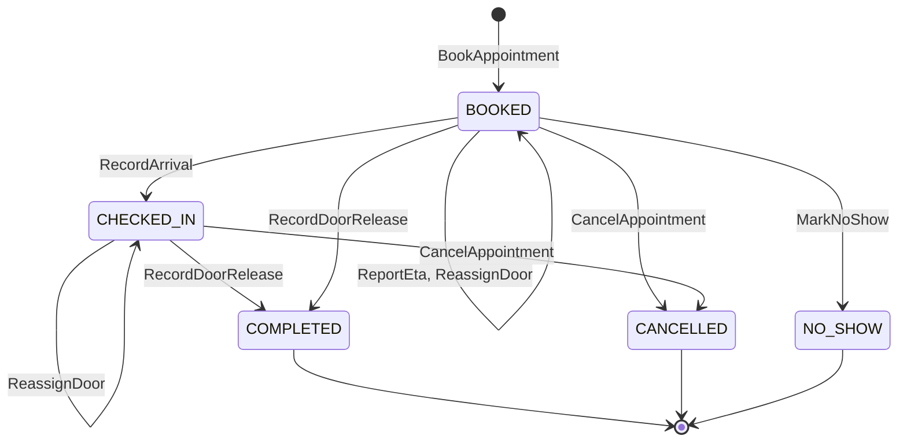
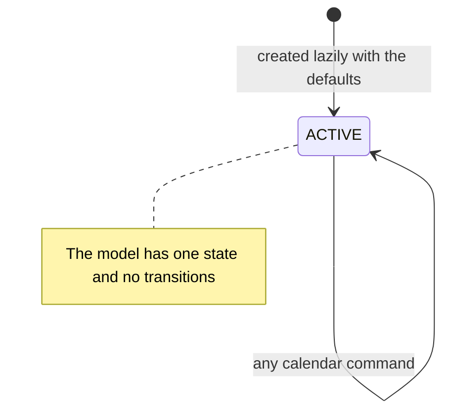

# Aggregate Design Canvas

:::info[Built, released at v0.1.2, applied to k3s (reduced footprint)]
Built on develop (merged 2026-11-08) in [IQVO/dock-scheduling](https://github.com/IQVO/dock-scheduling), released at v0.1.2 (first release v0.1.0 on 2026-11-09) and applied to the k3s cluster on 2026-11-10 in a reduced footprint: dock-scheduling runs its API only (it relays inline); yard-management runs its API and relay. Their MCP servers, analytics projectors, report services and sweeps are registered in warehouse-infra but switched off until the cluster has room, so the KPI reports of yard-management ADR 0011 are released, not yet served. The page still derives from [`yard/model/model.yaml`](https://github.com/IQVO/warehouse-docs/blob/main/yard/model/model.yaml); where the as-built service differs, the model and this page say so (see the as-built notes).
:::

Following the ddd-crew [Aggregate Design Canvas v1.1](https://github.com/ddd-crew/aggregate-design-canvas).
The model has two aggregate roots: **DockAppointment** and **DockCalendar**.
Go packages, as built: `internal/domain/dockappointment` and
`internal/domain/dockcalendar` (the `ul` code identifiers
`dockappointment.DockAppointment` and `dockcalendar.DockCalendar`), plus
`internal/domain/shared` for the door code, site id, carrier and SCAC value objects.
An appointment id is `appt-` followed by a lowercase UUID.

Four generic errors from `conventions.errors` apply to both aggregates and
are not repeated per invariant: `ErrNotFound` (404, `not-found`),
`ErrIllegalTransition` (409, `illegal-transition`), `ErrConcurrentUpdate`
(409, `concurrent-update`) and `ErrValidation` (422, `validation-failed`). As built the HTTP
status follows decision D-10: `409` for a conflict with state, `422` for a value or reference
rule, and the problem slug is the kebab-case of the error name without `Err`
(`ErrDoorDoubleBooked` is `door-double-booked`). `If-Match` mismatch is `412`.

## DockAppointment

### 1. Name

`DockAppointment` (`dockappointment.DockAppointment`), identified by
`appointmentId`.

### 2. Description

One booked door window for one carrier visit: direction, door, window, and
the ASNs (inbound) or CPT and shipment references (outbound) it covers.
Value objects: `Direction(INBOUND or OUTBOUND)`, `Window` with `start` and
`end` (half-open), `Carrier` with `name` and optional `scac`, `InboundRefs`
with `asn_numbers`, `OutboundRefs` with `cpt_id` and `shipment_refs`,
`ArrivalStatus(EARLY, ON_TIME, LATE)` computed against the window with the
site's arrival tolerance, `Eta` with `eta_at`, `reported_at` and `source`,
and `ExpectedSeal` with the `seal_number` the carrier declares when booking.

### 3. State Transitions

Derived from: `model.yaml → contexts[dock-scheduling].aggregates[DockAppointment].states`,
`.transitions`, `.commands`.

Omitted: the creation arrow `[*] --> BOOKED` is `BookAppointment` and
`ImportLegacyAppointment`; the model lists them as commands but not as
transitions, because a transition needs a from-state. `ReportEta` and `ReassignDoor` change
data and bump the version, not the state (a reassignment is also legal from `CHECKED_IN`).
`COMPLETED`, `CANCELLED` and `NO_SHOW` have no outgoing transition and are terminal
(decision D-9: a late carrier books anew). The arrival that is implicit in
`BOOKED --> COMPLETED` is policy `OutOfOrderYardFacts`.

### 4. Enforced Invariants

| Invariant | Enforced by | Checked against |
| --- | --- | --- |
| Door code is 1 to 64 characters, with no whitespace, control characters or `/` | `ErrInvalidDoorCode` | the value object |
| Carrier name is non-blank and at most 100 characters, `scac` is 2 to 4 upper-case letters when given | `ErrInvalidCarrier` | the value object |
| `end` is after `start` and `end - start` is at most `MaxWindow` (4 h) | `ErrInvalidWindow` | the value object |
| A booked or rescheduled window does not start before now | `ErrWindowInPast` | the clock |
| The door is a known, active Dock slot of the site | `ErrUnknownDoor` | `DoorView` |
| The door's `dockFlow` allows the direction (`Inbound`, `Outbound` or `Both`) | `ErrDoorFlowMismatch` | `DoorView` |
| No overlap with another `BOOKED` or `CHECKED_IN` appointment on the same door | `ErrDoorDoubleBooked` | domain service `DoorSchedule.CheckNoOverlap` under a per-door advisory lock |
| The window is inside the door's operating hours and outside its closures | `ErrDoorUnavailable` | `DockCalendar` |
| `INBOUND` covers at least one ASN, each known and not cancelled in the local ASN copy | `ErrUnknownAsn` | `AsnView` |
| `OUTBOUND` names a `cpt_id` known in the local CPT copy, or at least one `shipment_ref` | `ErrMissingOutboundRef` | `CutoffView` |
| An ASN sits on only one active native appointment (decision D-12) | `ErrAsnAlreadyScheduled` | the booking transaction, with the `asn_claims` primary key as the backstop |
| `MarkNoShow` only after `window_end` plus the site's no-show grace | `ErrNoShowTooEarly` | the clock and `Rules` |

Seven of the twelve reach outside one instance: the door and flow checks read
`DoorView`, the availability check reads the other aggregate, the ASN and CPT
checks read event-fed copies, and the overlap check spans every appointment of
a door. This pack's reading is that the use case loads those inputs and
passes them to the aggregate or to the domain service; the model
fixes that the overlap check is a domain service under a per-door advisory lock; as built a
GiST exclusion constraint on `(door_code, window)` is the database backstop (a losing writer
fails with `23P01`, mapped to `ErrDoorDoubleBooked`) and rows whose door was set by a physical
fact (`door_override`) and legacy imports are exempt from it.
`ErrDoorDoubleBooked` is deliberately **not** applied by `ReassignDoor`
(policy `ActualDoorWins`): the physical fact wins, and any later appointment
that now overlaps is flagged instead.

### 5. Corrective Policies

- **`ArrivalFromGate`**: on `VisitCheckedIn` naming an appointment,
  `RecordArrival` with `arrival_status` computed from the window and the
  arrival tolerance; an unknown or terminal appointment is ignored and
  counted.
- **`ActualDoorWins`**: on `TrailerDocked` whose door differs from the booked
  door, `ReassignDoor` without the overlap refusal; any later appointment now
  overlapping on the new door gets `DockAppointmentAtRisk`.
- **`CompleteOnDoorRelease`**: on `TrailerUndocked` naming an appointment,
  `RecordDoorRelease`.
- **`OutOfOrderYardFacts`**: a door release applied to a `BOOKED` appointment
  completes it and records the arrival as implicit (`BOOKED` to `COMPLETED`);
  a late `VisitCheckedIn` for a `COMPLETED` appointment is ignored; any yard
  fact for a `CANCELLED` or `NO_SHOW` appointment is ignored and counted.
- **`NoShowSweep`**: `POST /no-show-sweeps` marks `BOOKED` appointments past
  `window_end` plus the no-show grace as `NO_SHOW` (cron, idempotent).
- **`EtaRisk`**: `ReportEta` with `eta_at` later than `window_start` plus the
  arrival tolerance raises `DockAppointmentAtRisk` once per ETA report.
- **`CancelWhenAllAsnsCancelled`**: on `ASNCancelled`, an `INBOUND` `BOOKED`
  appointment whose ASNs are all cancelled is cancelled with reason
  `ASN_CANCELLED`.
- **`CancelOnVisitRejected`**: on `VisitRejected` naming a `BOOKED` appointment,
  `CancelAppointment` with reason `TURNED_AWAY`; any other state is ignored and counted (X2).
- **`PickupFromCutoffs`** (phase 2): on `CPTScheduleChanged`, keep one
  `OUTBOUND` appointment per cutoff and operating day on a 7-day horizon, on
  the door the site's `PickupDoorRule` names for the `ship_method`, window
  `[cutoff - pickup_lead, cutoff)`. `PickupDoorRule` and `pickup_lead` are not
  defined elsewhere in the model. As built (decision D-3) only the schedule is stored; no
  appointment is created from it and there is no `PickupDoorRule`.
- **`LegacyImport`** (strangler stage A): consume `inbound-receiving`
  `DockAppointment*` events and import each appointment once (provenance
  `legacy-import`, direction `INBOUND`, version 1); off when
  `DOCK_LEGACY_IMPORT_CONSUMER_GROUP` is unset.

### 6. Handled Commands

| Command | Issued by | State change |
| --- | --- | --- |
| `BookAppointment` | Carrier scheduler, REST `POST /appointments` | creates `BOOKED` |
| `RescheduleAppointment` | Carrier scheduler or dock planner, REST `POST /appointments/{appointmentId}/reschedules` | `BOOKED` to `BOOKED` (window and/or door) |
| `CancelAppointment` | Carrier scheduler or dock planner (reasons `CARRIER_REQUEST`, `SITE_REQUEST`), REST `POST /appointments/{appointmentId}/cancellations`; policies `CancelWhenAllAsnsCancelled`, `CancelOnVisitRejected` | `BOOKED` or `CHECKED_IN` to `CANCELLED` |
| `ReportEta` | Carrier scheduler, REST `POST /appointments/{appointmentId}/eta-reports` | none (stores `Eta`, bumps the version) |
| `RecordArrival` | policy `ArrivalFromGate` (no REST route) | `BOOKED` to `CHECKED_IN` |
| `ReassignDoor` | policy `ActualDoorWins` (no REST route) | none (changes the door; from `BOOKED` or `CHECKED_IN`) |
| `RecordDoorRelease` | policy `CompleteOnDoorRelease` (no REST route) | `CHECKED_IN` or `BOOKED` to `COMPLETED` |
| `MarkNoShow` | Scheduler (cron), REST `POST /no-show-sweeps` | `BOOKED` to `NO_SHOW` |
| `ImportLegacyAppointment` | policy `LegacyImport` (no REST route) | creates the appointment |

### 7. Created Events

| Event | Raised when | Topic | Full CloudEvents type |
| --- | --- | --- | --- |
| `DockAppointmentBooked` | `BookAppointment` succeeds (and `ImportLegacyAppointment`) | `.events` | `com.warehouse.wms.dock-scheduling.dockappointment.DockAppointmentBooked` |
| `DockAppointmentRescheduled` | `RescheduleAppointment` succeeds | `.events` | `com.warehouse.wms.dock-scheduling.dockappointment.DockAppointmentRescheduled` |
| `DockAppointmentCancelled` | `CancelAppointment` succeeds | `.events` | `com.warehouse.wms.dock-scheduling.dockappointment.DockAppointmentCancelled` |
| `DockAppointmentNoShow` | `MarkNoShow` succeeds | `.events` | `com.warehouse.wms.dock-scheduling.dockappointment.DockAppointmentNoShow` |
| `DockAppointmentCheckedIn` | `RecordArrival` succeeds | `.analytics` only | `com.warehouse.wms.dock-scheduling.dockappointment.DockAppointmentCheckedIn` |
| `DockAppointmentDoorReassigned` | `ReassignDoor` succeeds | `.events` and `.analytics` (ADR 0010) | `com.warehouse.wms.dock-scheduling.dockappointment.DockAppointmentDoorReassigned` |
| `DockAppointmentCompleted` | `RecordDoorRelease` succeeds | `.analytics` only | `com.warehouse.wms.dock-scheduling.dockappointment.DockAppointmentCompleted` |
| `DockAppointmentAtRisk` | `ReportEta` under policy `EtaRisk` (cause `LATE_ETA`), or `ReassignDoor` under `ActualDoorWins` for the overlapped appointment (cause `DOOR_REASSIGNED_OVERLAP`) | `.analytics` only | `com.warehouse.wms.dock-scheduling.dockappointment.DockAppointmentAtRisk` |

`.events` is `warehouse.dock-scheduling.events` (each such event is also written to the analytics
topic as a twin) and `.analytics` is `warehouse.dock-scheduling.analytics`. Every event except
`DockAppointmentAtRisk` carries the aggregate `version`; `Booked` and `Rescheduled` also carry
`arrival_tolerance_minutes`, and `Rescheduled` carries `previous_door_code`.

### 8. Throughput

*Estimate* (from the model): **medium** (bookings and ETA reports). Per-door
contention is bounded by the per-door advisory lock; `version` backs the
optimistic-concurrency check (`ErrConcurrentUpdate`).

### 9. Size

*Estimate* (from the model): **doors × appointments per day × horizon (14
days), plus history**. The model uses the 14-day figure only in this
estimate; as built there is no booking horizon (decision D-11), only the window length and
slot granularity are bounded.

## DockCalendar

### 1. Name

`DockCalendar` (`dockcalendar.DockCalendar`), identified by `siteId`.

### 2. Description

The per-site door calendar settings that every booking is checked against.
Value objects: `OperatingHours` with `door_code` (or the site default),
`weekday`, `opens_at`, `closes_at` and `timezone`; `Closure` with
`closure_id`, `door_code`, `from`, `to` and `reason`; `Settings` with
`max_window_minutes` (240, a site may lower it, never raise it), `slot_granularity_minutes`
(15), `arrival_tolerance_minutes` (15) and `no_show_grace_minutes` (60).

### 3. State Transitions

Derived from: `model.yaml → contexts[dock-scheduling].aggregates[DockCalendar].states`,
`.transitions` (empty), `.commands`.

Omitted: the calendar is created lazily, with the defaults, the first time a booking or a
calendar command needs it (decision D-1); a site with no operating-hours rows is open 24x7. The self-loop is drawn
only to show that commands change the contents, not the state.

### 4. Enforced Invariants

| Invariant | Enforced by |
| --- | --- |
| `opens_at < closes_at` for every operating-hours row | `ErrInvalidOperatingHours` |
| Closures do not overlap on one door | `ErrOverlappingClosure` |
| A closure may not cover an active appointment of that door (the refusal lists the appointment ids) | `ErrClosureConflictsWithAppointments` |
| New operating hours may not leave an active appointment of a door outside them (the refusal lists the appointment ids, decision D-8) | `ErrHoursConflictWithAppointments` |

The third reaches into `DockAppointment` (an active appointment is `BOOKED`
or `CHECKED_IN`); the two aggregates are saved in separate transactions, so
this pack's reading is that the use case reads the appointments of the door
and the check is a point-in-time refusal, not a guarantee against a
concurrent booking.

### 5. Corrective Policies

None of the model's policies reacts to the calendar. A change of operating hours that would
strand an active appointment is refused (`ErrHoursConflictWithAppointments`, D-8), and a
decommissioned door only blocks new bookings: existing appointments are left untouched (D-7).

### 6. Handled Commands

| Command | Issued by |
| --- | --- |
| `DeclareOperatingHours` | Dock planner, REST `PUT /sites/{siteId}/dock-calendar/operating-hours` (replaces the whole set of rows of the site) |
| `DeclareCalendarSettings` | Dock planner, REST `PUT /sites/{siteId}/dock-calendar/settings` |
| `ScheduleDoorClosure` | Dock planner, REST `POST /sites/{siteId}/dock-calendar/closures` |
| `LiftDoorClosure` | Dock planner, REST `POST /sites/{siteId}/dock-calendar/closures/{closureId}/lifts` |

### 7. Created Events

| Event | Raised when | Topic | Full CloudEvents type |
| --- | --- | --- | --- |
| `DoorOperatingHoursDeclared` | `DeclareOperatingHours` succeeds | `.analytics` only | `com.warehouse.wms.dock-scheduling.dockcalendar.DoorOperatingHoursDeclared` |
| `DoorClosureScheduled` | `ScheduleDoorClosure` succeeds | `.events` | `com.warehouse.wms.dock-scheduling.dockcalendar.DoorClosureScheduled` |
| `DoorClosureLifted` | `LiftDoorClosure` succeeds | `.events` | `com.warehouse.wms.dock-scheduling.dockcalendar.DoorClosureLifted` |

`DeclareCalendarSettings` raises no event, as modelled.

### 8. Throughput

*Estimate* (from the model): **low**. Planner edits only; reads on every
booking.

### 9. Size

*Estimate* (from the model): **one per site**, with its operating-hours rows
and closures.

## Read models

| Read model | Source | Used for | Why it is not an aggregate |
| --- | --- | --- | --- |
| `DoorView` | `facility-layout` `LocationSlotRegistered` (role Dock, `dockFlow`), `LocationSlotDecommissioned`, `ZoneRegistered` (`zoneId` to `siteCode`) | `ErrUnknownDoor`, `ErrDoorFlowMismatch`, the site of a door | A copy of `facility-layout`'s slots; this context changes nothing in it and enforces no rule on it. |
| `AsnView` | `inbound-receiving` `ASNRegistered`, `ASNCancelled` | `ErrUnknownAsn`; policy `CancelWhenAllAsnsCancelled` | A copy of `inbound-receiving`'s ASNs. |
| `CutoffView` | `process-path-management` `CPTScheduleChanged` | `ErrMissingOutboundRef`; policy `PickupFromCutoffs` (phase 2) | A copy of the fleet's CPT schedule. |
| `DoorAvailabilityView` | own `DockAppointment` and `DockCalendar` state | `GetDoorAvailability`: free windows per door | A projection of this context's own aggregates; it decides nothing (booking is checked on the aggregate). |
| `AdherenceReport` | own events on the analytics topic | `GET /reports/schedule-adherence`: on-time, early, late and no-show share per site and carrier | A projection of facts already recorded; it enforces nothing. |

Derived from: `model.yaml → contexts[dock-scheduling].read_models`.
