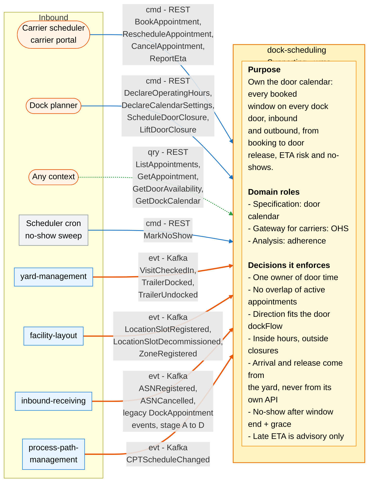
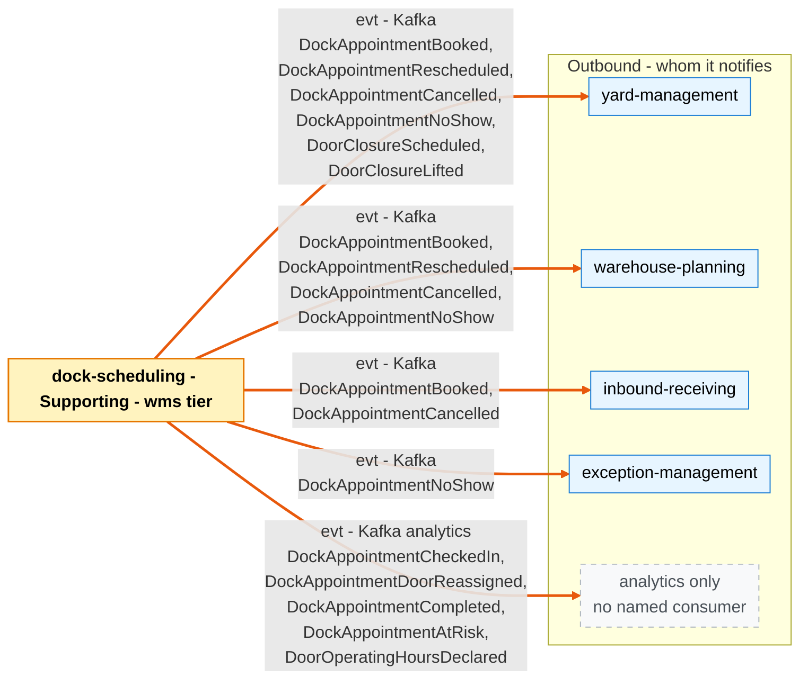

# Bounded Context Canvas

:::info[Proposed design]
Derived from [`yard/model/model.yaml`](https://github.com/IQVO/warehouse-docs/blob/main/yard/model/model.yaml). This context's service is not built yet; identifiers (`Err...` names, REST paths, CloudEvents types) are the names the service will use.
:::

Following the ddd-crew [Bounded Context Canvas v5](https://github.com/ddd-crew/bounded-context-canvas).
Every message row comes from `contexts[dock-scheduling]` → `inbound`, `rest`,
`publishes`, `consumes` and `sync_calls` (empty).

## Canvas at a glance

Two pictures of the sections below: first the collaborators that command,
query or feed this context (with its purpose, roles and the decisions it
enforces), then the collaborators it notifies. Arrows follow the message
type: **solid blue** commands (`cmd`), **dotted green** queries (`qry`),
**thick orange** events (`evt`). Box shapes mark the collaborator kind:
rounded = people or any client; blue = sibling bounded context; grey = this
context's own scheduler; dashed = published with no named consumer
(analytics only). Channel names are abbreviated; the tables carry the exact
route, topic and CloudEvents type.

### Inbound

### Outbound

Derived from: `model.yaml → contexts[dock-scheduling].inbound`,
`.rest`, `.publishes`, `.consumes`, `.business_decisions`, `.roles`.

Omitted: assumptions, metrics, open questions and the glossary (sections
below); the relationship pattern per message (see the tables); full
CloudEvents types and routes (see the tables). There are no outbound
commands or queries: `sync_calls` is empty, so this context calls no other
context synchronously.

## Name

**Dock Scheduling** (`dock-scheduling`, code `DS`, CloudEvents subdomain
`wms`).

## Purpose

Own the door calendar of every site: every booked time window on every dock
door, inbound and outbound, from booking through arrival to door release, the
no-double-booking rule, door opening hours and closures, ETA-driven risk and
no-shows. It owns the **future** of a door; `yard-management` owns the
**present** of the yard. Each keeps an event-fed local copy of what it needs
from the other, and neither records the other's facts.

## Strategic Classification

| Axis | Verdict |
| --- | --- |
| **Domain** | **Supporting** (see [Core Domain Chart](/yard/contexts/dock-scheduling/core-domain-chart)). |
| **Business Model** | Cost reducer (carrier wait, detention, idle dock labour) and revenue protector (on-time inbound). |
| **Evolution** | Product. |

## Domain Roles

| Role | Evidence in the model |
| --- | --- |
| **Specification** (door calendar) | `DockCalendar` holds operating hours, closures and settings; every booking is checked against it; `GetDockCalendar` and `GetDoorAvailability` publish it. |
| **Gateway for carriers** (Open Host Service) | The carrier scheduler books, reschedules, cancels and reports ETAs over REST (`relationship: OHS`); any context queries over REST (OHS). |
| **Analysis** (adherence) | Read model `AdherenceReport`: on-time, early, late and no-show share per site and carrier, built from the analytics topic; route `GET /reports/schedule-adherence`. |

## Inbound Communication

Kafka types of `yard-management` follow the model's convention
(`com.warehouse.wms.yard-management.<entity>.<Event>`). The model does not
print the full `type` of the events from the other producers; their
consumer dispatches on the full type string read from the producer's
AsyncAPI (gap `DS-G18`).

| Collaborator | Message | Type | Channel | Relationship |
| --- | --- | --- | --- | --- |
| Carrier scheduler (carrier portal) | `BookAppointment` | Command | REST `POST /appointments` | OHS |
| Carrier scheduler (carrier portal) | `RescheduleAppointment` | Command | REST `POST /appointments/{appointmentId}/reschedules` | OHS |
| Carrier scheduler (carrier portal) | `CancelAppointment` | Command | REST `POST /appointments/{appointmentId}/cancellations` | OHS |
| Carrier scheduler (carrier portal) | `ReportEta` | Command | REST `POST /appointments/{appointmentId}/eta-reports` | OHS |
| Dock planner | `DeclareOperatingHours` | Command | REST `PUT /sites/{siteId}/dock-calendar/operating-hours` | UI |
| Dock planner | `DeclareCalendarSettings` | Command | REST `PUT /sites/{siteId}/dock-calendar/settings` | UI |
| Dock planner | `ScheduleDoorClosure` | Command | REST `POST /sites/{siteId}/dock-calendar/closures` | UI |
| Dock planner | `LiftDoorClosure` | Command | REST `POST /sites/{siteId}/dock-calendar/closures/{closureId}/lifts` | UI |
| Any context | `ListAppointments` | Query | REST `GET /appointments` | OHS |
| Any context | `GetAppointment` | Query | REST `GET /appointments/{appointmentId}` | OHS |
| Any context | `GetDoorAvailability` | Query | REST `GET /doors/{doorCode}/availability` | OHS |
| Any context | `GetDockCalendar` | Query | REST `GET /sites/{siteId}/dock-calendar` | OHS |
| Scheduler (cron) | `MarkNoShow` | Command | REST `POST /no-show-sweeps` | UI |
| `yard-management` | `VisitCheckedIn` | Event | Kafka `warehouse.yard-management.events`, `com.warehouse.wms.yard-management.yardvisit.VisitCheckedIn` | Customer/Supplier |
| `yard-management` | `TrailerDocked` | Event | Kafka `warehouse.yard-management.events`, `com.warehouse.wms.yard-management.trailer.TrailerDocked` | Customer/Supplier |
| `yard-management` | `TrailerUndocked` | Event | Kafka `warehouse.yard-management.events`, `com.warehouse.wms.yard-management.trailer.TrailerUndocked` | Customer/Supplier |
| `facility-layout` | `LocationSlotRegistered` | Event | Kafka `warehouse.facility.events` | Conformist |
| `facility-layout` | `LocationSlotDecommissioned` | Event | Kafka `warehouse.facility.events` | Conformist |
| `facility-layout` | `ZoneRegistered` | Event | Kafka `warehouse.facility.events` | Conformist |
| `inbound-receiving` | `ASNRegistered` | Event | Kafka `warehouse.inbound-receiving.events` | Conformist |
| `inbound-receiving` | `ASNCancelled` | Event | Kafka `warehouse.inbound-receiving.events` | Conformist |
| `process-path-management` | `CPTScheduleChanged` | Event | Kafka `warehouse.process-path-management.events` | Conformist |
| `inbound-receiving` (strangler stage A to D) | `DockAppointmentBooked`, `DockAppointmentCheckedIn`, `DockAppointmentCancelled`, `DockAppointmentCompleted` | Event | Kafka `warehouse.inbound-receiving.events` (policy `LegacyImport`; removed at stage E) | not named in the model; this pack's reading: Conformist, transitional |

Routes with no `inbound` row: `GET /reports/schedule-adherence` is in `rest`
but not in any `inbound` row (see Open Questions).

## Outbound Communication

Topics are `warehouse.dock-scheduling.events` for integration events and
`warehouse.dock-scheduling.analytics` for the events the model marks
`analytics only`. The relationship column is the model's for
`yard-management` and this pack's reading for the others (gap `DS-G22`).

| Collaborator | Message | Type | Channel | Relationship |
| --- | --- | --- | --- | --- |
| `yard-management`, `warehouse-planning`, `inbound-receiving` | `DockAppointmentBooked` | Event | Kafka `warehouse.dock-scheduling.events`, `com.warehouse.wms.dock-scheduling.dockappointment.DockAppointmentBooked` | `yard-management`: Customer/Supplier; the others: OHS + PL (reading) |
| `yard-management`, `warehouse-planning` | `DockAppointmentRescheduled` | Event | Kafka `warehouse.dock-scheduling.events`, `com.warehouse.wms.dock-scheduling.dockappointment.DockAppointmentRescheduled` | same |
| `yard-management`, `warehouse-planning`, `inbound-receiving` | `DockAppointmentCancelled` | Event | Kafka `warehouse.dock-scheduling.events`, `com.warehouse.wms.dock-scheduling.dockappointment.DockAppointmentCancelled` | same |
| `yard-management`, `warehouse-planning`, `exception-management` | `DockAppointmentNoShow` | Event | Kafka `warehouse.dock-scheduling.events`, `com.warehouse.wms.dock-scheduling.dockappointment.DockAppointmentNoShow` | same |
| `yard-management` | `DoorClosureScheduled` | Event | Kafka `warehouse.dock-scheduling.events`, `com.warehouse.wms.dock-scheduling.dockcalendar.DoorClosureScheduled` | Customer/Supplier |
| `yard-management` | `DoorClosureLifted` | Event | Kafka `warehouse.dock-scheduling.events`, `com.warehouse.wms.dock-scheduling.dockcalendar.DoorClosureLifted` | Customer/Supplier |
| analytics only | `DockAppointmentCheckedIn` | Event | Kafka `warehouse.dock-scheduling.analytics`, `com.warehouse.wms.dock-scheduling.dockappointment.DockAppointmentCheckedIn` | PL, no in-org consumer |
| analytics only | `DockAppointmentDoorReassigned` | Event | Kafka `warehouse.dock-scheduling.analytics`, `com.warehouse.wms.dock-scheduling.dockappointment.DockAppointmentDoorReassigned` | PL, no in-org consumer |
| analytics only | `DockAppointmentCompleted` | Event | Kafka `warehouse.dock-scheduling.analytics`, `com.warehouse.wms.dock-scheduling.dockappointment.DockAppointmentCompleted` | PL, no in-org consumer |
| analytics only | `DockAppointmentAtRisk` | Event | Kafka `warehouse.dock-scheduling.analytics`, `com.warehouse.wms.dock-scheduling.dockappointment.DockAppointmentAtRisk` | PL, no in-org consumer |
| analytics only | `DoorOperatingHoursDeclared` | Event | Kafka `warehouse.dock-scheduling.analytics`, `com.warehouse.wms.dock-scheduling.dockcalendar.DoorOperatingHoursDeclared` | PL, no in-org consumer |
| none | (no synchronous calls) | n/a | `sync_calls: []` | n/a |

Full message details: [Domain Events](/yard/contexts/dock-scheduling/domain-events).
Relationship evidence: [Context Map](/yard/contexts/dock-scheduling/context-map).

## Ubiquitous Language

Full glossary: [Ubiquitous Language](/yard/contexts/dock-scheduling/ubiquitous-language).
Top terms: **Dock Appointment**, **Door Window**, **Door Calendar**,
**Closure**, **Arrival Status**, **No-Show**.

## Business Decisions

1. **One owner of door time.** Inbound and outbound appointments share one
   calendar per door; a door whose `dockFlow` is `Both` takes either
   direction.
2. **No overlap.** No two active (`BOOKED` or `CHECKED_IN`) appointments
   overlap on the same door; windows are half-open
   (`ErrDoorDoubleBooked`, enforced by domain service
   `DoorSchedule.CheckNoOverlap` under a per-door advisory lock).
3. **Direction fits the door.** `ErrDoorFlowMismatch`.
4. **Inside hours, outside closures.** `ErrDoorUnavailable`.
5. **Physical facts are applied, never recorded.** Arrival and door release
   come from `yard-management` events.
6. **No-show.** A `BOOKED` appointment with no arrival by `window_end` plus
   the site's no-show grace becomes `NO_SHOW`.
7. **Late ETA is advisory.** `DockAppointmentAtRisk`; nothing reschedules
   automatically.

## Assumptions

Each is an assumption of the model or of this pack's reading, not a verified
fact.

- `facility-layout` publishes every dock slot with its `dockFlow` and its
  `zoneId`, and every zone with its `siteCode`; a door reaches its site only
  through that join, never by parsing a location code
  (`conventions.site_key`).
- `inbound-receiving` publishes `ASNRegistered` before an appointment names
  that ASN; otherwise a booking is refused with `ErrUnknownAsn`.
- `process-path-management` publishes `CPTScheduleChanged` for a site before
  an outbound appointment names one of its `cpt_id` values.
- Yard events can arrive in any order across partitions (they are keyed by
  visit or trailer, not by appointment); `OutOfOrderYardFacts` is the rule
  that absorbs it.
- Consumers rebuild their views from events only; no sibling is called
  synchronously.
- The retail network is out of reach: no `retailnetwork.*` topic is consumed.

## Verification Metrics

Proposed; the model names the report but sets no targets.

| Metric | Target (proposed) | Source |
| --- | --- | --- |
| Active appointments that overlap on one door and are not flagged `DOOR_REASSIGNED_OVERLAP` | 0 | `dock_appointments` table, `ActualDoorWins` is the only allowed overlap |
| Share of appointments by `ArrivalStatus` (`EARLY`, `ON_TIME`, `LATE`) and by `NO_SHOW`, per site and carrier | report weekly | `AdherenceReport` |
| `BOOKED` appointments past `window_end` plus no-show grace | 0 after each sweep | `dock_appointments` table |
| `DockAppointmentAtRisk` per ETA report, by cause | report weekly | analytics topic |
| Yard facts ignored and counted (unknown, terminal, `CANCELLED`, `NO_SHOW`) | trend to 0 | use-case counter (policies `ArrivalFromGate`, `OutOfOrderYardFacts`) |
| Bookings refused, by `Err...` (`ErrDoorDoubleBooked`, `ErrDoorUnavailable`, `ErrUnknownAsn`) | report weekly | use-case error counter |
| Appointments completed with an implicit arrival (`BOOKED` to `COMPLETED`) | trend to 0 | `dock_appointments` table |
| Lag from a `yard-management` event to the matching `dock-scheduling` event | set before build | event timestamps |

## Open Questions

Each of these is a gap in `model.yaml`, returned to the orchestrator and not
patched here. The ids are the gap ids of this pack.

- **`DS-G01`: arrival tolerance never leaves this context.** `yard-management`
  needs it for `DirectOnCheckIn`; no event carries it.
- **`DS-G02`: `VisitRejected` is not consumed.** An appointment whose visit
  was rejected stays `BOOKED`; `TURNED_AWAY` has no producer.
- **`DS-G03`: one appointment, several trailers.**
- **`DS-G04`: phase-2 `PickupFromCutoffs`** names `PickupDoorRule` and
  `pickup_lead`, which exist nowhere, and creates appointments with no
  carrier.
- **`DS-G05`: the shape of `cutoffs`** and where `cpt_id` comes from.
- **`DS-G06`: can a reschedule change the door?**
- **`DS-G07`: a site with no calendar declared.**
- **`DS-G08`: what `ImportLegacyAppointment` enforces.**
- **`DS-G09`: the `ArrivalStatus` formula.**
- **`DS-G10`: no site-side actor** for cancel and reschedule.
- **`DS-G11`: no read side for at-risk appointments.**
- **`DS-G12` and `DS-G13`:** a decommissioned door and a change of operating
  hours have no effect on existing appointments.
- **`DS-G14`: which events `inbound-receiving` needs** for its local copy.
- **`DS-G15`: are door codes unique across sites?**
- **`DS-G16`: `NO_SHOW` is terminal.**
- **`DS-G17` to `DS-G22`:** conventions, consumed types, out-of-order matrix,
  value-object lists, calendar settings, the unlisted report route.
