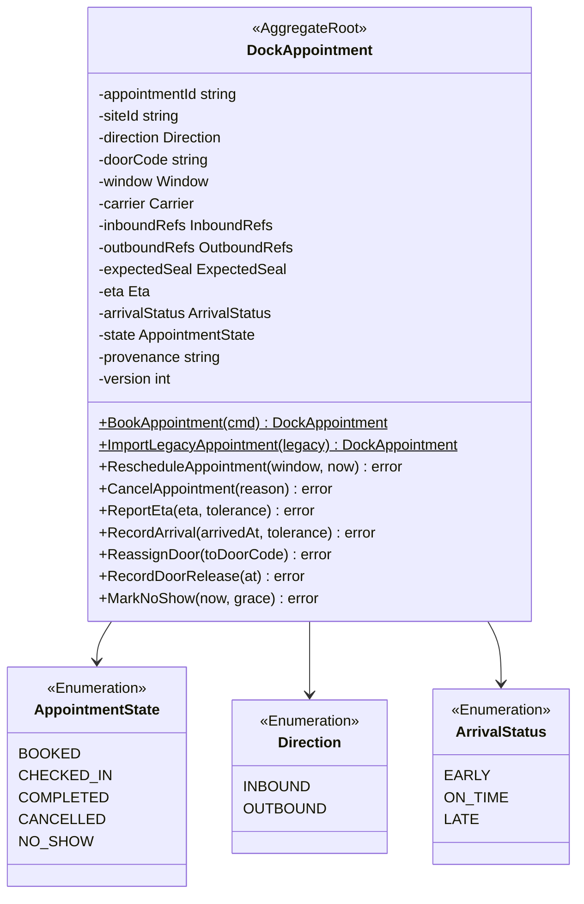
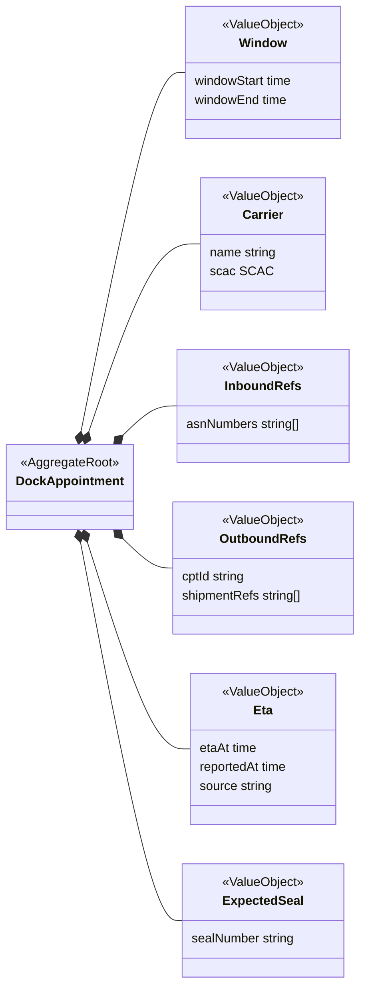
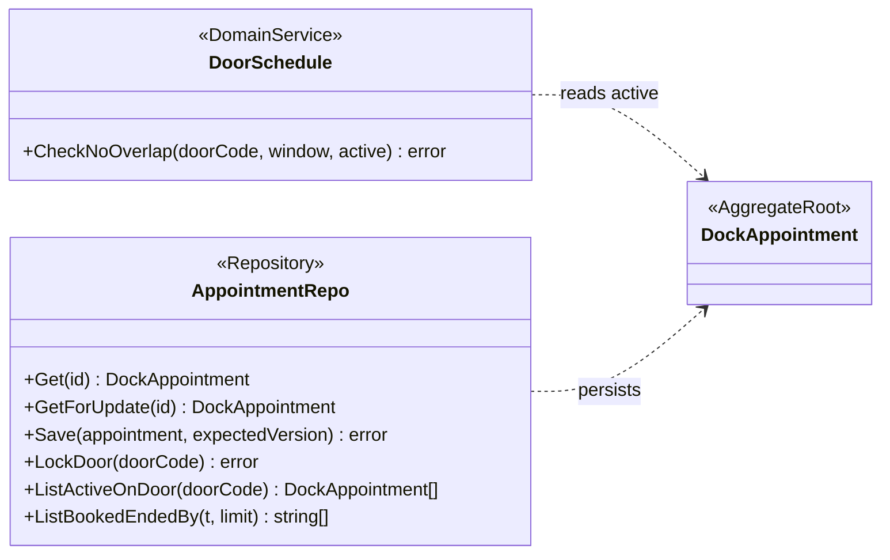
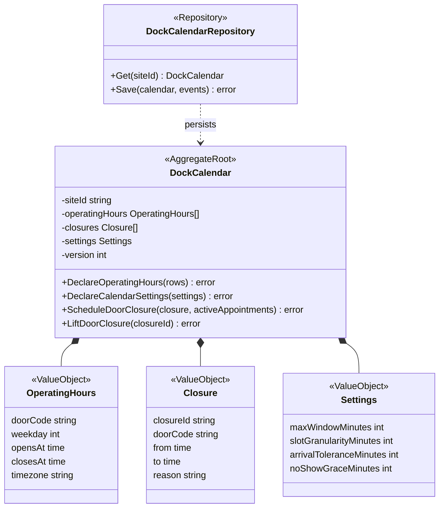
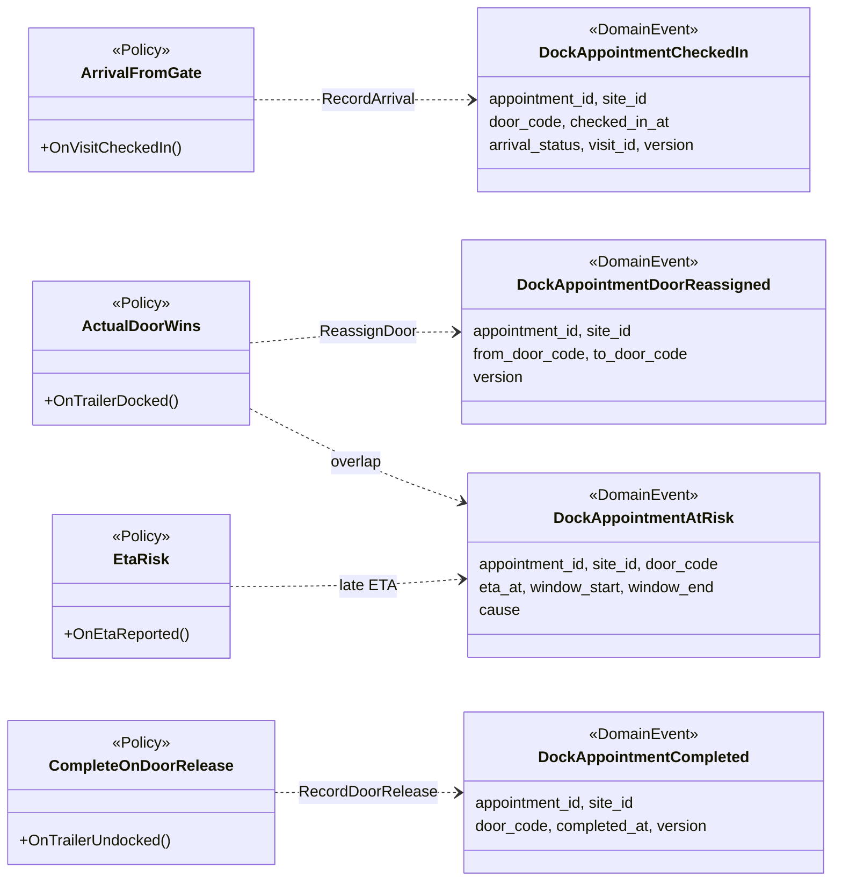
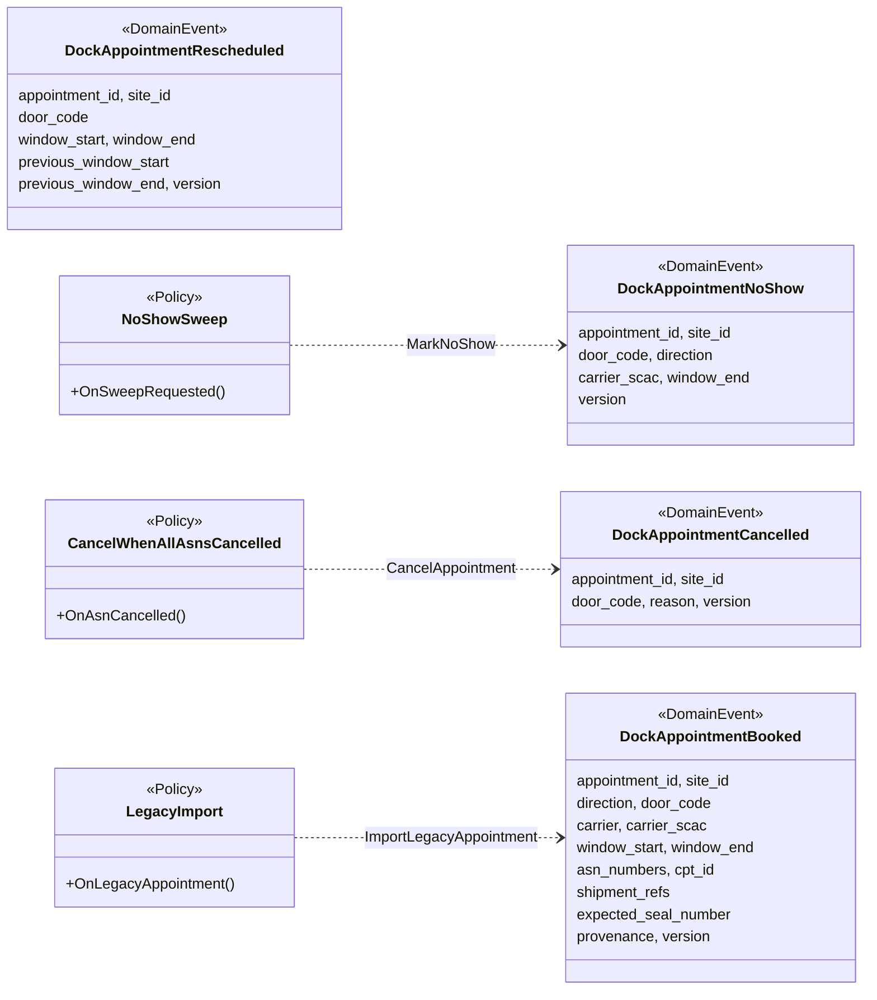
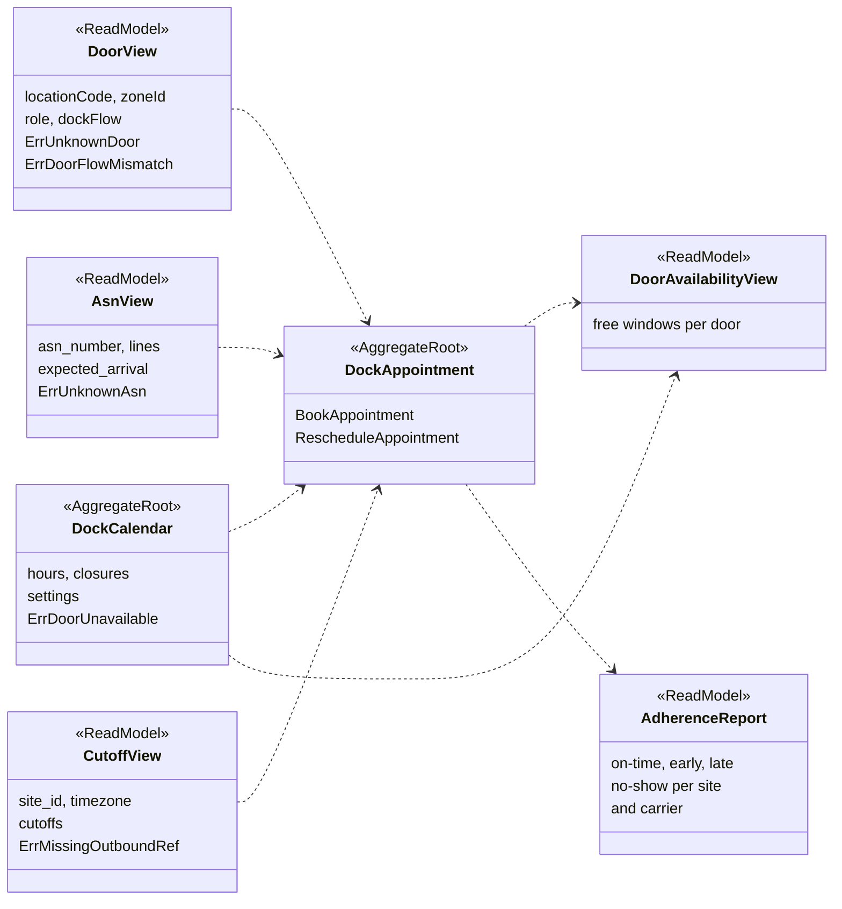
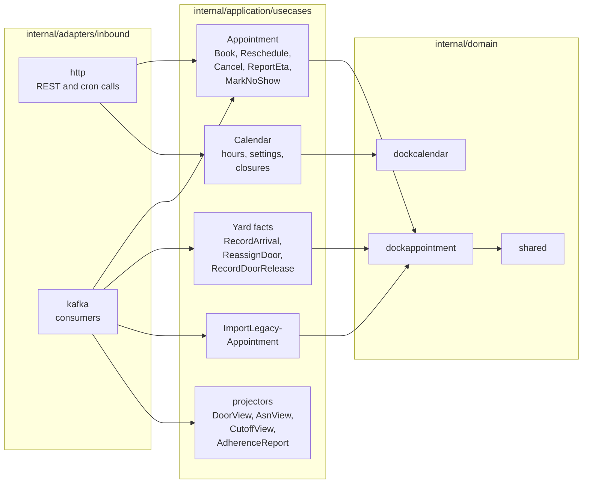
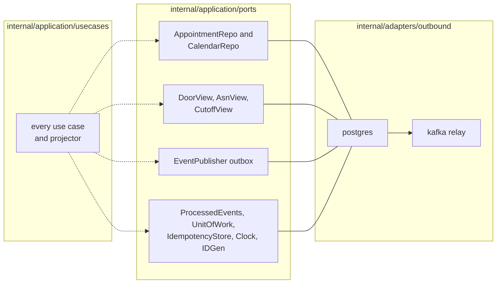

# Class Diagram

:::info[Built, released at v0.1.2, applied to k3s (reduced footprint)]
Built on develop (merged 2026-11-08) in [IQVO/dock-scheduling](https://github.com/IQVO/dock-scheduling), released at v0.1.2 (first release v0.1.0 on 2026-11-09) and applied to the k3s cluster on 2026-11-10 in a reduced footprint: dock-scheduling runs its API only (it relays inline); yard-management runs its API and relay. Their MCP servers, analytics projectors, report services and sweeps are registered in warehouse-infra but switched off until the cluster has room, so the KPI reports of yard-management ADR 0011 are released, not yet served. The page still derives from [`yard/model/model.yaml`](https://github.com/IQVO/warehouse-docs/blob/main/yard/model/model.yaml); where the as-built service differs, the model and this page say so (see the as-built notes).
:::

UML class diagrams of the `internal/domain/**` packages
(`dockappointment`, `dockcalendar`, `shared`), then the hexagonal ports and
adapters in the Go layout the fleet uses. Type and field names come from
`model.yaml`; method names are the model's commands. Fields are shown `-`
(unexported), methods `+`.

As built: the package names are the model's. The Go methods of the root are shorter than
the command names drawn here (`Reschedule`, `Cancel`, `ReportEta`, `MarkAtRisk`,
`RecordArrival`, `ReassignDoor`, `RecordDoorRelease`, `MarkNoShow`), booking and legacy import are
constructors, the state type is `State`, the per-site `Rules` value (max window, granularity,
arrival tolerance, no-show grace) is passed to the methods that need it, and the repository is
`AppointmentRepo` (diagram 1c). The ports and adapters are as built in diagram 5; the drawn
fields and methods are not a copy of the code.

## 1. DockAppointment aggregate

### 1a. Root and states

### 1b. Value objects

### 1c. Domain service and repository

Derived from: `model.yaml → contexts[dock-scheduling].aggregates[DockAppointment]`
(`value_objects`, `states`, `commands`, `invariants`), `.publishes[DockAppointmentBooked].data`.

Omitted: the error variables (see
[Aggregate Design Canvas](/yard/contexts/dock-scheduling/aggregate-design-canvas));
`version` handling beyond the field. `siteId` and `provenance` are in the
event payloads and not in the aggregate's value-object list; they are drawn
as fields on this pack's reading. `Window` is the model's `Window` with
`start` and `end`; the fields are named `windowStart` and `windowEnd` here to
avoid the diagram keyword `end`. `BookAppointment(cmd)` stands for the
booking inputs (door, direction, window, carrier, references, expected
seal). The advisory that `ReportEta` may raise (`DockAppointmentAtRisk`) is
an event, not a return value. The commands that policies drive
(`RecordArrival`, `ReassignDoor`, `RecordDoorRelease`,
`ImportLegacyAppointment`) have no REST route. `ListActiveOnDoor` and
`ListBookedEndedBy` are repository queries the rules need (the overlap check and
the no-show sweep); `LockDoor` takes the per-door advisory lock for the rest of the unit of work, and
`Save` is guarded by the version the caller loaded. `DoorSchedule` is the domain service named by
`ErrDoorDoubleBooked`; the checks that need `DoorView`, `AsnView`,
`CutoffView` and `DockCalendar` are in diagram 4.

## 2. DockCalendar aggregate

Derived from: `model.yaml → contexts[dock-scheduling].aggregates[DockCalendar]`,
`.publishes[DoorClosureScheduled, DoorClosureLifted, DoorOperatingHoursDeclared].data`.

Omitted: `ErrInvalidOperatingHours`, `ErrOverlappingClosure` and
`ErrClosureConflictsWithAppointments`. `activeAppointments` is a parameter of
`ScheduleDoorClosure` because the refusal needs the appointments of the door
and lists their ids; the two aggregates stay separate (this pack's reading).
`doorCode` on `OperatingHours` is empty for the site default. The model gives
no `weekday` type and states no bound for the settings.

## 3. Appointment events and the policies that raise them

### 3a. Yard facts and ETA risk

### 3b. Booking, cancelling, no-show and import

Derived from: `model.yaml → contexts[dock-scheduling].publishes`, `.policies`.

Omitted: the CloudEvents envelope (see
[Domain Events](/yard/contexts/dock-scheduling/domain-events));
`PickupFromCutoffs` (phase 2, names no command or event of its own);
`OutOfOrderYardFacts`, which is a rule on `RecordDoorRelease` and
`RecordArrival` rather than a source of events. `BookAppointment`,
`RescheduleAppointment` and `CancelAppointment` by a carrier raise
`DockAppointmentBooked`, `Rescheduled` and `Cancelled` directly, not through
a policy; `DockAppointmentRescheduled` has no policy at all. `LegacyImport`
raising `DockAppointmentBooked` is as built (service ADR 0002, assumption A12).

## 4. Read models and the checks that use them

Derived from: `model.yaml → contexts[dock-scheduling].read_models`,
`.aggregates[DockAppointment].invariants`, `.consumes[*].fields`.

Reading the diagram: an arrow into `DockAppointment` is a check a booking
makes against that copy, and the `Err...` listed in the source box is the
refusal. `DoorAvailabilityView` is built from `DockAppointment` and
`DockCalendar` state; `AdherenceReport` is built from the appointment events
on the analytics topic.

Omitted: the projectors that fill `DoorView`, `AsnView` and `CutoffView`
(shown in the ports view below). `DockCalendar` is an aggregate of this
context, not a copy; it is drawn here because a booking reads it. The
`cancelled` flag of an ASN is this pack's reading of how `ASNCancelled` is
stored.

## 5. Hexagonal ports and adapters

### 5a. Inbound adapters, use cases and domain

### 5b. Ports and outbound adapters

Derived from: `model.yaml → contexts[dock-scheduling].inbound`,
`.consumes`, `.read_models`, `.policies`, `.sync_calls` (empty),
`conventions.integration_rules` (own database, transactional outbox,
idempotent consumers).

All paths are under `internal/`. The dashed arrows mean every use case calls
ports only: the repository of its aggregate, the event publisher (outbox),
the inbox (`ProcessedEvents`), the unit of work, the clock and the id generator; the per-door advisory
lock is `AppointmentRepo.LockDoor`, and the read-model ports (`DoorView`, `AsnView`,
`CutoffView`) are separate interfaces. Report readers (`AdherenceReader`,
`FreshnessReader`) belong to the `reports` binary. The
`http` adapter drives the carrier and planner commands and the sweep, which
a Kubernetes CronJob calls over REST, so there is no `scheduler` adapter.
The `kafka` adapter drives the policies (`ArrivalFromGate`, `ActualDoorWins`,
`CompleteOnDoorRelease`, `CancelWhenAllAsnsCancelled`, `LegacyImport`) and the
projectors; the `AdherenceReport` projector reads this context's own
analytics topic.

Omitted: the HTTP read path (`GET` routes read the repositories and
`DoorAvailabilityView` directly); the MCP adapter (`internal/adapters/inbound/mcp`, nine tools: five
L1 reads and four L3 writes, service ADR 0007), the analytics projector and the report binary. There are no outbound HTTP clients: `sync_calls` is empty.
