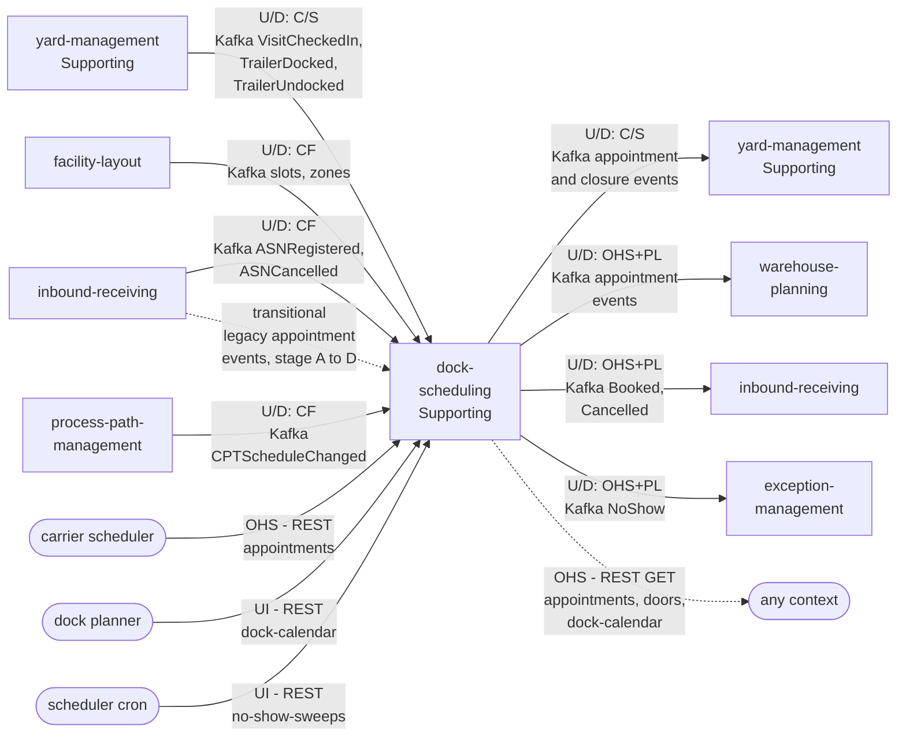

# Context Map

:::info[Proposed design]
Derived from [`yard/model/model.yaml`](https://github.com/IQVO/warehouse-docs/blob/main/yard/model/model.yaml). This context's service is not built yet; identifiers (`Err...` names, REST paths, CloudEvents types) are the names the service will use.
:::

Following ddd-crew [Context Mapping](https://github.com/ddd-crew/context-mapping).
This is **dock-scheduling's slice** of the yard context map: every
relationship it has, with the upstream (U) and downstream (D) side, the
pattern and the channel. Abbreviations: OHS = Open Host Service, PL =
Published Language, CF = Conformist, C/S = Customer/Supplier.

Derived from: `model.yaml → contexts[dock-scheduling].inbound`,
`.publishes[*].consumers`, `.consumes`; the matching `inbound` rows of
`contexts[yard-management]`; `fleet_changes`.

Legend: arrows point from upstream to downstream. Solid = events or
commands; dotted = synchronous query, or the transitional legacy feed.
`yard-management` and `inbound-receiving` appear twice because they are on
both sides: they feed this context and they consume from it. People are
rounded boxes. Patterns on the edges to `warehouse-planning`,
`inbound-receiving` and `exception-management` are this pack's reading; the
model names no pattern for them (gap `DS-G22`).

Omitted: Kafka and Postgres as infrastructure; the analytics-only events
(`DockAppointmentCheckedIn`, `DockAppointmentDoorReassigned`,
`DockAppointmentCompleted`, `DockAppointmentAtRisk`,
`DoorOperatingHoursDeclared`), which have no named consumer; the planned
changes to `warehouse-console`, `warehouse-floor-client` and
`warehouse-ops-agent` (they are clients of the REST routes, listed in
`fleet_changes`). **Separate Ways** (no edge at all): the retail network
(`retailnetwork.*` topics and services); the model's `hard_boundary` rules
out any yard context consuming a `retailnetwork.*` topic or calling a
retail-network service.

## Relationships

| Neighbour | Direction | Pattern | Channel | Messages | Why this pattern |
| --- | --- | --- | --- | --- | --- |
| `yard-management` (Supporting) | Upstream for yard facts; downstream for appointments (**mutual**) | **Customer/Supplier** both ways (the model names it on both inbound rows) | Kafka `warehouse.yard-management.events` into this context; `warehouse.dock-scheduling.events` out | In: `VisitCheckedIn`, `TrailerDocked`, `TrailerUndocked`. Out: `DockAppointmentBooked`, `DockAppointmentRescheduled`, `DockAppointmentCancelled`, `DockAppointmentNoShow`, `DoorClosureScheduled`, `DoorClosureLifted` | The two flows are independent (plan against physical) and neither writes into the other's aggregates. Each side shapes its events for the other and keeps an event-fed local copy; no synchronous call in either direction. |
| `facility-layout` | Upstream | **Conformist** | Kafka `warehouse.facility.events` | `LocationSlotRegistered`, `LocationSlotDecommissioned`, `ZoneRegistered` | `facility-layout` is the registry of slots and zones for every context. Dock slots, `dockFlow` and the zone to site join are taken as given into `DoorView`. |
| `inbound-receiving` | Upstream for ASNs (and, until stage E, for legacy appointments); downstream for appointments | **Conformist** for ASNs; consumer of this context's `Booked` and `Cancelled` | Kafka `warehouse.inbound-receiving.events` in; `warehouse.dock-scheduling.events` out | In: `ASNRegistered`, `ASNCancelled`; transitional: `DockAppointmentBooked`, `DockAppointmentCheckedIn`, `DockAppointmentCancelled`, `DockAppointmentCompleted`. Out: `DockAppointmentBooked`, `DockAppointmentCancelled` | ASNs are taken as given into `AsnView`. The appointment moves to this context (YD-0002); the legacy feed exists only so each appointment is imported once (policy `LegacyImport`) and is removed at stage E. |
| `process-path-management` | Upstream | **Conformist** | Kafka `warehouse.process-path-management.events` | `CPTScheduleChanged` | The CPT schedule is the fleet's own outbound cutoff; it is taken as given into `CutoffView`. |
| Carrier scheduler (carrier portal) | Upstream (person or carrier system) | **OHS** on this context's REST | REST `POST /appointments`, `.../reschedules`, `.../cancellations`, `.../eta-reports` | `BookAppointment`, `RescheduleAppointment`, `CancelAppointment`, `ReportEta` | Carriers are outside the fleet; the contract is one published REST surface. |
| Dock planner | Upstream (person, console) | UI on this context's REST | REST `PUT .../operating-hours`, `PUT .../settings`, `POST .../closures`, `POST .../closures/{closureId}/lifts` | `DeclareOperatingHours`, `DeclareCalendarSettings`, `ScheduleDoorClosure`, `LiftDoorClosure` | Human maintenance of the door calendar. |
| Scheduler (cron) | Upstream (CronJob) | UI on this context's REST | REST `POST /no-show-sweeps` | `MarkNoShow` | An idempotent sweep called on a timer. |
| `warehouse-planning` | Downstream | OHS + PL (this pack's reading) | Kafka `warehouse.dock-scheduling.events` | `DockAppointmentBooked`, `DockAppointmentRescheduled`, `DockAppointmentCancelled`, `DockAppointmentNoShow` | Inbound labour demand. The model's `fleet_changes` switches its source to these events; they gain `site_id` and `direction`. |
| `exception-management` | Downstream | OHS + PL (this pack's reading) | Kafka `warehouse.dock-scheduling.events` | `DockAppointmentNoShow` | Opens a problem case per no-show. |
| Any context | Downstream | **OHS** | REST `GET /appointments`, `GET /appointments/{appointmentId}`, `GET /doors/{doorCode}/availability`, `GET /sites/{siteId}/dock-calendar` | `ListAppointments`, `GetAppointment`, `GetDoorAvailability`, `GetDockCalendar` | Read access for tools and diagnostics; no decision path of a sibling depends on it (decisions use events). |

## Notes on the patterns

- **Mutual Customer/Supplier with `yard-management`.** The model puts the
  two contexts in each other's consumer list. The risk is a start-up cycle
  or a feedback loop; the safeguards named in the model are idempotent
  consumers (inbox on the CloudEvents `id`) and version-guarded readers
  (apply only `version` greater than the stored one).
- **Conformist upstream, Open Host downstream.** This context conforms to
  `facility-layout`, `inbound-receiving` (ASNs) and `process-path-management`,
  and offers its appointment and closure events as a published language.
- **No Anti-Corruption Layer.** All neighbours are in the same fleet and
  share the CloudEvents standard; translation stops at local read models.
  The future `transport-visibility` context is the first place the model
  expects an ACL (an ETA feed into `ReportEta`).
- **No Shared Kernel.** `shared.SCAC` is a package inside this service (the
  `ul` code identifier), not shared code across contexts. Identifiers such as
  `siteId`, `doorCode` and `asn_number` are values copied from events.
