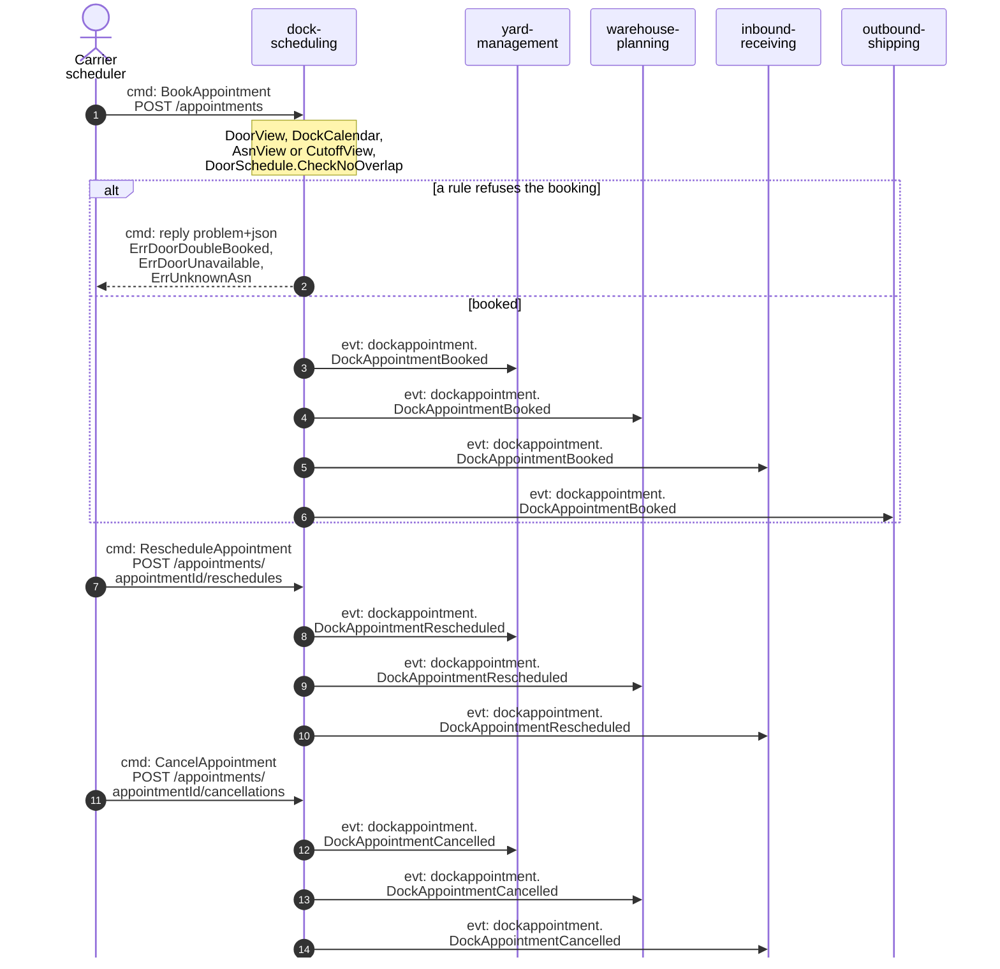
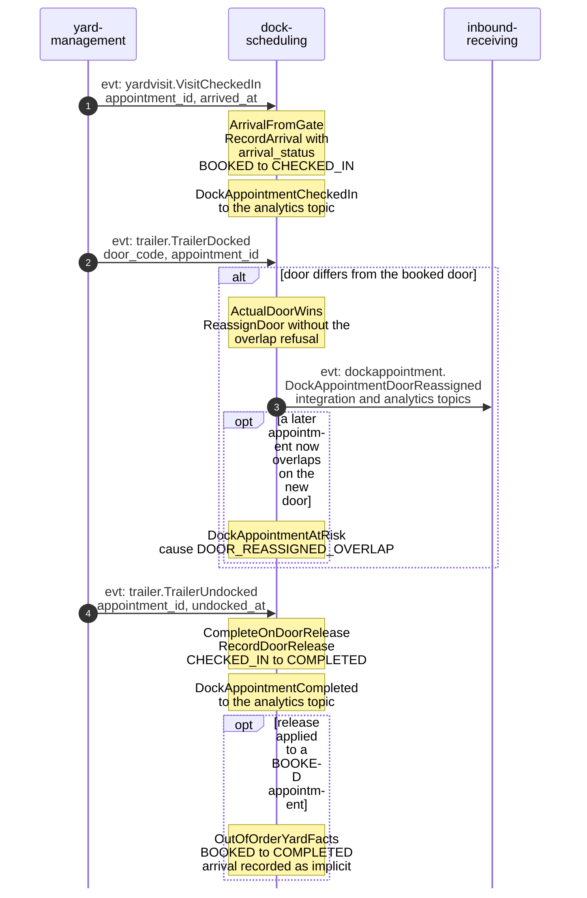
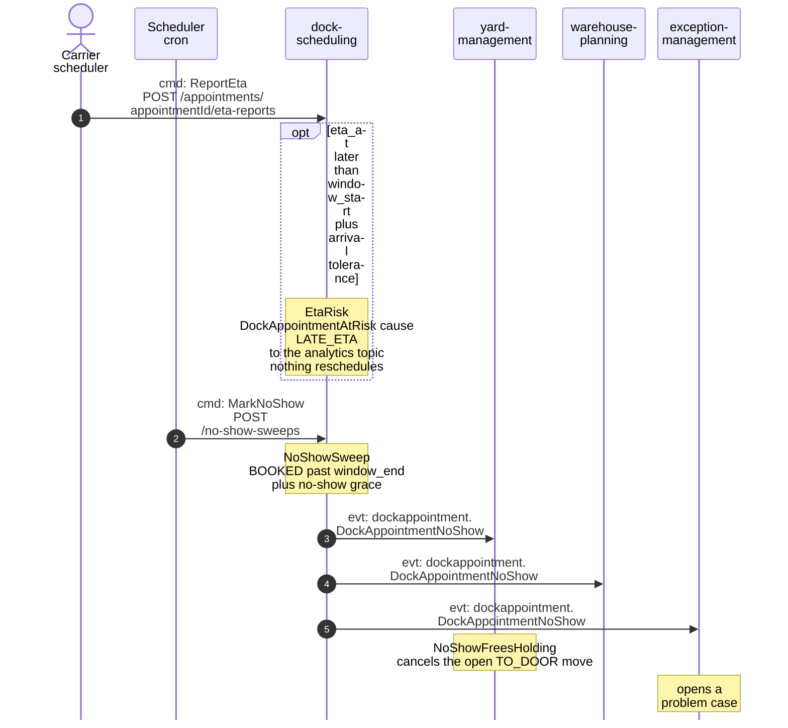
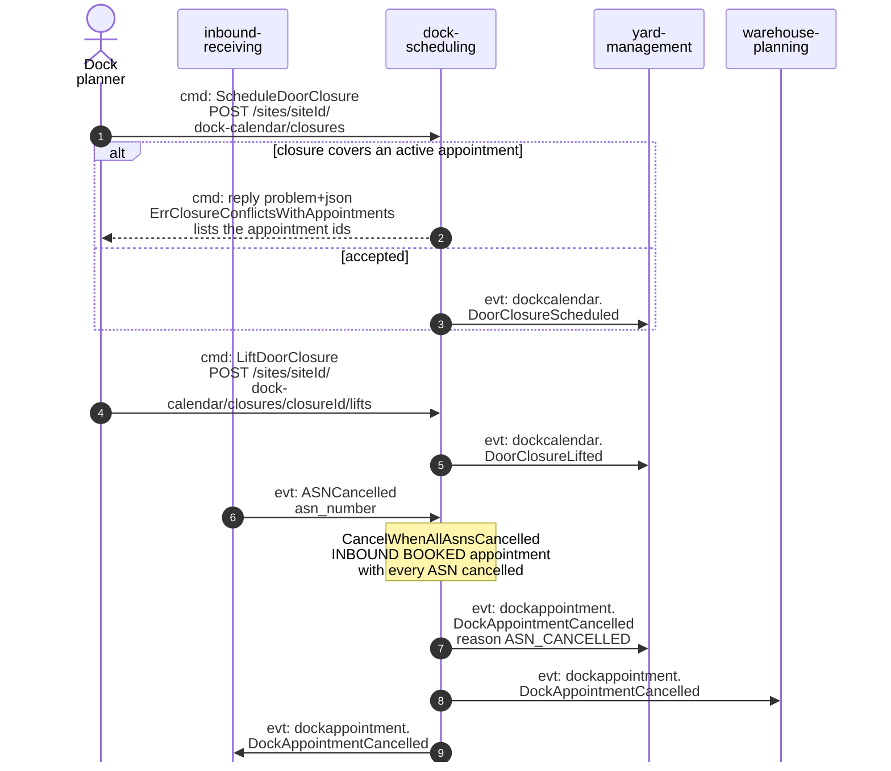

# Domain Message Flow

:::info[Built, released at v0.1.2, applied to k3s (reduced footprint)]
Built on develop (merged 2026-11-08) in [IQVO/dock-scheduling](https://github.com/IQVO/dock-scheduling), released at v0.1.2 (first release v0.1.0 on 2026-11-09) and applied to the k3s cluster on 2026-11-10 in a reduced footprint: dock-scheduling runs its API only (it relays inline); yard-management runs its API and relay. Their MCP servers, analytics projectors, report services and sweeps are registered in warehouse-infra but switched off until the cluster has room, so the KPI reports of yard-management ADR 0011 are released, not yet served. The page still derives from [`yard/model/model.yaml`](https://github.com/IQVO/warehouse-docs/blob/main/yard/model/model.yaml); where the as-built service differs, the model and this page say so (see the as-built notes).
:::

Following ddd-crew [Domain Message Flow Modelling](https://github.com/ddd-crew/domain-message-flow-modelling).
Participants are contexts and actors. Every arrow is a message from
`model.yaml`, prefixed `cmd:`, `qry:` or `evt:`. Events are written
`entity.EventName`; the full type is
`com.warehouse.wms.<producer>.<entity>.<EventName>` (see
[Domain Events](/yard/contexts/dock-scheduling/domain-events)). Route
parameters are written without braces. Events marked `analytics only` go to
`warehouse.dock-scheduling.analytics` and have no named consumer; the
diagrams show them as notes.

## 1. Booking, rescheduling and cancelling

Derived from: `model.yaml → contexts[dock-scheduling].inbound`,
`.aggregates[DockAppointment].invariants`, `.publishes[*].consumers`.

Omitted: the three branches are shown in sequence for width; a real carrier
reschedules or cancels one appointment, not all three in a row. A reschedule
is allowed only from `BOOKED`, a cancel from `BOOKED` or `CHECKED_IN`
(otherwise `ErrIllegalTransition`, 409). `inbound-receiving` also consumes
`DockAppointmentRescheduled` as built (its appointments copy, ADR 0019); `outbound-shipping`
reads `DockAppointmentBooked`. A dock planner may also reschedule and cancel. The `Err...` to
HTTP status mapping is decision D-10: 409 for conflicts, 422 for value rules.

## 2. From the gate to the released door

Derived from: `model.yaml → contexts[dock-scheduling].policies[ArrivalFromGate, ActualDoorWins, CompleteOnDoorRelease, OutOfOrderYardFacts]`,
`.publishes`, `contexts[yard-management].publishes[VisitCheckedIn, TrailerDocked, TrailerUndocked]`.

Omitted: the yard's own steps between the three events (moves, door work),
which belong to `yard-management`. A yard fact for an unknown, terminal,
`CANCELLED` or `NO_SHOW` appointment is ignored and counted; a late
`VisitCheckedIn` for a `COMPLETED` appointment is ignored. One appointment covers exactly one trailer
(decision X3). A release applied to a `BOOKED` appointment completes it without a
`DockAppointmentCheckedIn`; the adherence report counts it as `ON_TIME` and the metric
`dock_scheduling_implicit_arrivals_total` counts it (decision X6).

## 3. A late ETA and a no-show

Derived from: `model.yaml → contexts[dock-scheduling].policies[EtaRisk, NoShowSweep]`,
`.inbound`, `.publishes[DockAppointmentNoShow]`,
`contexts[yard-management].policies[NoShowFreesHolding]`, `fleet_changes`.

Omitted: the sweep is idempotent, so a second run marks nothing new. The
routing of the case inside `exception-management` is that context's and is
not in the model beyond "open problem cases ... and `DockAppointmentNoShow`".
A carrier that missed its window books a new appointment: `NO_SHOW` is terminal (decision D-9).

## 4. A door closure and a cancelled ASN

Derived from: `model.yaml → contexts[dock-scheduling].aggregates[DockCalendar].invariants`,
`.policies[CancelWhenAllAsnsCancelled]`, `.publishes`, `.consumes`.

Omitted: `DoorOperatingHoursDeclared` (analytics only) and
`DeclareOperatingHours`, which is refused with `ErrHoursConflictWithAppointments` when it would
leave an active appointment outside the hours (decision D-8); the phase-2 pickup policy
(`PickupFromCutoffs`), which is described on
[Domain Events](/yard/contexts/dock-scheduling/domain-events). The refusal that
lists the appointment ids is the model's only help for a planner closing a
door; `ListAppointments` takes filters (for example `atRisk`), which are in the OpenAPI contract.
