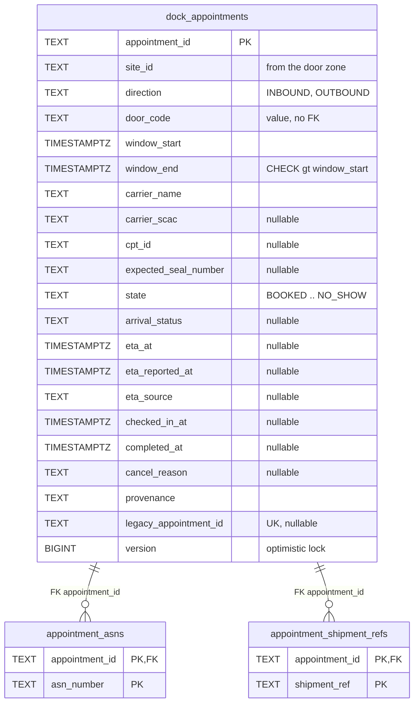
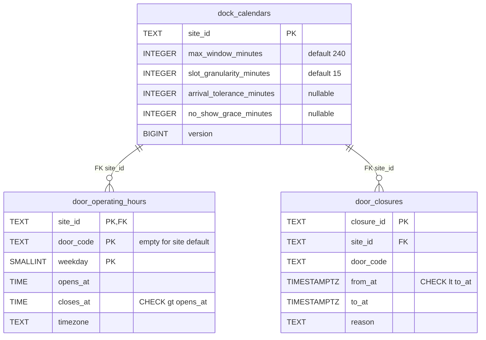
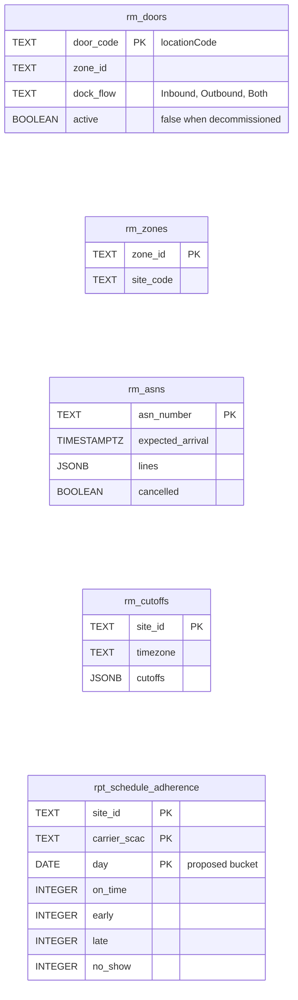
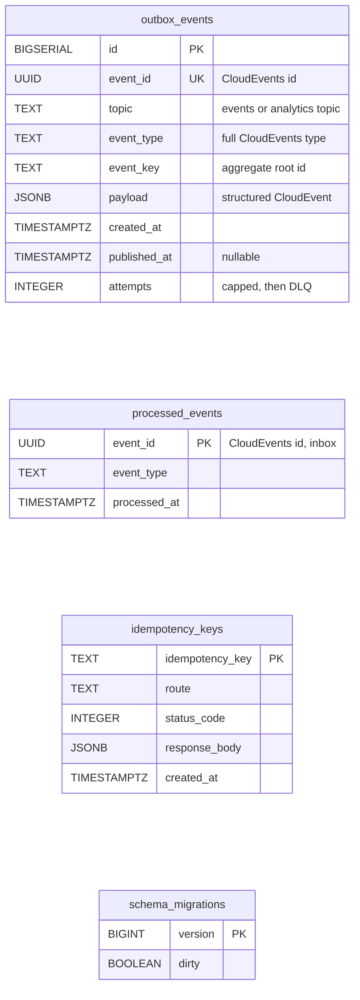

# Entity Relationship

:::info[Built on develop, not deployed]
Built on develop (merged 2026-11-08) in [IQVO/dock-scheduling](https://github.com/IQVO/dock-scheduling), not deployed: registered nowhere in warehouse-infra. The page still derives from [`yard/model/model.yaml`](https://github.com/IQVO/warehouse-docs/blob/main/yard/model/model.yaml); where the as-built service differs, the model and this page say so (see the as-built notes).
:::

The **proposed** Postgres schema. This context owns its database; no table
is shared with another context (`conventions.integration_rules`). A
relationship line is drawn only where a foreign key would exist, and only
inside one aggregate. The model fixes no table or column; every name below
is this pack's proposal, built from the aggregates' value objects and the
event payloads.

## Aggregate tables

### DockAppointment

### DockCalendar

Derived from: `model.yaml → contexts[dock-scheduling].aggregates`
(`DockAppointment`, `DockCalendar`: root ids, states, value objects,
invariants) and `.publishes[*].data`.

Omitted: indexes. Proposed: `dock_appointments (door_code, window_start)`
for the overlap check and `GET /doors/{doorCode}/availability`;
`(state, window_end)` for the no-show sweep; a unique index on
`legacy_appointment_id` (null for native bookings), which makes the strangler
import happen once; an exclusion constraint on `door_closures` per door
(closures never overlap, `ErrOverlappingClosure`). There is **no** exclusion
constraint on `dock_appointments`: `ErrDoorDoubleBooked` is enforced by the
domain service under the per-door advisory lock, and policy `ActualDoorWins`
deliberately allows an overlap when the physical door differs. Comparison
operators are written `lt` / `gt` inside the diagrams, and `..` abbreviates
the full state list from the model. `site_id` is the `siteCode` found through
the door's zone, never parsed from a code. `eta_*` columns hold the last
`Eta`. `door_operating_hours` keeps one interval per weekday, the shape of
the model's `OperatingHours`. `appointment_asns` and
`appointment_shipment_refs` hold `InboundRefs.asn_numbers` and
`OutboundRefs.shipment_refs`; `asn_number` is a value with no FK to the ASN
copy. `door_code` and `site_id` on `door_closures` follow the model's
`Closure`; whether `door_code` may be empty for a whole site is not stated
(gap `DS-G20`).

## Read-model tables

Derived from: `model.yaml → contexts[dock-scheduling].read_models`, and the
fields the model lists for the consumed events (`LocationSlotRegistered`:
`locationCode`, `zoneId`, `role`, `dockFlow`; `ZoneRegistered`: `zoneId`,
`siteCode`; `ASNRegistered`: `asn_number`, `expected_arrival`, `lines`;
`CPTScheduleChanged`: `site_id`, `timezone`, `cutoffs`).

Omitted: `DoorAvailabilityView`, which is computed from
`dock_appointments`, `door_operating_hours` and `door_closures` and has no
table of its own (this pack's reading). `rm_doors` holds only Dock slots (role
Dock) and `door_code` is the slot's `locationCode` (this pack's reading). There
is no foreign key from `rm_doors.zone_id` to `rm_zones` because the two events
may arrive in either order (gap `DS-G15`); the join to the site is made when
both exist. `rm_cutoffs.cutoffs` keeps the element shape of the producer,
which the model does not print (gap `DS-G05`). `rpt_schedule_adherence`
is a projection of this context's own analytics topic; the model names the
measures (on-time, early, late and no-show share per site and carrier) but no
time bucket, so `day` is proposed.

## Infrastructure tables

Derived from: `model.yaml → conventions.integration_rules` (transactional
outbox with attempt cap and DLQ, inbox on the CloudEvents id,
`Idempotency-Key` on state-changing calls) and `conventions.cloudevents`.

**All four are infrastructure, not domain.** `outbox_events` is written in
the same transaction as the aggregate and drained by the relay to Kafka; its
`topic` is `warehouse.dock-scheduling.events` or, for the events marked
`analytics only`, `warehouse.dock-scheduling.analytics`. `processed_events` is
the inbox: one row per consumed CloudEvents `id`, written in the same
transaction as the effect. `idempotency_keys` stores the first response to a
REST `Idempotency-Key` (proposed). `schema_migrations` is the migration
tool's bookkeeping.

## Why no foreign key crosses an aggregate or a context

- **Across aggregates.** `dock_appointments.door_code` and `.site_id` are
  values, not foreign keys to `dock_calendars` or `door_closures`.
  `DockAppointment` and `DockCalendar` are separate consistency boundaries
  saved in separate transactions; a foreign key would couple their lifecycles.
  The rules that span them (`ErrDoorUnavailable`,
  `ErrClosureConflictsWithAppointments`) are checks in the use case.
- **To other contexts.** `door_code`, `asn_number`, `cpt_id`, `site_id` and
  `shipment_ref` name things owned by `facility-layout`, `inbound-receiving`,
  `process-path-management` or an outbound system that does not exist yet.
  Those live in other databases; this context only holds event-fed copies
  (`rm_...`).

## Table ≠ aggregate

| Table | Aggregate / role | Notes |
| --- | --- | --- |
| `dock_appointments` | **DockAppointment** (root) | One row per appointment; `version` for optimistic concurrency. |
| `appointment_asns` | **DockAppointment** (its `InboundRefs`) | Replaced as a set at booking. |
| `appointment_shipment_refs` | **DockAppointment** (its `OutboundRefs`) | Replaced as a set at booking. |
| `dock_calendars` | **DockCalendar** (root) | One row per site; the settings. |
| `door_operating_hours` | **DockCalendar** (its `OperatingHours`) | Replaced as a set by `DeclareOperatingHours`. |
| `door_closures` | **DockCalendar** (its `Closure` list) | Added by `ScheduleDoorClosure`, removed by `LiftDoorClosure`. |
| `rm_doors`, `rm_zones` | read model `DoorView` | From `facility-layout` slot and zone events. |
| `rm_asns` | read model `AsnView` | From `ASNRegistered`, `ASNCancelled`. |
| `rm_cutoffs` | read model `CutoffView` | From `CPTScheduleChanged`. |
| `rpt_schedule_adherence` | read model `AdherenceReport` | Projected from the analytics topic. |
| `outbox_events` | none (infrastructure) | Transactional outbox. |
| `processed_events` | none (infrastructure) | Inbox. |
| `idempotency_keys` | none (infrastructure) | REST replay store. |
| `schema_migrations` | none (infrastructure) | Migrations. |
