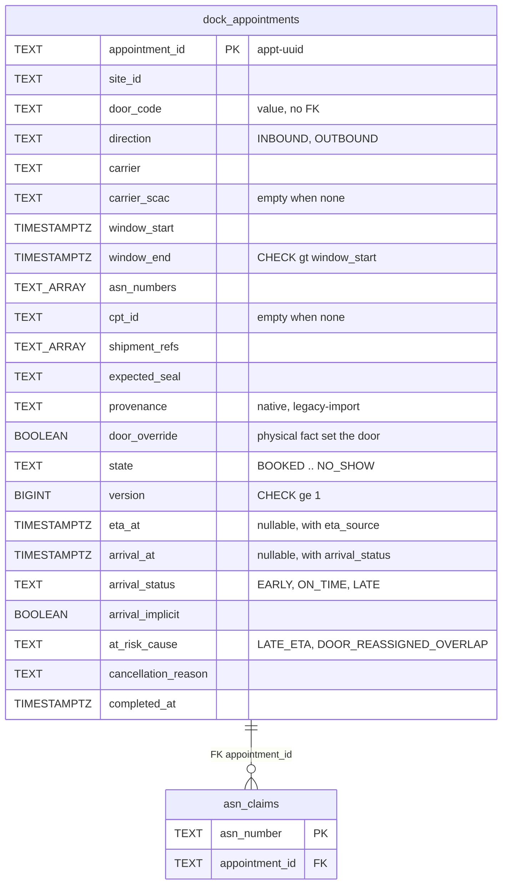
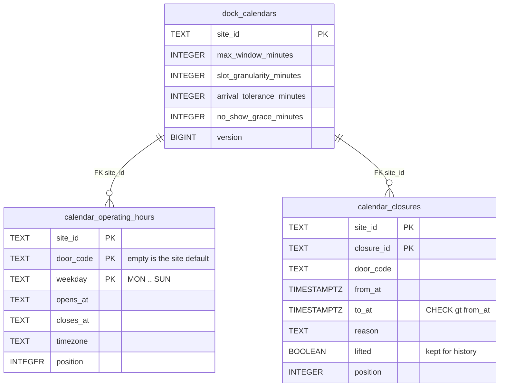
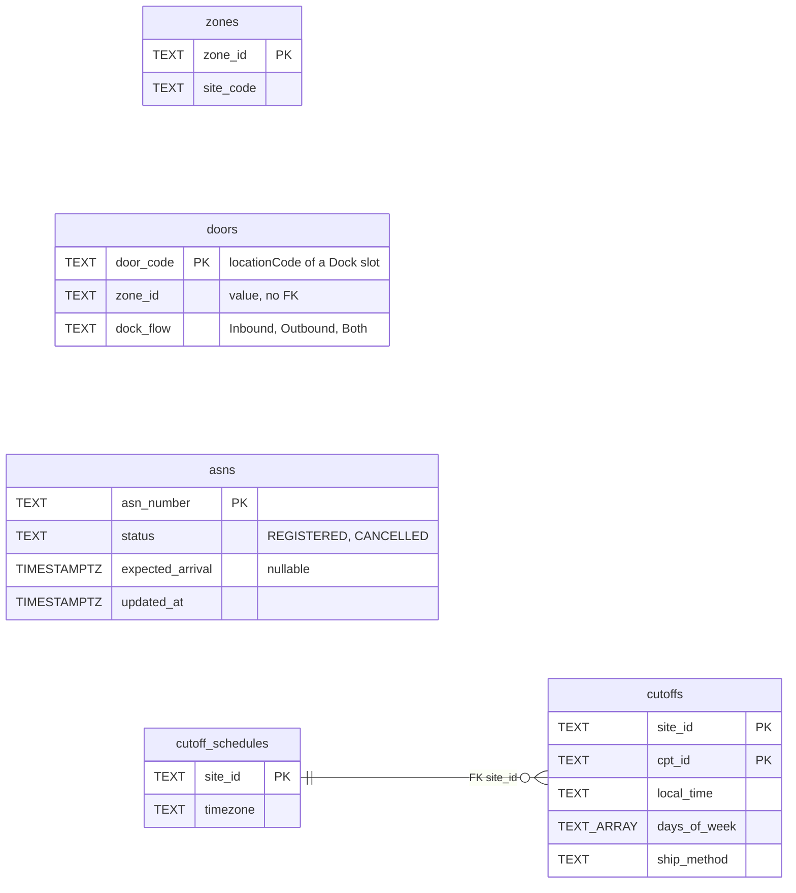
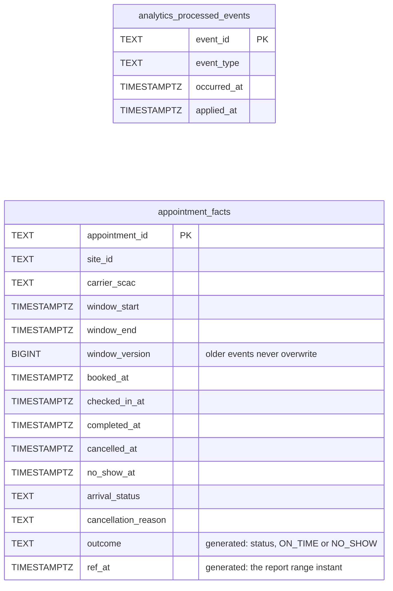
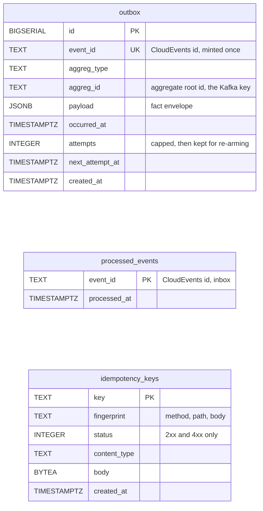

# Entity Relationship

:::info[Built on develop, not deployed]
Built on develop (merged 2026-11-08) in [IQVO/dock-scheduling](https://github.com/IQVO/dock-scheduling), not deployed: registered nowhere in warehouse-infra. The page still derives from [`yard/model/model.yaml`](https://github.com/IQVO/warehouse-docs/blob/main/yard/model/model.yaml); where the as-built service differs, the model and this page say so (see the as-built notes).
:::

The Postgres schema **as built**, from the service's migrations
(`migrations/0001_dock_scheduling` and `0002_idempotency_keys` for the OLTP database,
`analytics/migrations/0001_schedule_adherence` for the analytics database). This context owns its
database; no table is shared with another context (`conventions.integration_rules`). A relationship
line is drawn only where a foreign key exists, and only inside one aggregate. The earlier version of
this page proposed table names (`appointment_asns`, `rm_doors`, `outbox_events`, ...); they are
replaced by the real ones below.

## Aggregate tables

### DockAppointment

### DockCalendar

Derived from: `model.yaml → contexts[dock-scheduling].aggregates`
(`DockAppointment`, `DockCalendar`: root ids, states, value objects,
invariants), `.publishes[*].data` and the service migrations.

Omitted: the plain indexes (by window start, by site, by door among active rows, `BOOKED` by window end for the
no-show sweep, a partial index on `at_risk_cause`, a GIN index on `asn_numbers` for
`CancelWhenAllAsnsCancelled`). Two database backstops enforce invariants: the GiST **exclusion
constraint** `ex_dock_appointments_door_window` on `(door_code, tstzrange(window_start, window_end, '[)'))`
for `BOOKED` and `CHECKED_IN` rows that are native and not `door_override` (a losing writer
fails with `23P01`, mapped to `ErrDoorDoubleBooked`; the domain service under the per-door advisory
lock decides first), and the primary key of `asn_claims` (one row per ASN of every active native
appointment, `ErrAsnAlreadyScheduled`). Legacy imports and `ActualDoorWins` rows are deliberately exempt.
The earlier version of this page said there is no exclusion constraint on `dock_appointments`; as built there is,
with those exemptions. Comparison operators are written `lt` / `gt` / `ge` inside the diagrams, `..`
abbreviates the full state list, and an array column is written `TEXT_ARRAY`. `site_id` is the `siteCode`
found through the door's zone, never parsed from a code. Text keys that are compared or ordered in Go use
the `C` collation. The extension `btree_gist` is required.

## Read-model tables

Derived from: `model.yaml → contexts[dock-scheduling].read_models` and `.consumes`
(`LocationSlotRegistered`: `locationCode`, `zoneId`, `role`, `dockFlow`; `ZoneRegistered`: `zoneId`,
`siteCode`; `ASNRegistered`: `asn_number`, `expected_arrival`, `lines`; `CPTScheduleChanged`: `site_id`,
`timezone`, `cutoffs`).

Omitted: `DoorAvailabilityView`, which is computed from `dock_appointments`,
`calendar_operating_hours` and `calendar_closures` and has no table of its own. `doors` holds only Dock
slots (role Dock) and `door_code` is the slot's `locationCode`; a decommission deletes the row. There
is no foreign key from `doors.zone_id` to `zones` because the two events may arrive in either order: a
door whose zone has not arrived is held pending, cannot be booked, and the join to the site is made at use
time (decision X5). `cutoff_schedules` is replaced as a whole per site by `CPTScheduleChanged`. A cancelled
ASN stays cancelled.

### Analytics database

The adherence report reads a **separate analytics database**, written only by the `projector` binary
and read only by the `reports` binary, rebuilt by replaying the analytics topic.

`appointment_facts` has one row per appointment and one column per milestone, kept with
`LEAST`/`COALESCE`, so arrival order never matters. `outcome` is the adherence classification, computed by
the database: an arrival counts as its status, a completion without a check-in (an implicit arrival) as
`ON_TIME`, a no-show as `NO_SHOW`; an appointment that was only booked or was cancelled before anyone
arrived has no outcome and is not counted.

## Infrastructure tables

Derived from: `model.yaml → conventions.integration_rules` (transactional
outbox with attempt cap and DLQ, inbox on the CloudEvents id,
`Idempotency-Key` on state-changing calls) and `conventions.cloudevents`.

**All three are infrastructure, not domain.** `outbox` is written in the same transaction as the aggregate
(one row per domain fact) and drained by the relay, which encodes it as a CloudEvent and writes it to
`warehouse.dock-scheduling.events` and/or `warehouse.dock-scheduling.analytics` depending on the event's
stream; rows at the attempt cap stay until an operator re-arms them, and a row that can never be encoded
goes to `warehouse.dock-scheduling.events.dlq`. `processed_events` is the inbox: one row per consumed CloudEvents `id`, claimed in
the same transaction as the effect. `idempotency_keys` stores the first 2xx or 4xx answer to a REST
`Idempotency-Key` (never a 5xx), keyed by the request fingerprint so that the same key with another request
is `409 idempotency-key-reused`. The migration tool keeps its own bookkeeping table.

## Why no foreign key crosses an aggregate or a context

- **Across aggregates.** `dock_appointments.door_code` and `.site_id` are
  values, not foreign keys to `dock_calendars` or `calendar_closures`.
  `DockAppointment` and `DockCalendar` are separate consistency boundaries
  saved in separate transactions; a foreign key would couple their lifecycles.
  The rules that span them (`ErrDoorUnavailable`,
  `ErrClosureConflictsWithAppointments`, `ErrHoursConflictWithAppointments`) are checks in the use case.
  The one foreign key inside the appointment boundary is `asn_claims.appointment_id`.
- **To other contexts.** `door_code`, `asn_number`, `cpt_id`, `site_id` and
  `shipment_ref` name things owned by `facility-layout`, `inbound-receiving`,
  `process-path-management` or an outbound system. Those live in other databases; this context only
  holds event-fed copies (`zones`, `doors`, `asns`, `cutoff_schedules`).

## Table ≠ aggregate

| Table | Aggregate / role | Notes |
| --- | --- | --- |
| `dock_appointments` | **DockAppointment** (root) | One row per appointment, the whole snapshot; `version` guards every update. |
| `asn_claims` | **DockAppointment** (its `InboundRefs`, as a uniqueness guard) | One row per ASN of an active native appointment. |
| `dock_calendars` | **DockCalendar** (root) | One row per site; the settings. Created lazily. |
| `calendar_operating_hours` | **DockCalendar** (its `OperatingHours`) | Replaced as a set by `DeclareOperatingHours`. |
| `calendar_closures` | **DockCalendar** (its `Closure` list) | Added by `ScheduleDoorClosure`; `LiftDoorClosure` sets `lifted`. |
| `zones`, `doors` | read model `DoorView` | From `facility-layout` zone and slot events. |
| `asns` | read model `AsnView` | From `ASNRegistered`, `ASNCancelled`. |
| `cutoff_schedules`, `cutoffs` | read model `CutoffView` | From `CPTScheduleChanged`. |
| `appointment_facts` (analytics database) | read model `AdherenceReport` | Projected from the analytics topic. |
| `outbox` | none (infrastructure) | Transactional outbox. |
| `processed_events` | none (infrastructure) | Inbox. |
| `idempotency_keys` | none (infrastructure) | REST replay store. |
