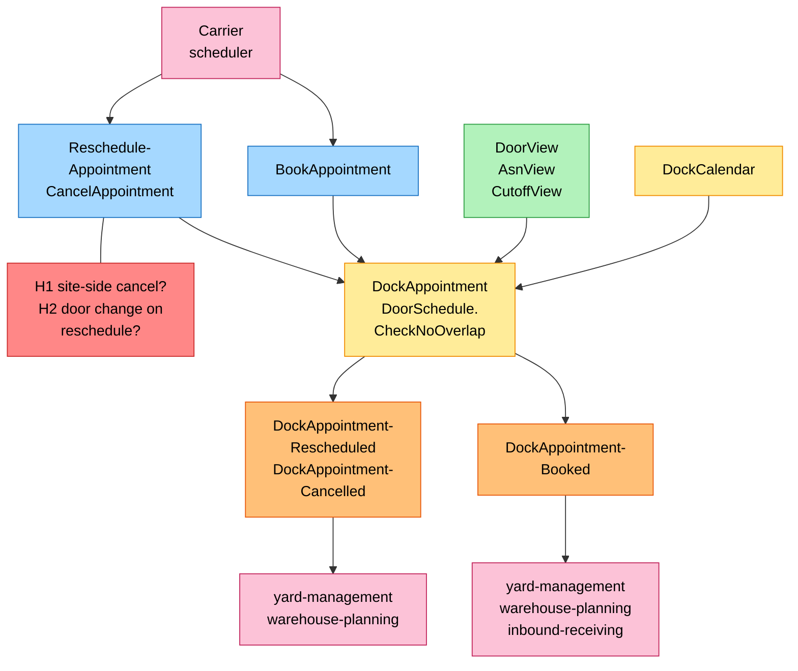
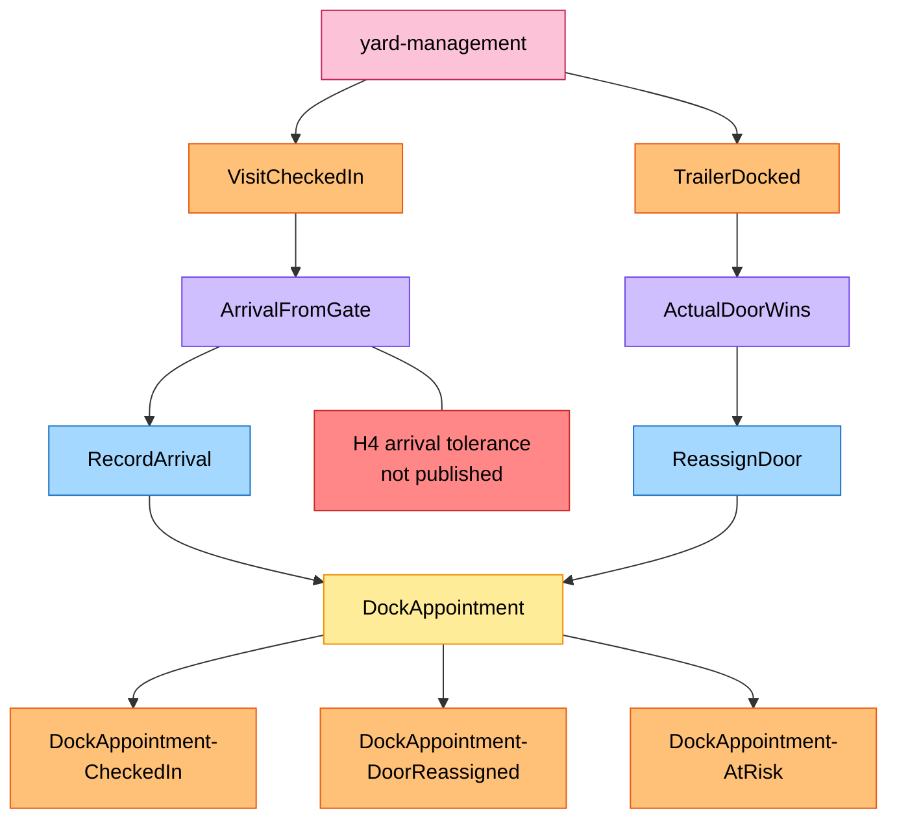
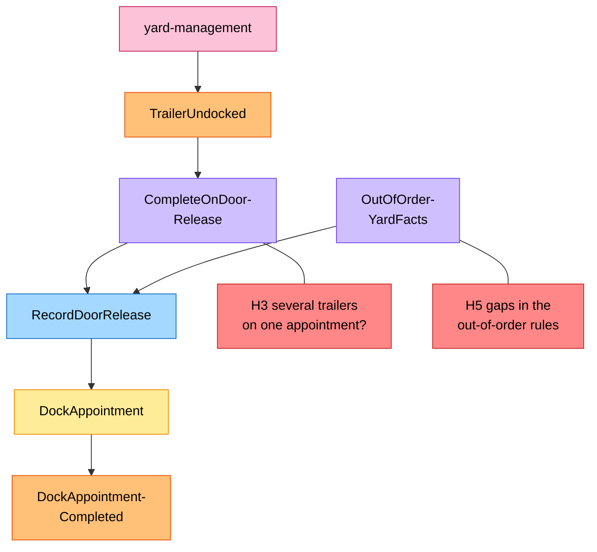
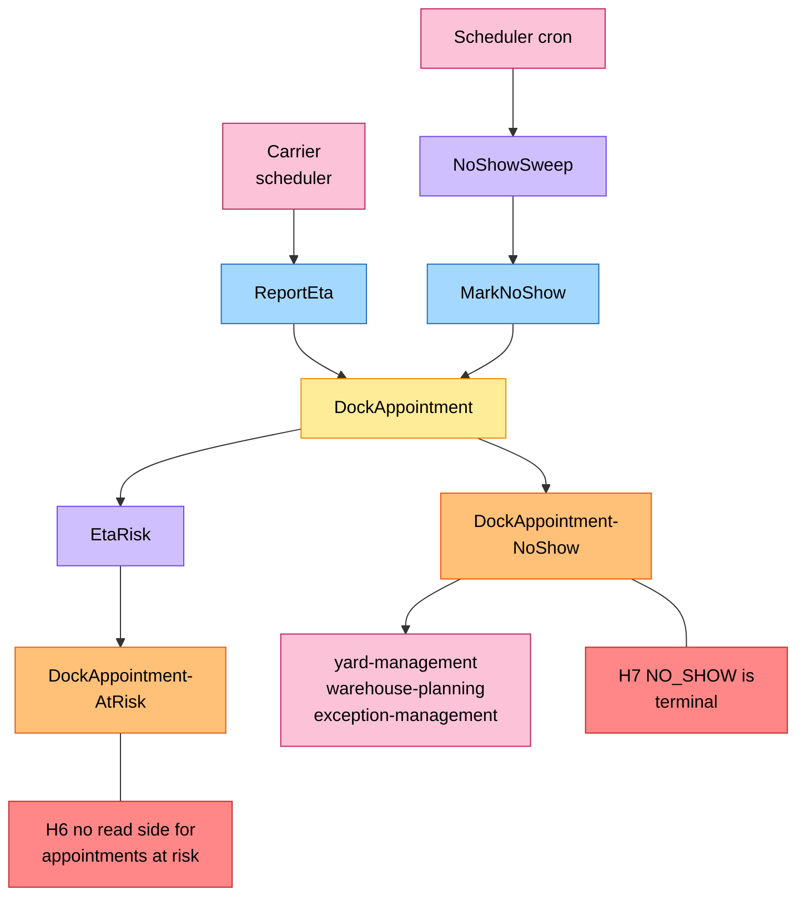
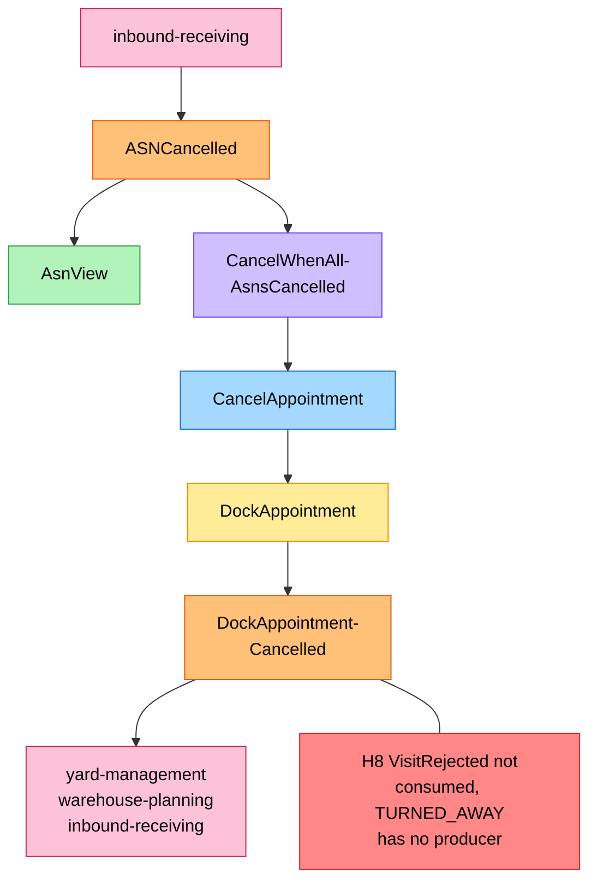
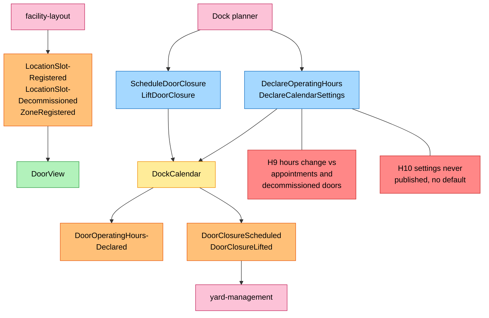
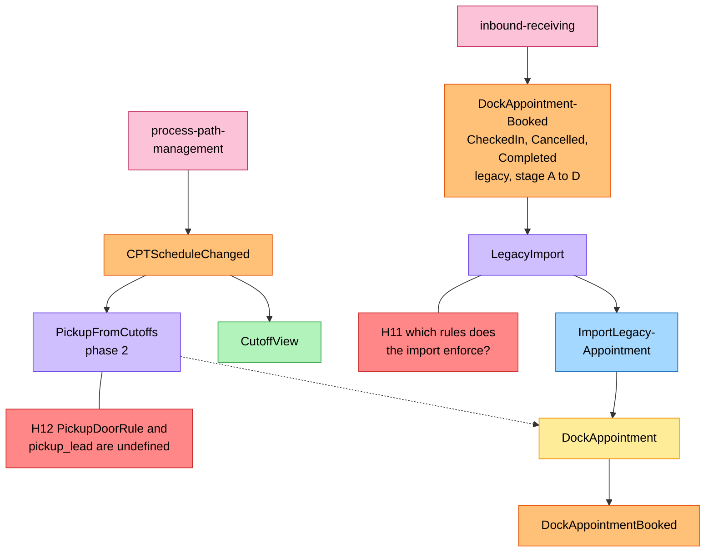

# EventStorming

:::info[Built on develop, not deployed]
Built on develop (merged 2026-11-08) in [IQVO/dock-scheduling](https://github.com/IQVO/dock-scheduling), not deployed: registered nowhere in warehouse-infra. The page still derives from [`yard/model/model.yaml`](https://github.com/IQVO/warehouse-docs/blob/main/yard/model/model.yaml); where the as-built service differs, the model and this page say so (see the as-built notes).
:::

Process-level EventStorming in the ddd-crew
[EventStorming glossary & cheat sheet](https://github.com/ddd-crew/eventstorming-glossary-cheat-sheet)
notation. Every sticky comes from `model.yaml`. Hotspots are genuine open
questions or risks in the model; the source of each is in the
[hotspot table](#hotspots).

## Legend

| Colour | Sticky | Hex |
| --- | --- | --- |
| Blue | Command | `#a5d8ff` |
| Yellow | Aggregate | `#ffec99` |
| Orange | Domain Event | `#ffc078` |
| Lilac | Policy | `#d0bfff` |
| Green | Read Model | `#b2f2bb` |
| Pink | External System (a sibling context or an actor) | `#fcc2d7` |
| Red | Hotspot | `#ff8787` |

## 1. Booking, rescheduling and cancelling

Derived from: `model.yaml → contexts[dock-scheduling].aggregates[DockAppointment]`,
`.read_models`, `.inbound`, `.publishes[*].consumers`.

Omitted: the refusals (`ErrInvalidDoorCode`, `ErrInvalidCarrier`,
`ErrInvalidWindow`, `ErrWindowInPast`, `ErrUnknownDoor`,
`ErrDoorFlowMismatch`, `ErrDoorDoubleBooked`, `ErrDoorUnavailable`,
`ErrUnknownAsn`, `ErrMissingOutboundRef`). `DockAppointmentCancelled` also
reaches `inbound-receiving`; `DockAppointmentRescheduled` does not.

## 2. Arrival at the gate and a different door

Derived from: `model.yaml → contexts[dock-scheduling].policies[ArrivalFromGate, ActualDoorWins]`,
`.aggregates[DockAppointment]`, `.publishes`.

Omitted: `DockAppointmentCheckedIn`, `DoorReassigned` and `AtRisk` are all
`analytics only`; no context reacts to them. `E5` is raised for the
**overlapped** appointment, with cause `DOOR_REASSIGNED_OVERLAP`.

## 3. Door release and out-of-order yard facts

Derived from: `model.yaml → contexts[dock-scheduling].policies[CompleteOnDoorRelease, OutOfOrderYardFacts]`,
`.aggregates[DockAppointment]`, `.publishes[DockAppointmentCompleted]`.

Omitted: `DockAppointmentCompleted` is `analytics only`.
`OutOfOrderYardFacts` is drawn into `RecordDoorRelease` because it defines
the `BOOKED` to `COMPLETED` path; it also says a late `VisitCheckedIn` for a
`COMPLETED` appointment is ignored and that any yard fact for a `CANCELLED`
or `NO_SHOW` appointment is ignored and counted.

## 4. ETA risk and no-show

Derived from: `model.yaml → contexts[dock-scheduling].policies[EtaRisk, NoShowSweep]`,
`.aggregates[DockAppointment]`, `.publishes[*].consumers`.

Omitted: `DockAppointmentNoShow` also triggers `NoShowFreesHolding` in
`yard-management`, drawn in
[Domain Message Flow](/yard/contexts/dock-scheduling/domain-message-flow).

## 5. ASN cancellation

Derived from: `model.yaml → contexts[dock-scheduling].policies[CancelWhenAllAsnsCancelled]`,
`.read_models[AsnView]`, `.reasons[CancellationReason]`, `.publishes[DockAppointmentCancelled]`.

Omitted: only an `INBOUND` `BOOKED` appointment whose ASNs are **all**
cancelled is cancelled by the policy; the reason is `ASN_CANCELLED`.

## 6. The door calendar

Derived from: `model.yaml → contexts[dock-scheduling].aggregates[DockCalendar]`,
`.read_models[DoorView]`, `.publishes`, `.consumes`.

Omitted: `ErrInvalidOperatingHours`, `ErrOverlappingClosure` and
`ErrClosureConflictsWithAppointments` refusals. `DeclareCalendarSettings`
raises no event; `DoorOperatingHoursDeclared` is `analytics only`.

## 7. Strangler import and phase-2 pickups

Derived from: `model.yaml → contexts[dock-scheduling].policies[LegacyImport, PickupFromCutoffs]`,
`.consumes`, `.read_models[CutoffView]`, `fleet_changes`.

Omitted: the dotted arrow from `PickupFromCutoffs` is the policy keeping one
`OUTBOUND` appointment per cutoff and operating day; the model names no
command for it. `DockAppointmentBooked` after an import is this pack's
reading (gap `DS-G08`).

## Hotspots

| # | Hotspot | Where it comes from in the model | Gap |
| --- | --- | --- | --- |
| H1 | `CancellationReason` has `SITE_REQUEST`, but the only inbound row for cancel is the carrier scheduler. | `aggregates[DockAppointment]`, `reasons[CancellationReason]`, `inbound[0]` | `DS-G10` |
| H2 | `DockAppointmentRescheduled` carries `door_code` but no previous door; the model does not say a reschedule may change the door. | `publishes[DockAppointmentRescheduled].data` | `DS-G06` |
| H3 | An appointment is one carrier visit, but `VisitCheckedIn` carries `trailers`, and the first `TrailerUndocked` completes the appointment. | `policies[CompleteOnDoorRelease]`, `contexts[yard-management].publishes[VisitCheckedIn]` | `DS-G03` |
| H4 | The arrival tolerance is a `DockCalendar` setting; `yard-management`'s `DirectOnCheckIn` needs it and no event carries it. | `aggregates[DockCalendar].value_objects`, `contexts[yard-management].policies[DirectOnCheckIn]` | `DS-G01` |
| H5 | The out-of-order rules cover four cases; a second `VisitCheckedIn`, a `TrailerDocked` after completion and an implicit arrival in the adherence report are not covered. | `policies[OutOfOrderYardFacts, ArrivalFromGate]` | `DS-G19` |
| H6 | `DockAppointmentAtRisk` is `analytics only` and no read model or route exposes it, yet the console and the ops agent are meant to show at-risk appointments. | `publishes[DockAppointmentAtRisk]`, `fleet_changes` | `DS-G11` |
| H7 | `NO_SHOW` has no outgoing transition; a carrier that arrives after the sweep is ignored by this context. | `aggregates[DockAppointment].transitions`, `policies[OutOfOrderYardFacts]` | `DS-G16` |
| H8 | `TURNED_AWAY` has no producer, and `VisitRejected` is not consumed here. | `reasons[CancellationReason]`, `consumes`, `contexts[yard-management].publishes[VisitRejected]` | `DS-G02` |
| H9 | A closure is refused if it covers an active appointment; a change of operating hours and a decommissioned door are not. | `aggregates[DockCalendar].invariants`, `consumes[facility-layout]` | `DS-G12`, `DS-G13` |
| H10 | `DeclareCalendarSettings` raises no event, and no default is given for the arrival tolerance or the no-show grace. | `aggregates[DockCalendar]`, `publishes` | `DS-G07`, `DS-G01` |
| H11 | `ImportLegacyAppointment` lists no invariants, and the effect of the legacy check-in, cancel and complete events is not stated. | `policies[LegacyImport]`, `consumes[inbound-receiving]` | `DS-G08` |
| H12 | `PickupFromCutoffs` names `PickupDoorRule` and `pickup_lead`, defined nowhere, and creates an appointment with no carrier. | `policies[PickupFromCutoffs]`, `aggregates[DockAppointment].invariants` | `DS-G04` |
