# Sequence Diagrams

:::info[Built on develop, not deployed]
Built on develop (merged 2026-11-08) in [IQVO/dock-scheduling](https://github.com/IQVO/dock-scheduling), not deployed: registered nowhere in warehouse-infra. The page still derives from [`yard/model/model.yaml`](https://github.com/IQVO/warehouse-docs/blob/main/yard/model/model.yaml); where the as-built service differs, the model and this page say so (see the as-built notes).
:::

One UML sequence diagram per command use case of
[Use Cases](/yard/contexts/dock-scheduling/use-cases), in the
hexagonal layout of the built service: inbound adapter → use case → aggregate → repositories and
views → outbox (same transaction) → relay → Kafka. The outbox, the relay and Kafka
share one lifeline ("outbox and relay to Kafka") to keep each diagram at five
participants.
`alt` blocks show error branches, optimistic-concurrency `version` checks and
idempotency (REST `Idempotency-Key`, Kafka inbox on the CloudEvents `id`).
Errors named `ErrNotFound`, `ErrIllegalTransition`, `ErrConcurrentUpdate` and
`ErrValidation` carry the model's status and problem slug; every
other `Err...` has the status of decision D-10 (409 conflicts, 422 value rules). Route parameters are written
without braces. The relay publishes to `warehouse.dock-scheduling.events` for
integration events and, as a twin, to `warehouse.dock-scheduling.analytics`; events
marked `analytics only` go to the analytics topic alone. Both are keyed by the aggregate root id.

## 1. BookAppointment

Carrier scheduler, REST `POST /appointments`.

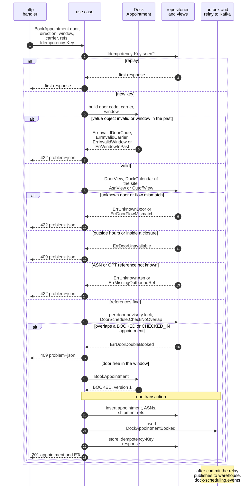

Derived from: `model.yaml → contexts[dock-scheduling].aggregates[DockAppointment]` (`commands`, `invariants`), `.publishes[DockAppointmentBooked]`, `conventions.integration_rules`.

Omitted: the per-door lock is released at commit (not drawn). The order of the checks is this pack's reading; the HTTP statuses are decision D-10. `slot_granularity_minutes` forces the window start and end onto a grid of whole minutes since the Unix epoch (`ErrInvalidWindow`, decision D-11), and an ASN already on another active appointment is refused (`ErrAsnAlreadyScheduled`).

## 2. RescheduleAppointment

Carrier scheduler, REST `POST /appointments/appointmentId/reschedules`.

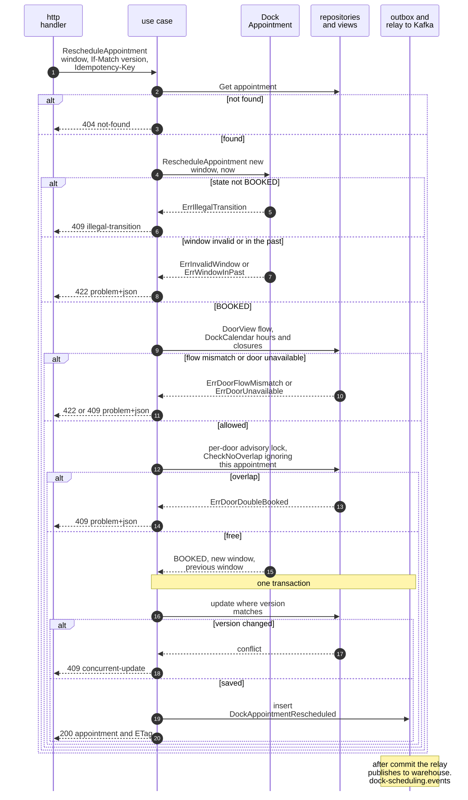

Derived from: `model.yaml → contexts[dock-scheduling].aggregates[DockAppointment].transitions` (`BOOKED` to `BOOKED`), `.invariants`, `.publishes[DockAppointmentRescheduled]`.

Omitted: the idempotency replay branch (drawn in diagram 1); a reschedule may also change the door (decision D-4); the event then carries `previous_door_code`.

## 3. CancelAppointment

Carrier scheduler, REST `POST /appointments/appointmentId/cancellations`. The policy `CancelWhenAllAsnsCancelled` calls the same use case with reason `ASN_CANCELLED` from the Kafka consumer of `ASNCancelled`.

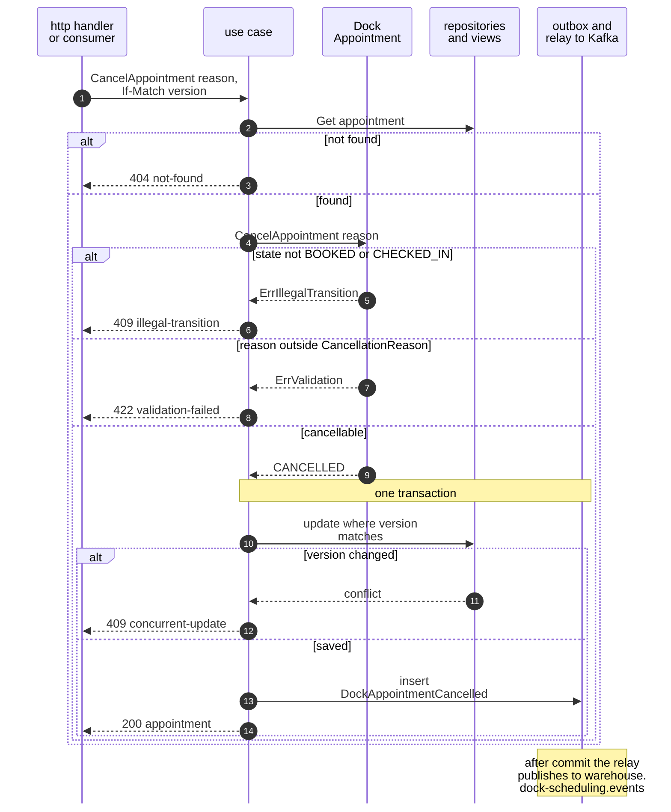

Derived from: `model.yaml → contexts[dock-scheduling].aggregates[DockAppointment].transitions`, `.policies[CancelWhenAllAsnsCancelled]`, `.reasons[CancellationReason]`.

Omitted: the inbox check on the policy path (drawn in diagram 5) and the idempotency replay on the REST path (diagram 1). On the policy path there is no HTTP reply: a non-cancellable appointment is skipped.

## 4. ReportEta

Carrier scheduler, REST `POST /appointments/appointmentId/eta-reports`. Policy `EtaRisk` decides whether the report raises an advisory.

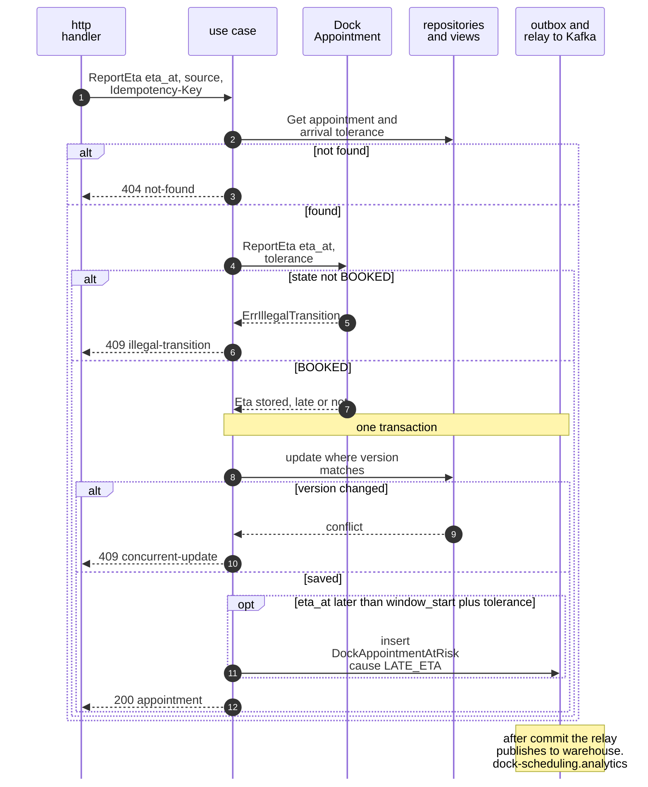

Derived from: `model.yaml → contexts[dock-scheduling].policies[EtaRisk]`, `.aggregates[DockAppointment].value_objects[Eta]`, `.publishes[DockAppointmentAtRisk]`.

Omitted: the relay step publishes only when an `AtRisk` row exists; nothing is rescheduled. `BOOKED` is the only state that accepts an ETA (assumption A6); a later on-time ETA or a reschedule clears the at-risk flag.

## 5. RecordArrival

Policy `ArrivalFromGate` on `VisitCheckedIn` naming an `appointment_id`.

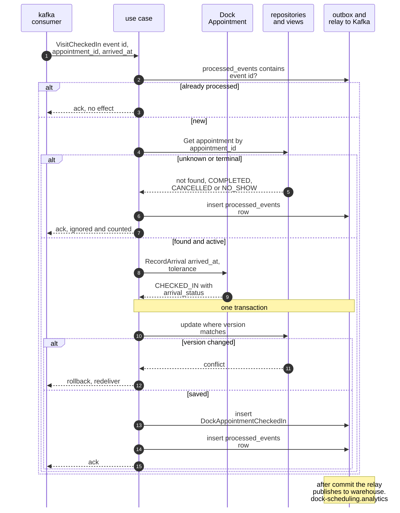

Derived from: `model.yaml → contexts[dock-scheduling].policies[ArrivalFromGate, OutOfOrderYardFacts]`, `contexts[yard-management].publishes[VisitCheckedIn]`.

Omitted: an appointment already `CHECKED_IN` is left unchanged and counted, so only `BOOKED` reaches the aggregate. The `arrival_status` formula is decision X6: EARLY before `window_start` minus the tolerance, LATE after `window_start` plus the tolerance, else ON_TIME.

## 6. ReassignDoor

Policy `ActualDoorWins` on `TrailerDocked` whose door differs from the booked door.

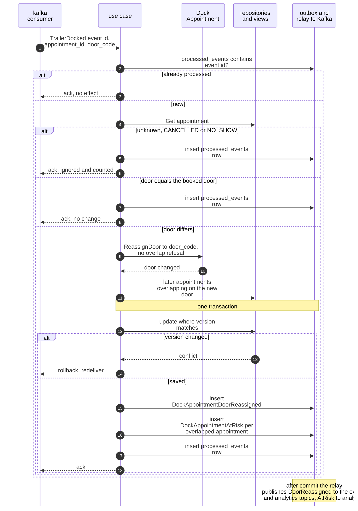

Derived from: `model.yaml → contexts[dock-scheduling].policies[ActualDoorWins]`, `.publishes[DockAppointmentDoorReassigned, DockAppointmentAtRisk]`.

Omitted: `ErrDoorDoubleBooked` is deliberately not raised: the physical fact wins. `BOOKED` and `CHECKED_IN` accept the command, and a same-door event changes nothing. The reassignment is also written to the integration topic (service ADR 0010), so the closing note's analytics topic is not the only target.

## 7. RecordDoorRelease

Policy `CompleteOnDoorRelease` on `TrailerUndocked` naming an `appointment_id`.

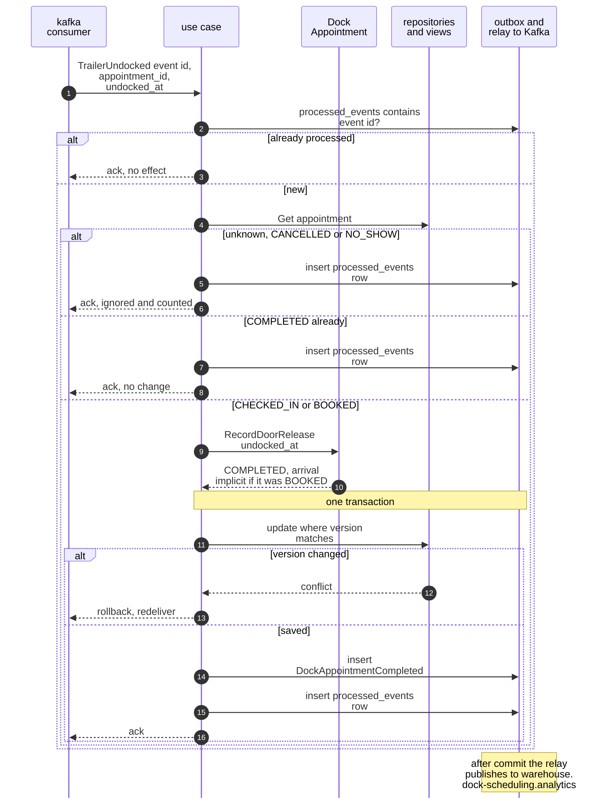

Derived from: `model.yaml → contexts[dock-scheduling].aggregates[DockAppointment].transitions`, `.policies[CompleteOnDoorRelease, OutOfOrderYardFacts]`.

Omitted: no `DockAppointmentCheckedIn` is written for an implicit arrival (the adherence report counts it as `ON_TIME`); one appointment covers exactly one trailer (decision X3).

## 8. MarkNoShow

Scheduler (cron), REST `POST /no-show-sweeps`, policy `NoShowSweep`.

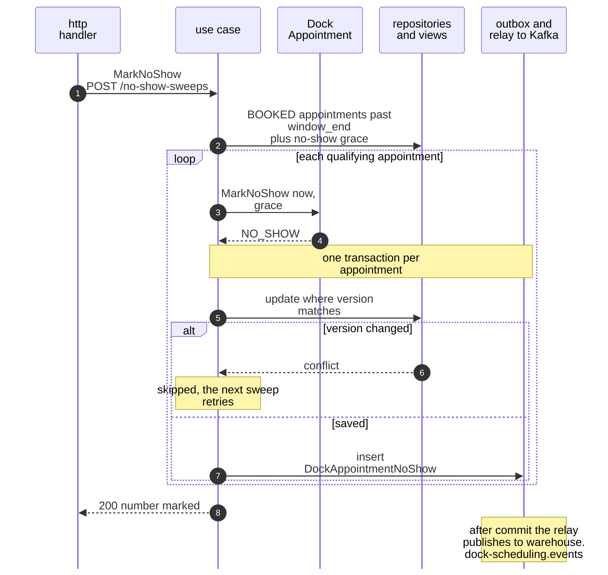

Derived from: `model.yaml → contexts[dock-scheduling].policies[NoShowSweep]`, `.aggregates[DockAppointment].transitions` (`BOOKED` to `NO_SHOW`), `.publishes[DockAppointmentNoShow]`.

Omitted: the idempotency replay (diagram 1). A rerun selects only what still qualifies. The response body is not in the model.

## 9. ImportLegacyAppointment

Policy `LegacyImport` (strangler stage A), on `inbound-receiving` `DockAppointment*` events; off when its group env is unset.

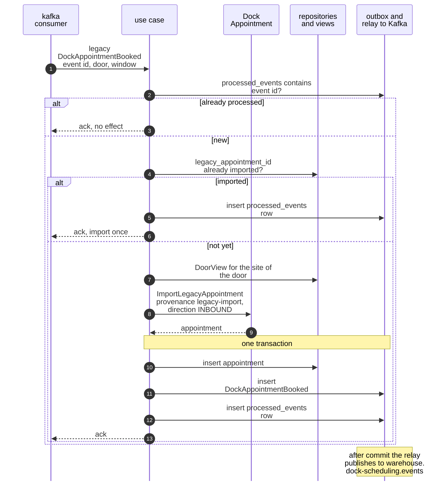

Derived from: `model.yaml → contexts[dock-scheduling].policies[LegacyImport]`, `.consumes` (legacy-import entry), `fleet_changes`.

Omitted: which invariants an import enforces, how the legacy check-in, cancel and complete events are applied and whether the import raises `DockAppointmentBooked` are settled by decision D-2: the import enforces no invariant, later legacy events move only `legacy-import` appointments, and `DockAppointmentBooked` is raised; the diagram shows that.

## 10. DeclareOperatingHours

Dock planner, REST `PUT /sites/siteId/dock-calendar/operating-hours`.

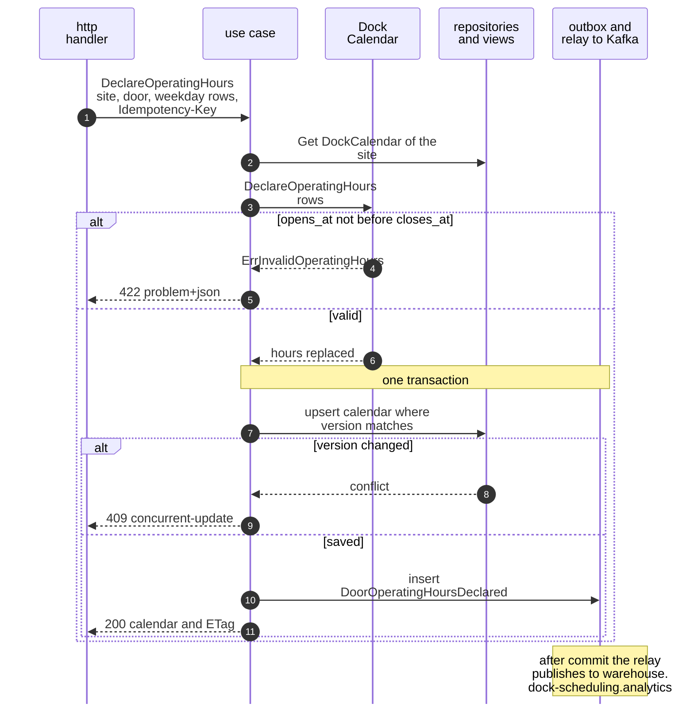

Derived from: `model.yaml → contexts[dock-scheduling].aggregates[DockCalendar]` (`invariants`, `commands`, `events`).

Omitted: the idempotency replay (diagram 1). The calendar is created lazily with the defaults at first use (decision D-1); new hours that leave an active appointment outside them are refused with `ErrHoursConflictWithAppointments` (decision D-8), a branch this diagram does not draw.

## 11. DeclareCalendarSettings

Dock planner, REST `PUT /sites/siteId/dock-calendar/settings`.

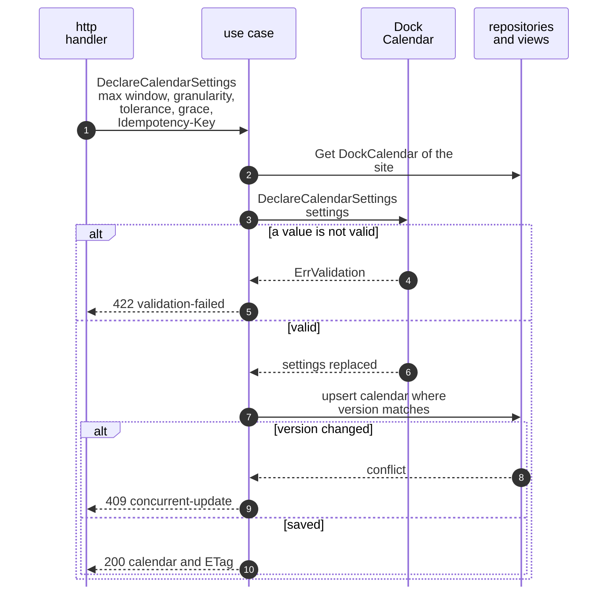

Derived from: `model.yaml → contexts[dock-scheduling].aggregates[DockCalendar]` (`value_objects[Settings]`, `commands`, `events`).

Omitted: no outbox row and no relay: the service raises no event for this command (decision D-11 fixes the bounds). The idempotency replay is as in diagram 1.

## 12. ScheduleDoorClosure

Dock planner, REST `POST /sites/siteId/dock-calendar/closures`.

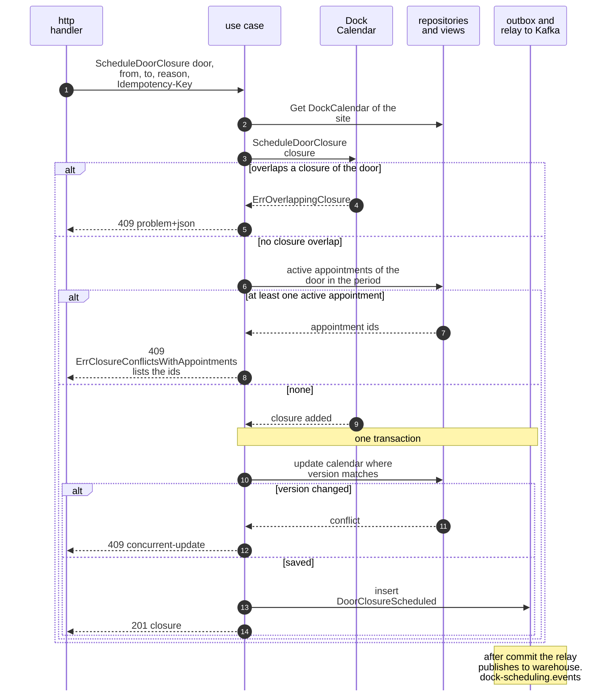

Derived from: `model.yaml → contexts[dock-scheduling].aggregates[DockCalendar].invariants`, `.publishes[DoorClosureScheduled]`.

Omitted: the idempotency replay (diagram 1). The appointments are read from another aggregate; a booking that commits between the read and the save is not prevented (this pack's reading; the service does not state it).

## 13. LiftDoorClosure

Dock planner, REST `POST /sites/siteId/dock-calendar/closures/closureId/lifts`.

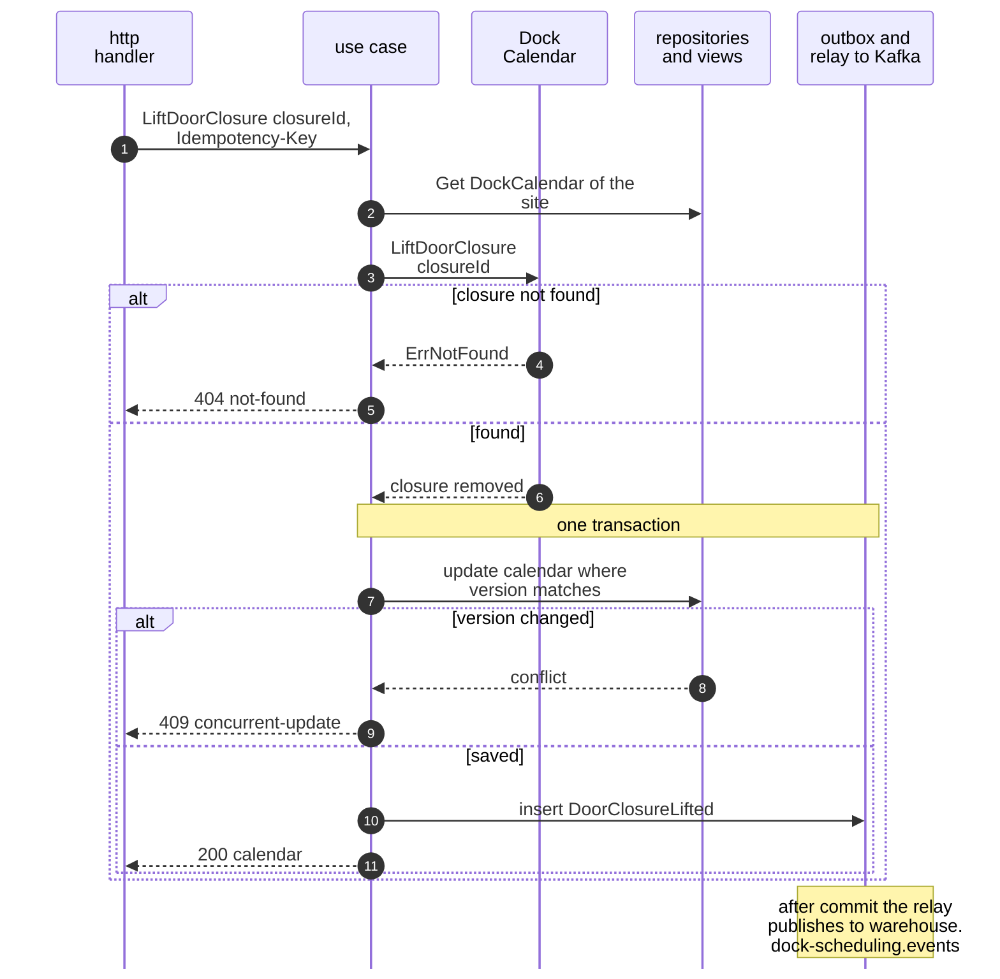

Derived from: `model.yaml → contexts[dock-scheduling].aggregates[DockCalendar].commands`, `.publishes[DoorClosureLifted]`.

Omitted: the idempotency replay (diagram 1).
