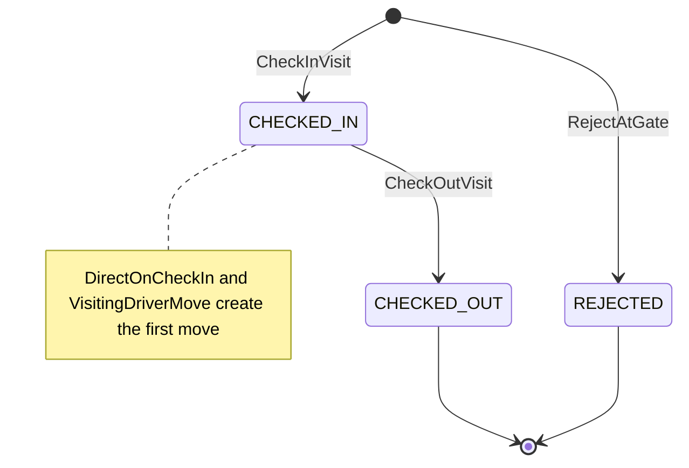
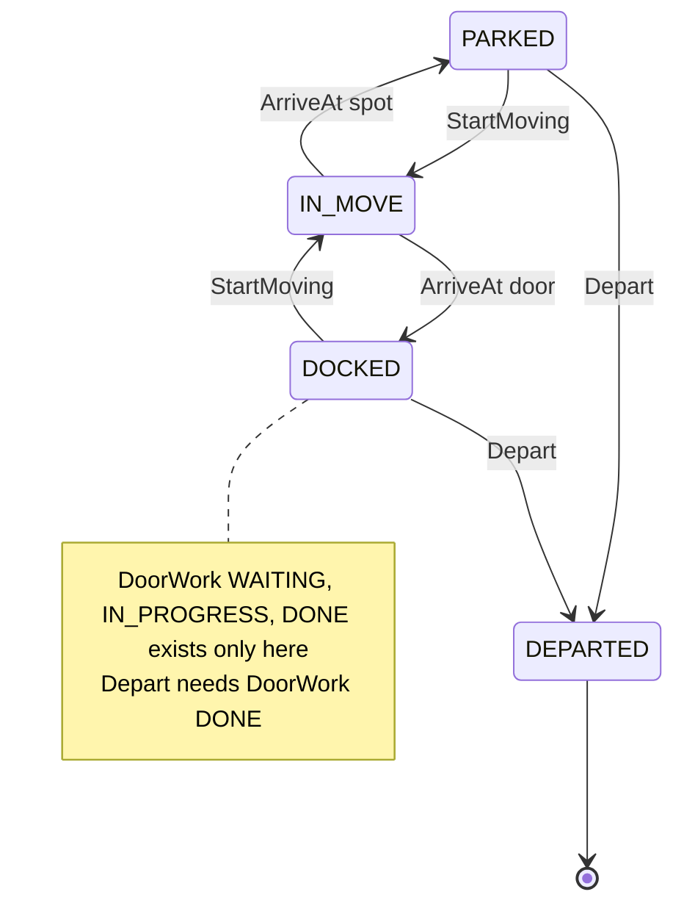
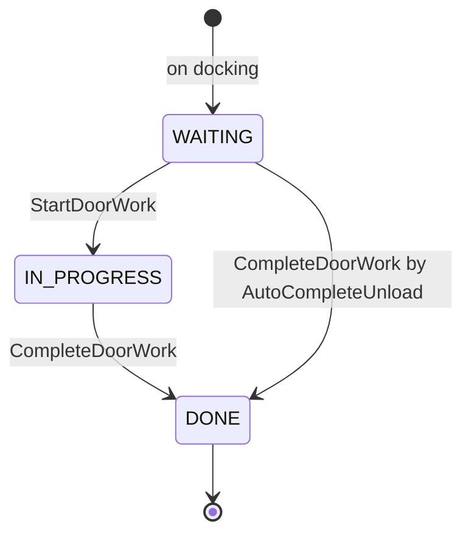
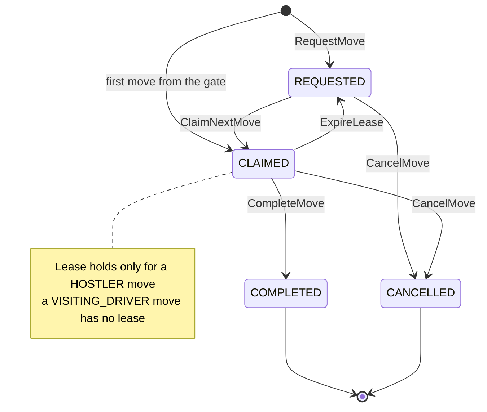
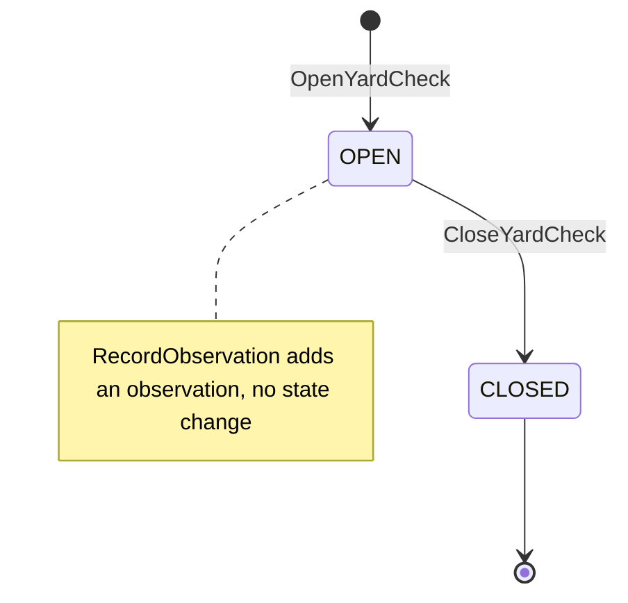
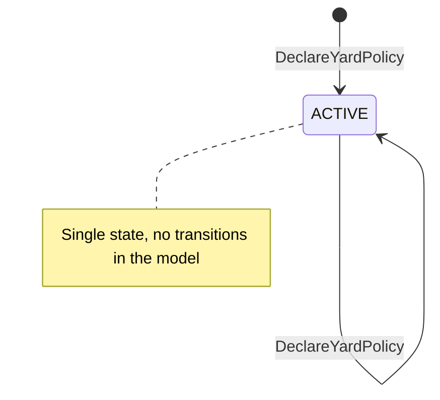
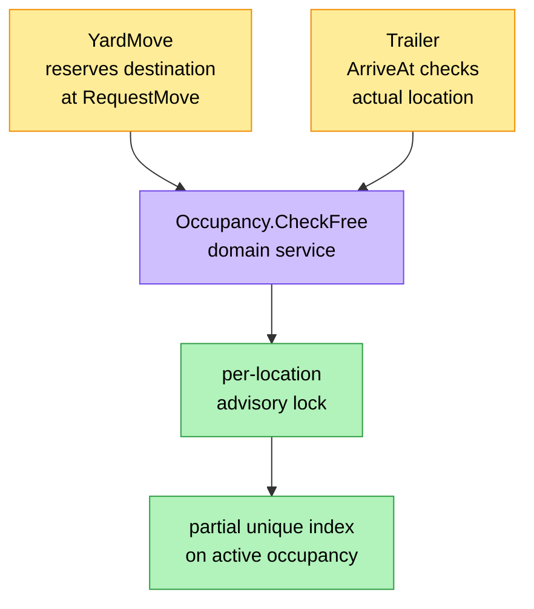

# Aggregate Design Canvas

:::info[Built on develop, registered in infra, not applied]
Built on develop (merged 2026-11-08) in [IQVO/yard-management](https://github.com/IQVO/yard-management), registered in warehouse-infra develop (apps.yaml entry, helm values, dashboards and alert rules, image pinned at v0.1.1), not applied to the k3s cluster (no pods). The page still derives from [`yard/model/model.yaml`](https://github.com/IQVO/warehouse-docs/blob/main/yard/model/model.yaml); where the as-built service differs, the model and this page say so (see the as-built notes).
:::

Following the ddd-crew [Aggregate Design Canvas v1.1](https://github.com/ddd-crew/aggregate-design-canvas).
The model has five aggregate roots: **YardVisit**, **Trailer**, **YardMove**,
**YardCheck** and **YardPolicy**. Go packages, as built:
`internal/domain/yardvisit`, `trailer`, `yardmove`, `yardcheck`, `yardpolicy`, plus `shared` (ids,
`Location`, `TrailerKind`, `LoadState`, `Purpose`, `SCAC`). Ids are `<prefix>-<uuid>`: `visit-`, `trl-`, `mv-`,
`yck-`; the policy is keyed by the site code. The aggregates are pure Go: `Snapshot()` and `Restore()` are the
persistence boundary and `Restore` re-validates.

Common to all: every mutable aggregate carries an optimistic-concurrency
`version` (starts at 1, +1 per accepted change; ETag / If-Match on REST), and
errors are `ErrNotFound` (404), `ErrIllegalTransition` (409),
`ErrConcurrentUpdate` (409) and `ErrValidation` (422) plus the domain errors
named below. As built the status of a domain error is 409 for a conflict with state, 422 for a value or
reference rule and 400 for a malformed request; the problem slug is the kebab-case of the `Err` name.

## YardVisit

### 1. Name

`YardVisit` (`yardvisit.Visit`), identified by `visitId`.

### 2. Description

One tractor and driver passing the gate, from check-in to check-out, with the
trailers it brings and takes. Value objects: `Carrier{name, scac?}`,
`TractorPlate`, `DriverRef` (opaque, no PII),
`Purpose(DROP|LIVE_UNLOAD|LIVE_LOAD|PICKUP|BOBTAIL)`, `AppointmentRef?`,
`TrailersIn[]`, `TrailersOut[]`.

### 3. State Transitions

Derived from: `model.yaml → contexts[yard-management].aggregates[YardVisit].states`,
`.transitions`, `.commands`.

Omitted: the model's only transition is `CHECKED_IN → CHECKED_OUT`. The two
creation arrows are `CheckInVisit` and `RejectAtGate` (a command that creates the aggregate has no
from-state). A refused `CheckInVisit` creates nothing; `RejectAtGate` is the command that records a
`REJECTED` visit (decision Y-5).

### 4. Enforced Invariants

| Invariant | Enforced by |
| --- | --- |
| Carrier name non-blank, at most 100 characters; `scac` 2..4 upper-case letters when given | `ErrInvalidCarrier` |
| At most one `CHECKED_IN` visit per tractor plate per site | `ErrVisitAlreadyOpen` |
| When the site requires appointments, the named appointment is `BOOKED` for this site in the local copy | `ErrAppointmentRequired` |
| Every trailer taken out is on site and released (not `DOCKED`, no open move) | `ErrTrailerNotReleased` |
| Every `LOADED` trailer taken out on an `OUTBOUND` purpose carries a seal | `ErrSealRequired` |

The last two read `Trailer` and `YardMove` state, so they cross the aggregate
boundary; the use case loads the trailers and checks them in one unit of work.
The outbound purposes are `LIVE_LOAD` and `PICKUP` (decision Y-9), and a trailer is released when it has no open move and is either `PARKED` or `DOCKED` with door work `DONE`, so a live visit leaves from the door (decision Y-2).

### 5. Corrective Policies

- **`DirectOnCheckIn`** (this context): at `CheckInVisit`, a trailer with an
  appointment whose door is free, not closed and flow-compatible gets a
  `VISITING_DRIVER` move `TO_DOOR`; otherwise a move to the first free spot of the
  site's parking zones (by location code; nearest-to-door is phase 2); a walk-in
  or an arrival earlier than the tolerance goes `TO_HOLDING`.
- **`VisitingDriverMove`** (this context): the first move of a trailer from the
  gate is created `CLAIMED` with performer `VISITING_DRIVER` (no lease).
- **`SealCheckAtGate`** (this context): a recorded seal that differs from the
  appointment's `expected_seal_number` raises `SealExceptionRaised`; `REJECT`
  policy also rejects the visit.
- **`ArrivalFromGate`** (`dock-scheduling`, a neighbour's reaction): on
  `VisitCheckedIn` naming an appointment, it records the arrival.

### 6. Handled Commands

| Command | Issued by |
| --- | --- |
| `CheckInVisit` | Gate clerk or kiosk, REST `POST /visits` |
| `RejectAtGate` | Gate clerk or kiosk, REST `POST /visit-rejections` |
| `CheckOutVisit` | Gate clerk or kiosk, REST `POST /visits/{visitId}/check-outs` |

### 7. Created Events

| Event | Raised when | Full CloudEvents type |
| --- | --- | --- |
| `VisitCheckedIn` | `CheckInVisit` succeeds | `com.warehouse.wms.yard-management.yardvisit.VisitCheckedIn` |
| `VisitRejected` | `RejectAtGate` succeeds (also the `REJECT` seal outcome) | `com.warehouse.wms.yard-management.yardvisit.VisitRejected` |
| `VisitCheckedOut` | `CheckOutVisit` succeeds | `com.warehouse.wms.yard-management.yardvisit.VisitCheckedOut` (analytics only) |

### 8. Throughput

*Estimate* (from the model): **medium (gate events)**. One check-in and one
check-out per visit, no contended row.

### 9. Size

*Estimate* (from the model): **visits/day × retention**. Each instance is small:
scalars plus the in and out trailer lists. About two events per visit (one for a
rejected visit).

## Trailer

### 1. Name

`Trailer` (`trailer.Trailer`), identified by `trailerId`.

### 2. Description

A towable unit on site (trailer, or container on a chassis): where it is, what
it holds, its seal and hold. Value objects: `TrailerKind(DRY_VAN|REEFER|FLATBED|CONTAINER)`,
`UnitNumber{carrier_scac, number}` (natural key on site), `LoadState(EMPTY|LOADED|PARTIAL)`,
`Contents{asn_numbers[] inbound, outbound_ref?}`, `Seal{number, state INTACT|BROKEN|NONE}`,
`Hold{reason}`, `Location{kind SPOT|DOOR, code}`, `DoorWork(WAITING|IN_PROGRESS|DONE)`
(only while `DOCKED`), `ArrivedAt` (the dwell clock start).

`StartMoving` and `ArriveAt` are invoked only by the `YardMove` use cases (claim
and complete), in the same unit of work as the move, the fleet precedent of
closing a receipt together with its ASN.

### 3. State Transitions

Derived from: `model.yaml → contexts[yard-management].aggregates[Trailer].states`,
`.transitions`, `.invariants`, `.notes`.

Omitted: the creation arrow. `RecordArrival` creates the trailer `IN_MOVE` together with its first move,
created `CLAIMED` (decision Y-1). A move that is cancelled or whose lease expires after the claim brings the
trailer back through `ReturnToOrigin` (`IN_MOVE` to `PARKED` or `DOCKED`, where `StartMoving` found it) in the same
unit of work; if that origin has since been taken the trailer stays `IN_MOVE` and the move `REQUESTED`.
`ArriveAt` to a spot or a door is one command with two target states; the label says which. `RecordSeal`, `BreakSeal`, `PlaceHold`,
`ReleaseHold` and `RecordLoadState` do not change the state.

Door work (the three values and the commands, as built):

`WAITING → DONE` is real: `AutoCompleteUnload` may complete door work that was never started, once every ASN
on the trailer has a closed receipt (decision Y-7); `CompleteDoorWork` by an operator requires `IN_PROGRESS`
(assumption A11).

### 4. Enforced Invariants

| Invariant | Enforced by |
| --- | --- |
| A spot or door holds at most one trailer (domain service `Occupancy.CheckFree` under a per-location advisory lock, plus a partial unique index) | `ErrLocationOccupied` |
| The location is a known, active Yard or Dock slot of the trailer's site | `ErrUnknownLocation` |
| A door under a closure takes no trailer | `ErrDoorClosed` |
| A `LOADED` inbound trailer docks only at an Inbound or Both door, an outbound one only at an Outbound or Both door | `ErrDoorFlowMismatch` |
| A trailer on hold is not docked | `ErrTrailerOnHold` |
| A `DOCKED` trailer departs only when its door work is `DONE` | `ErrDoorWorkOpen` |
| The natural key `(scac, number)` is unique among trailers on site | `ErrTrailerAlreadyOnSite` |

The first three and the fourth read other state (other trailers, the
`LocationView`, the `DoorClosureView`, the door's `dockFlow`); the use case passes
those in. See [Occupancy across aggregates](#occupancy-across-aggregates).

### 5. Corrective Policies

- **`CallToDoor`** (this context): on `TrailerUndocked`, the next `BOOKED` or
  `CHECKED_IN` appointment of that door whose trailer is `PARKED` gets a
  `HOSTLER` move `TO_DOOR`, `due_by` = `window_start`, priority by `window_start`.
- **`AutoCompleteUnload`** (this context): on `inbound-receiving` `ReceiptClosed`
  for a receipt opened on an appointment whose trailer is `DOCKED`,
  `CompleteDoorWork` and set `load_state` `EMPTY`.
- **`ClearDoorAfterWork`** (this context): on `DoorWorkCompleted`, a `DROP` trailer
  gets a `HOSTLER` move `FROM_DOOR` to a free spot; a `LIVE` trailer stays until
  its visit checks out.
- **`SealCheckAtGate`** (this context): see `YardVisit`.
- **`DwellSweep`** (this context): `POST /dwell-sweeps` raises
  `TrailerDwellExceeded` once per trailer and threshold crossing.
- **`ActualDoorWins`** (`dock-scheduling`, a neighbour's reaction): on
  `TrailerDocked` at a door other than the booked one, it reassigns the door.
- **`CompleteOnDoorRelease`** (`dock-scheduling`): on `TrailerUndocked` naming an
  appointment, it completes the appointment.

### 6. Handled Commands

| Command | Issued by |
| --- | --- |
| `RecordArrival` | `CheckInVisit` (one per trailer in `TrailersIn`, and one appointment covers exactly one trailer); no route of its own |
| `StartMoving` | `ClaimNextMove` use case, same unit of work as the claim |
| `ArriveAt` | `CompleteMove` use case, same unit of work as the completion |
| `StartDoorWork` | Dock operator, REST `POST /trailers/{trailerId}/door-work-starts` |
| `CompleteDoorWork` | Dock operator, REST `POST /trailers/{trailerId}/door-work-completions`; `AutoCompleteUnload` |
| `RecordSeal` | Yard supervisor, REST `POST /trailers/{trailerId}/seals` |
| `BreakSeal` | `RecordSeal` with state `BROKEN`, which also places a `SEAL_BROKEN` hold (decision Y-6); no route of its own |
| `PlaceHold` | Yard supervisor, REST `POST /trailers/{trailerId}/holds` |
| `ReleaseHold` | Yard supervisor, REST `POST /trailers/{trailerId}/hold-releases` |
| `RecordLoadState` | `AutoCompleteUnload` sets `EMPTY`; no route of its own |
| `Depart` | `CheckOutVisit` for each trailer taken out (it raises `TrailerUndocked` first when the trailer is `DOCKED`) |

### 7. Created Events

| Event | Raised when | Full CloudEvents type |
| --- | --- | --- |
| `TrailerParked` | `ArriveAt` a spot (also `ReturnToOrigin` to a spot) | `com.warehouse.wms.yard-management.trailer.TrailerParked` |
| `TrailerDocked` | `ArriveAt` a door (also `ReturnToOrigin` to a door) | `com.warehouse.wms.yard-management.trailer.TrailerDocked` |
| `DoorWorkStarted` | `StartDoorWork` succeeds | `com.warehouse.wms.yard-management.trailer.DoorWorkStarted` |
| `DoorWorkCompleted` | `CompleteDoorWork` succeeds | `com.warehouse.wms.yard-management.trailer.DoorWorkCompleted` |
| `TrailerUndocked` | the trailer leaves a door: `StartMoving` or `Depart` from `DOCKED` (decision Y-6) | `com.warehouse.wms.yard-management.trailer.TrailerUndocked` |
| `TrailerDeparted` | `Depart` succeeds | `com.warehouse.wms.yard-management.trailer.TrailerDeparted` |
| `SealExceptionRaised` | `SealCheckAtGate` finds a mismatch | `com.warehouse.wms.yard-management.trailer.SealExceptionRaised` |
| `TrailerHeld` | `PlaceHold` succeeds | `com.warehouse.wms.yard-management.trailer.TrailerHeld` |
| `TrailerHoldReleased` | `ReleaseHold` succeeds | `com.warehouse.wms.yard-management.trailer.TrailerHoldReleased` |
| `TrailerDwellExceeded` | `DwellSweep` crosses a threshold | `com.warehouse.wms.yard-management.trailer.TrailerDwellExceeded` |

`RecordArrival`, `RecordSeal`, `BreakSeal` and `RecordLoadState` raise no event of
their own in the model.

### 8. Throughput

*Estimate* (from the model): **high (every move and door step)**. Two trailer
writes per move (claim, complete), plus door-work steps. The contended resource is
a location: one door wanted by two moves. As built: per-location advisory lock,
partial unique index as backstop (`uq_trailers_one_per_location`, `uq_trailers_unit_on_site`), optimistic
concurrency on `version`.

### 9. Size

*Estimate* (from the model): **trailers on site (hundreds per site) plus
history**. Each instance is small. The model gives no event count; this pack's
estimate for one dock cycle is about six (parked, docked, door work started,
door work completed, undocked, departed, plus a parked or docked and an undocked
per extra move).

## YardMove

### 1. Name

`YardMove` (`yardmove.Move`), identified by `moveId`.

### 2. Description

One instruction to take a trailer from where it is to a spot, a door or the gate,
done by a hostler or by the visiting driver. Value objects: `Performer(HOSTLER|VISITING_DRIVER)`,
`From/To Location{kind, code}`, `Priority{band 1..9, due_by}`,
`Reason(TO_DOOR|FROM_DOOR|RELOCATE|TO_HOLDING)`, `Lease{hostler_ref, expires_at}`.

### 3. State Transitions

Derived from: `model.yaml → contexts[yard-management].aggregates[YardMove].states`,
`.transitions`, `.commands`, `.policies[VisitingDriverMove]`.

Omitted: the creation arrow into `REQUESTED` is `RequestMove`. The arrow into `CLAIMED` comes from the
policy text ("created `CLAIMED` with performer `VISITING_DRIVER`") and is not in `transitions`. A `CLAIMED`
visiting-driver move has no lease, so it can neither expire nor be cancelled; the dock operator or gate clerk
completes it through the same completion route (decisions Y-1, Y-3).

### 4. Enforced Invariants

| Invariant | Enforced by |
| --- | --- |
| A trailer has at most one `REQUESTED` or `CLAIMED` move | `ErrTrailerHasOpenMove` |
| No two open moves share a destination, and the destination is free when requested | `ErrDestinationReserved` |
| A hostler holds at most one `CLAIMED` move | `ErrHostlerBusy` |
| Only the lease holder completes a `CLAIMED` move | `ErrNotLeaseHolder` |
| Completion records the actual location; a location other than the destination needs a reason | `ErrUnexplainedDestination` |

The first, second and third span moves (and, for "free", trailers). Enforcement as built:
partial unique indexes on open moves per trailer, per destination and per hostler
(`uq_yard_moves_one_open_per_trailer`, `uq_yard_moves_open_destination`, `uq_yard_moves_one_claim_per_hostler`),
and `Occupancy.CheckFree` for "the destination is free". See
[Occupancy across aggregates](#occupancy-across-aggregates).

### 5. Corrective Policies

- **`CallToDoor`**, **`ClearDoorAfterWork`**, **`DirectOnCheckIn`** (this
  context): create moves (see `Trailer` and `YardVisit`).
- **`LeaseExpirySweep`** (this context): `POST /move-lease-sweeps` returns expired
  `CLAIMED` moves to `REQUESTED`.
- **`NoShowFreesHolding`** (this context): on `DockAppointmentNoShow` or
  `DockAppointmentCancelled`, an open `TO_DOOR` move for that appointment is
  cancelled. A move carries the `appointment_id` of its appointment (decision X3), which is how the policy finds it.
- **`VisitingDriverMove`** (this context): the first move from the gate is created
  `CLAIMED`, performer `VISITING_DRIVER`, no lease; the dock operator or gate clerk
  completes it. Departures leave from a spot or, for a live visit, from the door;
  there is no move to the gate.

### 6. Handled Commands

| Command | Issued by |
| --- | --- |
| `RequestMove` | Yard supervisor, REST `POST /moves`; policies `DirectOnCheckIn`, `CallToDoor`, `ClearDoorAfterWork` |
| `ClaimNextMove` | Hostler, REST `POST /moves/claims` |
| `CompleteMove` | Hostler, REST `POST /moves/{moveId}/completions`; dock operator or gate clerk for a `VISITING_DRIVER` move (same route, decision Y-3) |
| `CancelMove` | Yard supervisor, REST `POST /moves/{moveId}/cancellations`; policy `NoShowFreesHolding` |
| `ExpireLease` | Scheduler (cron), REST `POST /move-lease-sweeps` |

### 7. Created Events

| Event | Raised when | Full CloudEvents type |
| --- | --- | --- |
| `YardMoveRequested` | `RequestMove` succeeds (also the first move at the gate) | `com.warehouse.wms.yard-management.yardmove.YardMoveRequested` |
| `YardMoveClaimed` | `ClaimNextMove` succeeds | `com.warehouse.wms.yard-management.yardmove.YardMoveClaimed` |
| `YardMoveLeaseExpired` | `ExpireLease` succeeds | `com.warehouse.wms.yard-management.yardmove.YardMoveLeaseExpired` |
| `YardMoveCompleted` | `CompleteMove` succeeds | `com.warehouse.wms.yard-management.yardmove.YardMoveCompleted` |
| `YardMoveCancelled` | `CancelMove` succeeds | `com.warehouse.wms.yard-management.yardmove.YardMoveCancelled` |

All five are analytics only. `YardMoveLeaseExpired` is new as built (decision Y-10); the type strings above
replace the earlier `MoveRequested` style, which was never the contract.

### 8. Throughput

*Estimate* (from the model): **high**. Hostlers poll `ClaimNextMove`; two hostlers
may reach for the same move, and two requests may name one destination. As built, the
claim is ordered by lowest priority band, then earliest `due_by` (none last), then request time (decision
Y-11, assumption A14), with a unique index of one `CLAIMED` move per hostler as the backstop and optimistic
concurrency on `version`.

### 9. Size

*Estimate* (from the model): **moves/day × retention**. Small; at most four events
per instance (requested, claimed, completed or cancelled), plus any lease expiry,
which raises none.

## YardCheck

### 1. Name

`YardCheck` (`yardcheck.Check`), identified by `yardCheckId`.

### 2. Description

A yard audit: walk the spots and doors, record what is really there, reconcile with
the model. Value objects: `Observation{location_code, unit_number?}`,
`Discrepancy{kind MISSING|UNEXPECTED|WRONG_LOCATION, location_code, trailer_id?, unit_number?}`.

### 3. State Transitions

Derived from: `model.yaml → contexts[yard-management].aggregates[YardCheck].states`,
`.transitions`, `.commands`.

Omitted: the creation arrow is `OpenYardCheck` (a command, not a model transition).

### 4. Enforced Invariants

| Invariant | Enforced by |
| --- | --- |
| At most one `OPEN` yard check per site | `ErrYardCheckOpen` |
| A location is observed at most once per check | `ErrLocationAlreadyObserved` |

### 5. Corrective Policies

None in the model. Closing computes the discrepancies and publishes them; no
command applies a discrepancy to a `Trailer`: closing only reports (decision Y-11), and a location that was not
observed is `MISSING` when the model records a trailer there. `exception-management`
opens one case per discrepancy (`fleet_changes`).

### 6. Handled Commands

| Command | Issued by |
| --- | --- |
| `OpenYardCheck` | Yard supervisor, REST `POST /yard-checks` |
| `RecordObservation` | Yard supervisor, REST `POST /yard-checks/{yardCheckId}/observations` |
| `CloseYardCheck` | Yard supervisor, REST `POST /yard-checks/{yardCheckId}/closures` |

### 7. Created Events

| Event | Raised when | Full CloudEvents type |
| --- | --- | --- |
| `YardCheckClosed` | `CloseYardCheck` succeeds | `com.warehouse.wms.yard-management.yardcheck.YardCheckClosed` |

### 8. Throughput

*Estimate* (from the model): **low**. One check per site per shift; observations
arrive as the supervisor walks the yard.

### 9. Size

*Estimate* (from the model): **one per site per shift**. Up to one observation per
location; one event per instance.

## YardPolicy

### 1. Name

`YardPolicy` (`yardpolicy.Policy`), identified by `siteId`.

### 2. Description

The per-site yard rules every gate and move decision reads. Value objects:
`require_appointment` (bool), `holding_spot_codes[]`, `parking_zone_ids[]`;
`dwell_threshold_minutes` per `TrailerKind`, `lease_seconds`,
`seal_mismatch_action` (`FLAG` or `REJECT`); `free_time_minutes` (detention clock,
optional, no default). Defaults as built: `require_appointment` false, `seal_mismatch_action` `FLAG`,
`lease_seconds` 300, no free time and no dwell thresholds (a kind without a threshold is never alerted).

### 3. State Transitions

Derived from: `model.yaml → contexts[yard-management].aggregates[YardPolicy].states`,
`.transitions` (empty).

Omitted: the self-arrow is `PUT` replacing the settings (`If-Match` is honoured). A site that never declared a
policy answers the defaults above, as version 1.

### 4. Enforced Invariants

| Invariant | Enforced by |
| --- | --- |
| Holding spots are known Yard slots of the site | `ErrUnknownLocation` |
| Thresholds and lease are positive | `ErrValidation` |

### 5. Corrective Policies

None. Other policies read it: `DirectOnCheckIn` (holding spots, parking zones,
`require_appointment`), `SealCheckAtGate` (`seal_mismatch_action`),
`DwellSweep` (thresholds), the claim use case (`lease_seconds`).

### 6. Handled Commands

| Command | Issued by |
| --- | --- |
| `DeclareYardPolicy` | Yard supervisor, REST `PUT /sites/{siteId}/yard-policy` |

### 7. Created Events

None (`events: []`). Its effect shows in the decisions that read it.

### 8. Throughput

*Estimate* (from the model): **low**. Supervisor edits; read on every check-in and
claim.

### 9. Size

*Estimate* (from the model): **one per site**.

## Occupancy across aggregates

The business decision "a spot or a door holds at most one trailer" is not inside
one aggregate. It spans every `Trailer` of a site and the open `YardMove`s that
have reserved a destination. The model puts the rule in a domain service,
`Occupancy.CheckFree`, under a per-location advisory lock, with a partial unique
index as backstop.

| Moment | Check | Error | Source |
| --- | --- | --- | --- |
| `RequestMove` | The destination is free and no other open move names it | `ErrDestinationReserved` | `YardMove` invariant |
| `RequestMove` | The trailer has no other open move | `ErrTrailerHasOpenMove` | `YardMove` invariant |
| `ClaimNextMove` | The hostler holds no other `CLAIMED` move; the trailer goes `IN_MOVE` and its origin place is released (decision Y-8, assumption A3) | `ErrHostlerBusy` | `YardMove` invariant |
| `CompleteMove` (`ArriveAt`) | `Occupancy.CheckFree` on the actual location, under the lock | `ErrLocationOccupied` | `Trailer` invariant |
| `CompleteMove` (`ArriveAt`) | Known, active slot; door not closed; door flow allows the trailer; trailer not on hold | `ErrUnknownLocation`, `ErrDoorClosed`, `ErrDoorFlowMismatch`, `ErrTrailerOnHold` | `Trailer` invariants |
| `CompleteMove` | A location other than the destination needs a reason | `ErrUnexplainedDestination` | `YardMove` invariant |
| `CheckOutVisit` | Every trailer out is released (no open move, and `PARKED` or `DOCKED` with door work `DONE`) | `ErrTrailerNotReleased` | `YardVisit` invariant |

Derived from: `model.yaml → contexts[yard-management].aggregates[Trailer].invariants`,
`aggregates[YardMove].invariants`, `.business_decisions`.

Omitted: the origin place is released at `StartMoving`, the destination was reserved at `RequestMove` and is
validated again at `ArriveAt`; an occupied location is refused and the move stays `CLAIMED` (decision Y-8,
assumption A3). The model uses two error names for "not free": `ErrDestinationReserved` when requesting and
`ErrLocationOccupied` when arriving, and the service follows that split.

## Read models

| Read model | Source events | Used for | Why it is not an aggregate |
| --- | --- | --- | --- |
| `LocationView` | `facility-layout` `LocationSlotRegistered` (role `Yard` or `Dock`, `dockFlow`), `LocationSlotDecommissioned`, `ZoneRegistered` (`zoneId` → `siteCode`) | `ErrUnknownLocation`, `ErrDoorFlowMismatch`, the site of a door or spot, free-spot search by location code | A copy of `facility-layout`'s registry; this context enforces no rule on it. |
| `AppointmentView` | `dock-scheduling` `DockAppointmentBooked`, `DockAppointmentRescheduled`, `DockAppointmentCancelled`, `DockAppointmentNoShow` | `ErrAppointmentRequired`, `DirectOnCheckIn`, `CallToDoor`, `SealCheckAtGate` (`expected_seal_number`), `NoShowFreesHolding` | A copy of `dock-scheduling`'s appointments; it never changes them. It marks itself `CHECKED_IN` from the yard's own `VisitCheckedIn` and `USED` from its own `TrailerUndocked` (decision X4). |
| `DoorClosureView` | `dock-scheduling` `DoorClosureScheduled`, `DoorClosureLifted` | `ErrDoorClosed`, `DirectOnCheckIn` | A copy of `dock-scheduling`'s closures. |
| `AsnContentView` | `inbound-receiving` `ASNRegistered`, `ASNCancelled` | What an inbound trailer holds (`Contents.asn_numbers`) | A projection of another context's ASNs. |
| `ReceiptAtDoorView` | `inbound-receiving` `ReceiptOpened` (`receipt_id`, `appointment_id`, `door_code`), `ReceiptClosed` | `AutoCompleteUnload` | A projection of receipts at a door; it decides nothing alone. |
| `YardBoardView` | Own `Trailer` and `YardMove` state | The live spot and door map (`GET /sites/{siteId}/yard-board`) | A read side of this context's own aggregates. |
| `YardKpiReport` | Own events on the analytics topic | Dwell by kind, door utilisation, moves per hostler hour, driver wait (arrival to door work started) | A projection of facts; it decides nothing. |

Derived from: `model.yaml → contexts[yard-management].read_models`.
