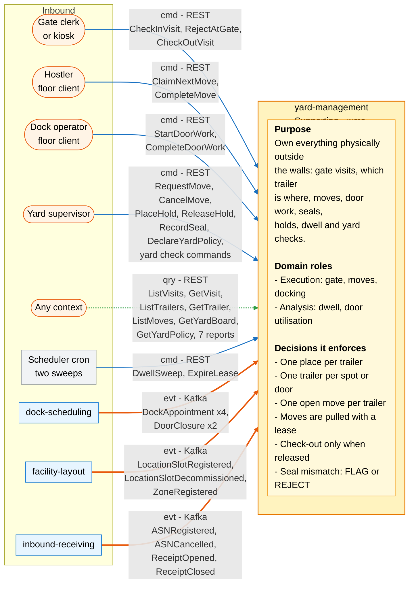
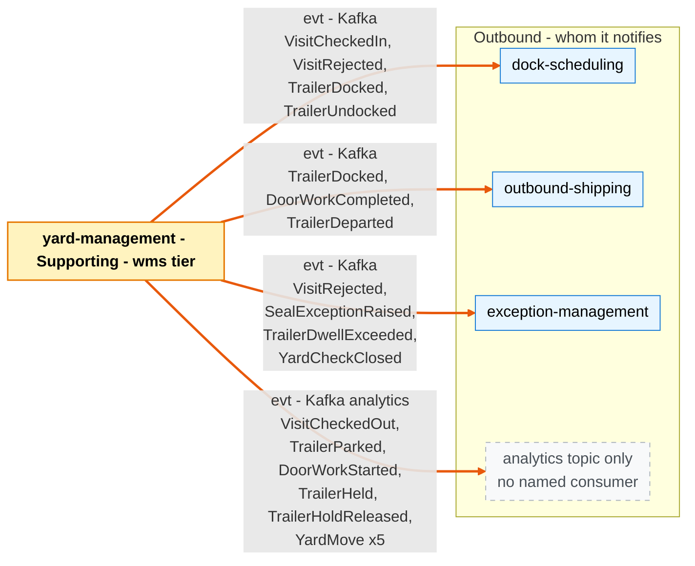

# Bounded Context Canvas

:::info[Built on develop, registered in infra, not applied]
Built on develop (merged 2026-11-08) in [IQVO/yard-management](https://github.com/IQVO/yard-management), registered in warehouse-infra develop (apps.yaml entry, helm values, dashboards and alert rules, image pinned at v0.1.1), not applied to the k3s cluster (no pods). The page still derives from [`yard/model/model.yaml`](https://github.com/IQVO/warehouse-docs/blob/main/yard/model/model.yaml); where the as-built service differs, the model and this page say so (see the as-built notes).
:::

Following the ddd-crew [Bounded Context Canvas v5](https://github.com/ddd-crew/bounded-context-canvas).
Every message row comes from `contexts[yard-management]` → `inbound`, `rest`,
`publishes`, `consumes` and `sync_calls` (empty).

## Canvas at a glance

Two pictures of the sections below: first the collaborators that command, query
or feed this context (with its purpose, roles and the decisions it enforces),
then the collaborators it notifies. Arrows follow the message type: **solid
blue** commands (`cmd`), **dotted green** queries (`qry`), **thick orange**
events (`evt`). Box shapes mark the collaborator kind: rounded = people or any
client; blue = sibling bounded context; grey = this context's own scheduler;
dashed = published only on the analytics topic. Channel names are abbreviated;
the tables carry the exact route, topic and CloudEvents type.

### Inbound

### Outbound

Derived from: `model.yaml → contexts[yard-management].inbound`, `.rest`,
`.publishes`, `.consumes`, `.policies`, `.business_decisions`, `.roles`.

Omitted: assumptions, metrics, open questions and the glossary (sections below);
the relationship pattern per message (see the tables); full CloudEvents types
and routes (see the tables). There are no outbound commands or queries:
`sync_calls` is empty, so this context calls no other context synchronously.
`DockAppointment x4` is `DockAppointmentBooked`, `Rescheduled`, `Cancelled` and
`NoShow`; `DoorClosure x2` is `DoorClosureScheduled` and `DoorClosureLifted`.

## Name

**Yard Management** (`yard-management`, code `YM`, CloudEvents tier `wms`).

## Purpose

Own everything physically on site outside the four walls: who passed the gate
(visits), which trailer is where (spot, door or an open move), its load, seal and
hold state, the moves hostlers and visiting drivers make, door work at the door,
and yard checks. The source of dwell, door occupancy and yard truck productivity
facts. `dock-scheduling` owns the future of a door; this context owns the
present of the yard.

## Strategic Classification

| Axis | Verdict |
| --- | --- |
| **Domain** | **Supporting** (see [Core Domain Chart](/yard/contexts/yard-management/core-domain-chart)). |
| **Business Model** | Cost reducer (detention, demurrage, lost trailers, idle dock labour) and throughput enabler. |
| **Evolution** | Custom-built. |

## Domain Roles

| Role | Evidence in the model |
| --- | --- |
| **Execution** (gate, moves, docking) | Runs the visit lifecycle (`CheckInVisit` … `CheckOutVisit`), the move lifecycle (`RequestMove` … `CompleteMove`) and docking (`ArriveAt`, `StartDoorWork`, `CompleteDoorWork`, `Depart`); policies `DirectOnCheckIn`, `CallToDoor`, `ClearDoorAfterWork`. |
| **Analysis** (dwell, door utilisation) | Publishes dwell, door-work and move facts on the analytics topic; read model `YardKpiReport` (dwell by kind, door utilisation, moves per hostler hour, driver wait); routes `GET /reports/yard-dwell`, `/door-utilisation`, `/hostler-productivity`. |

## Inbound Communication

| Collaborator | Message | Type | Channel | Relationship |
| --- | --- | --- | --- | --- |
| Gate clerk or kiosk | `CheckInVisit` | Command | REST `POST /visits` | UI |
| Gate clerk or kiosk | `RejectAtGate` | Command | REST `POST /visit-rejections` | UI |
| Gate clerk or kiosk | `CheckOutVisit` | Command | REST `POST /visits/{visitId}/check-outs` | UI |
| Hostler (floor client) | `ClaimNextMove` | Command | REST `POST /moves/claims` | UI |
| Hostler (floor client) | `CompleteMove` | Command | REST `POST /moves/{moveId}/completions` | UI |
| Dock operator (floor client) | `StartDoorWork` | Command | REST `POST /trailers/{trailerId}/door-work-starts` | UI |
| Dock operator (floor client) | `CompleteDoorWork` | Command | REST `POST /trailers/{trailerId}/door-work-completions` | UI |
| Yard supervisor | `RequestMove` | Command | REST `POST /moves` | UI |
| Yard supervisor | `CancelMove` | Command | REST `POST /moves/{moveId}/cancellations` | UI |
| Yard supervisor | `PlaceHold` | Command | REST `POST /trailers/{trailerId}/holds` | UI |
| Yard supervisor | `ReleaseHold` | Command | REST `POST /trailers/{trailerId}/hold-releases` | UI |
| Yard supervisor | `RecordSeal` | Command | REST `POST /trailers/{trailerId}/seals` | UI |
| Yard supervisor | `DeclareYardPolicy` | Command | REST `PUT /sites/{siteId}/yard-policy` | UI |
| Yard supervisor | `OpenYardCheck` | Command | REST `POST /yard-checks` | UI |
| Yard supervisor | `RecordObservation` | Command | REST `POST /yard-checks/{yardCheckId}/observations` | UI |
| Yard supervisor | `CloseYardCheck` | Command | REST `POST /yard-checks/{yardCheckId}/closures` | UI |
| Any context | `ListVisits` | Query | REST `GET /visits` | OHS |
| Any context | `GetVisit` | Query | REST `GET /visits/{visitId}` | OHS |
| Any context | `ListTrailers` | Query | REST `GET /trailers` | OHS |
| Any context | `GetTrailer` | Query | REST `GET /trailers/{trailerId}` | OHS |
| Any context | `ListMoves` | Query | REST `GET /moves` | OHS |
| Any context | `GetYardBoard` | Query | REST `GET /sites/{siteId}/yard-board` | OHS |
| Any context | `GetYardPolicy` | Query | REST `GET /sites/{siteId}/yard-policy` | OHS |
| Scheduler (cron) | `DwellSweep` | Command | REST `POST /dwell-sweeps` | UI |
| Scheduler (cron) | `ExpireLease` | Command | REST `POST /move-lease-sweeps` | UI |
| `dock-scheduling` | `DockAppointmentBooked` | Event | Kafka `warehouse.dock-scheduling.events`, `com.warehouse.wms.dock-scheduling.dockappointment.DockAppointmentBooked` | Customer/Supplier |
| `dock-scheduling` | `DockAppointmentRescheduled` | Event | Kafka `warehouse.dock-scheduling.events`, `com.warehouse.wms.dock-scheduling.dockappointment.DockAppointmentRescheduled` | Customer/Supplier |
| `dock-scheduling` | `DockAppointmentCancelled` | Event | Kafka `warehouse.dock-scheduling.events`, `com.warehouse.wms.dock-scheduling.dockappointment.DockAppointmentCancelled` | Customer/Supplier |
| `dock-scheduling` | `DockAppointmentNoShow` | Event | Kafka `warehouse.dock-scheduling.events`, `com.warehouse.wms.dock-scheduling.dockappointment.DockAppointmentNoShow` | Customer/Supplier |
| `dock-scheduling` | `DoorClosureScheduled` | Event | Kafka `warehouse.dock-scheduling.events`, `com.warehouse.wms.dock-scheduling.dockcalendar.DoorClosureScheduled` | Customer/Supplier |
| `dock-scheduling` | `DoorClosureLifted` | Event | Kafka `warehouse.dock-scheduling.events`, `com.warehouse.wms.dock-scheduling.dockcalendar.DoorClosureLifted` | Customer/Supplier |
| `facility-layout` | `LocationSlotRegistered` | Event | Kafka `warehouse.facility.events`, `com.warehouse.wms.facility-layout.locationslot.LocationSlotRegistered` | Conformist |
| `facility-layout` | `LocationSlotDecommissioned` | Event | Kafka `warehouse.facility.events`, `com.warehouse.wms.facility-layout.locationslot.LocationSlotDecommissioned` | Conformist |
| `facility-layout` | `ZoneRegistered` | Event | Kafka `warehouse.facility.events`, `com.warehouse.wms.facility-layout.zone.ZoneRegistered` | Conformist |
| `inbound-receiving` | `ASNRegistered` | Event | Kafka `warehouse.inbound-receiving.events`, `com.warehouse.wms.inbound-receiving.asn.ASNRegistered` | Conformist |
| `inbound-receiving` | `ASNCancelled` | Event | Kafka `warehouse.inbound-receiving.events`, `com.warehouse.wms.inbound-receiving.asn.ASNCancelled` | Conformist |
| `inbound-receiving` | `ReceiptOpened` | Event | Kafka `warehouse.inbound-receiving.events`, `com.warehouse.wms.inbound-receiving.receipt.ReceiptOpened` | Conformist |
| `inbound-receiving` | `ReceiptClosed` | Event | Kafka `warehouse.inbound-receiving.events`, `com.warehouse.wms.inbound-receiving.receipt.ReceiptClosed` | Conformist |

The CloudEvents `type` strings of the consumed events are the ones in each producer's
AsyncAPI: `apis/` for `facility-layout` and `inbound-receiving`, `yard/apis/dock-scheduling/` for
`dock-scheduling` (merged on develop).

## Outbound Communication

| Collaborator | Message | Type | Channel | Relationship |
| --- | --- | --- | --- | --- |
| `dock-scheduling` | `VisitCheckedIn` | Event | Kafka `warehouse.yard-management.events`, `com.warehouse.wms.yard-management.yardvisit.VisitCheckedIn` | Customer/Supplier (`dock-scheduling` is the Customer) |
| `dock-scheduling`, `outbound-shipping` | `TrailerDocked` | Event | Kafka `warehouse.yard-management.events`, `com.warehouse.wms.yard-management.trailer.TrailerDocked` | Customer/Supplier |
| `dock-scheduling` | `TrailerUndocked` | Event | Kafka `warehouse.yard-management.events`, `com.warehouse.wms.yard-management.trailer.TrailerUndocked` | Customer/Supplier |
| `dock-scheduling`, `exception-management` | `VisitRejected` | Event | Kafka `warehouse.yard-management.events`, `com.warehouse.wms.yard-management.yardvisit.VisitRejected` | Customer/Supplier |
| `exception-management` | `SealExceptionRaised` | Event | Kafka `warehouse.yard-management.events`, `com.warehouse.wms.yard-management.trailer.SealExceptionRaised` | Customer/Supplier |
| `exception-management` | `TrailerDwellExceeded` | Event | Kafka `warehouse.yard-management.events`, `com.warehouse.wms.yard-management.trailer.TrailerDwellExceeded` | Customer/Supplier |
| `exception-management` | `YardCheckClosed` | Event | Kafka `warehouse.yard-management.events`, `com.warehouse.wms.yard-management.yardcheck.YardCheckClosed` | Customer/Supplier |
| analytics only | `VisitCheckedOut` | Event | Kafka `warehouse.yard-management.analytics`, `com.warehouse.wms.yard-management.yardvisit.VisitCheckedOut` | PL, no named consumer |
| `outbound-shipping` | `DoorWorkCompleted`, `TrailerDeparted` | Event | Kafka `warehouse.yard-management.events`, `com.warehouse.wms.yard-management.trailer.<Event>` | Customer/Supplier (integration since 2026-11-09) |
| analytics only | `TrailerParked`, `DoorWorkStarted`, `TrailerHeld`, `TrailerHoldReleased` | Event | Kafka `warehouse.yard-management.analytics`, `com.warehouse.wms.yard-management.trailer.<Event>` | PL, no named consumer |
| analytics only | `YardMoveRequested`, `YardMoveClaimed`, `YardMoveLeaseExpired`, `YardMoveCompleted`, `YardMoveCancelled` | Event | Kafka `warehouse.yard-management.analytics`, `com.warehouse.wms.yard-management.yardmove.<Event>` | PL, no named consumer |
| — | (no synchronous calls) | — | `sync_calls: []` | — |

The relationship for `exception-management` and `outbound-shipping` is this
pack's reading: the model lists them as consumers of the events and as
`fleet_changes`, and the strategic context map marks both edges Customer/Supplier. Both
consumers are merged on `develop`. `inbound-receiving` is not a consumer of `TrailerDocked`: the optional
consumer in the model was not built. Neither context's own `inbound` rows are in this model.

Full message details: [Domain Events](/yard/contexts/yard-management/domain-events).
Relationship evidence: [Context Map](/yard/contexts/yard-management/context-map).

## Ubiquitous Language

Full glossary: [Ubiquitous Language](/yard/contexts/yard-management/ubiquitous-language).
Top terms: **Yard**, **Yard Visit** (purposes `DROP`, `LIVE_UNLOAD`, `LIVE_LOAD`,
`PICKUP`, `BOBTAIL`), **Trailer**, **Spot**, **Dock Door**, **Hostler**, **Yard
Move**, **Door Work**, **Dwell**, **Seal**.

## Business Decisions

1. **One place per trailer.** A trailer on site is at exactly one yard spot, one
   door, or one open move.
2. **One trailer per spot or door** (`ErrLocationOccupied`, under a per-location
   advisory lock and a partial unique index).
3. **One open move per trailer** (`ErrTrailerHasOpenMove`), and its destination is
   reserved when requested (`ErrDestinationReserved`).
4. **Moves are pulled.** A hostler claims the next move with a lease and holds at
   most one (`ErrHostlerBusy`); only the lease holder completes it
   (`ErrNotLeaseHolder`).
5. **Check-out only when released and sealed.** `ErrTrailerNotReleased`,
   `ErrSealRequired`.
6. **Walk-ins go to a holding spot** unless the site's policy requires an
   appointment (`ErrAppointmentRequired`).
7. **Seal mismatch raises an exception;** `REJECT` policy also rejects the visit.
8. **A trailer on hold is not docked** (`ErrTrailerOnHold`); **a docked trailer
   departs only when its door work is done** (`ErrDoorWorkOpen`).
9. **A door under a closure takes no trailer** (`ErrDoorClosed`); a loaded trailer
   docks only at a door whose flow allows its direction (`ErrDoorFlowMismatch`).
10. **At most one open yard check per site** (`ErrYardCheckOpen`).

## Assumptions

- `facility-layout` publishes every Yard and Dock slot with `zoneId`, `role` and
  `dockFlow`, and every zone with its `siteCode`; a door or spot is mapped to its
  site only through that join, never by parsing a location code.
- `dock-scheduling` publishes an appointment's `door_code`, window and
  `expected_seal_number`, and its closures, before the carrier arrives.
- `inbound-receiving` opens a receipt on the appointment with `appointment_id`
  and `door_code` (`ReceiptOpened`), and closes it (`ReceiptClosed`).
- Yard events are keyed by visit or trailer id, so `dock-scheduling` may see
  them in any order across partitions (its policy `OutOfOrderYardFacts`).
- Consumers rebuild their copies from events only; there is no synchronous call
  into or out of this context on a decision path.

## Verification Metrics

Neither the model nor the service states targets; the targets below are this page's proposal. The measures
are the ones `YardKpiReport` names or the invariants imply.

| Metric | Target | Source |
| --- | --- | --- |
| Trailers on site in more than one place | 0 | `trailers` check |
| Spots or doors holding more than one trailer | 0 | partial unique index, `trailers` check |
| Dwell by trailer kind | report weekly | `TrailerDeparted.dwell_minutes` on the analytics topic |
| Door utilisation | report weekly | `TrailerDocked`, `TrailerUndocked`, `DoorWorkStarted`, `DoorWorkCompleted` |
| Moves per hostler hour | report weekly | `YardMoveCompleted.duration_seconds` |
| Driver wait (arrival to door work started) | report weekly | `VisitCheckedIn.arrived_at`, `DoorWorkStarted.started_at` |
| Expired leases per day | trend to 0 | `POST /move-lease-sweeps` result |
| `ErrLocationOccupied` or `ErrDestinationReserved` refusals | trend to 0 | use-case error counter |
| Late or unknown appointment facts ignored by `dock-scheduling` | trend to 0 | `dock-scheduling` ignored-and-counted metric |
| Lag from `TrailerUndocked` to the next `YardMoveRequested` for that door | p95 under one minute | event timestamps |

## Closed questions

The gaps this page used to list were decided before the build (decisions Y-1 to Y-14, X1 to X7; the
register is [Model Gap Register](/yard/strategic-design/model-gap-register)) and are in the service; how each was
settled is in the hotspot table on [EventStorming](/yard/contexts/yard-management/eventstorming#hotspots). In
short: a lease expiry or a cancelled claimed move returns the trailer where it was (`ReturnToOrigin`, `YM-G1`);
the gate creates the trailer `IN_MOVE` with a visiting-driver move that the gate clerk or dock operator completes
(`YM-G2`, `YM-G3`); the arrival tolerance travels on the dock-scheduling booking events and the appointment copy
marks itself `CHECKED_IN` and `USED` (`YM-G5`, `YM-G6`); a refused check-in creates nothing while `RejectAtGate`
records a rejected visit (`YM-G7`); `ArriveAt` and the departure commands raise the location events (`YM-G8`); a
live visit leaves from the door (`YM-G28`); the report routes have an `inbound` row of their own (`YM-G26`).
