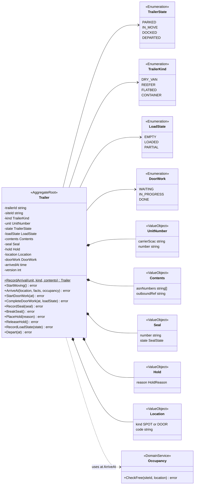
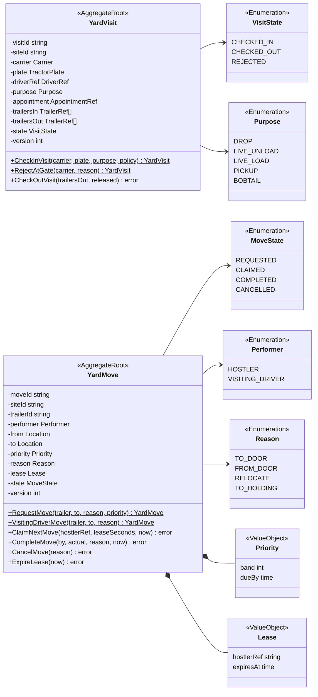
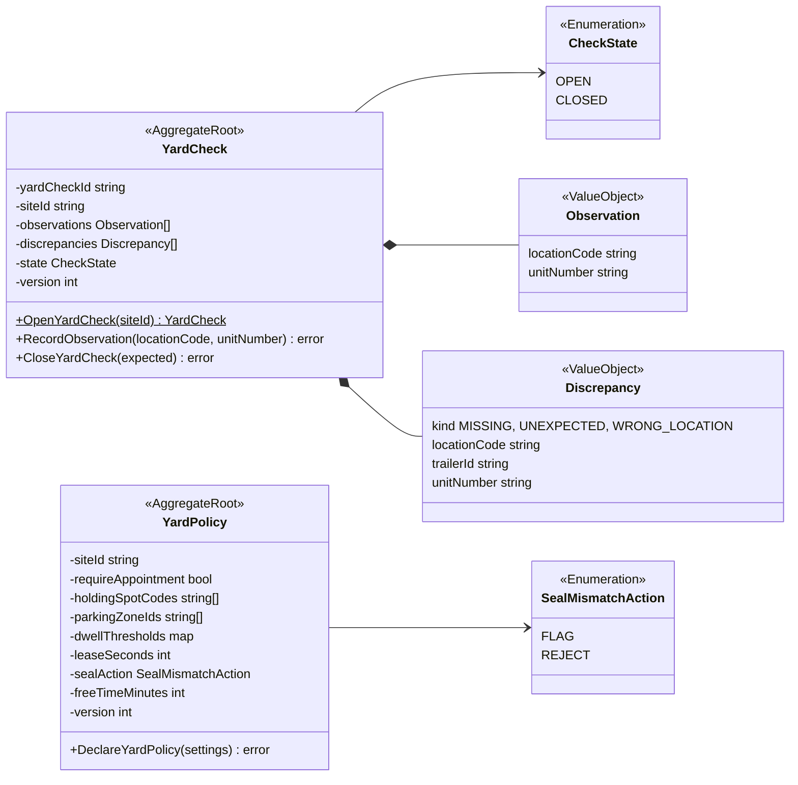
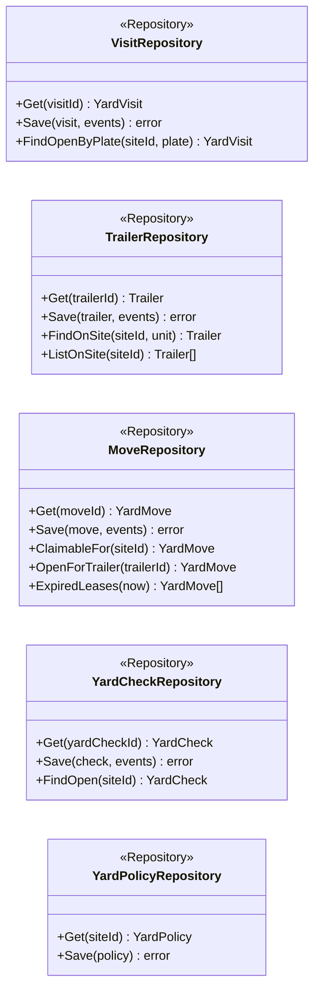
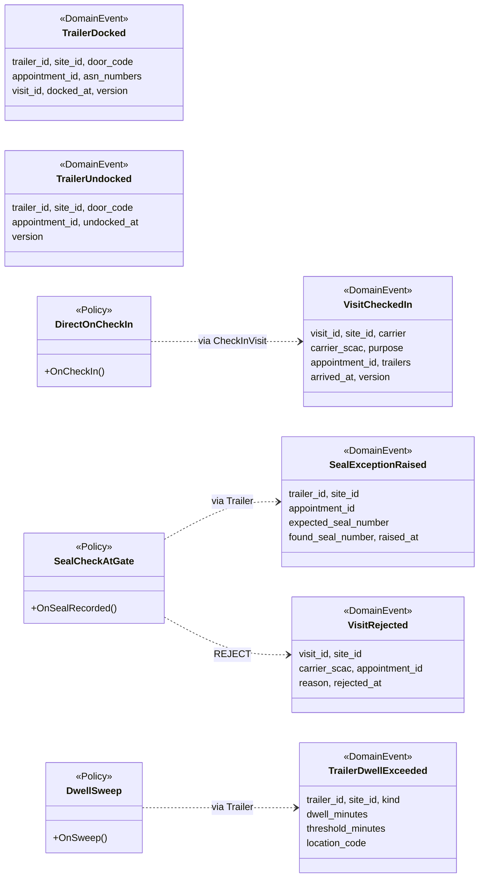
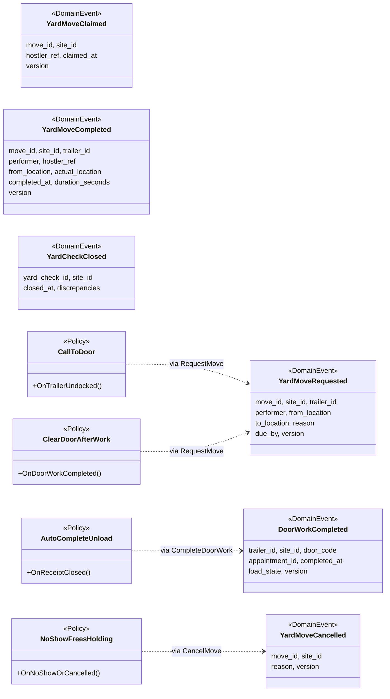
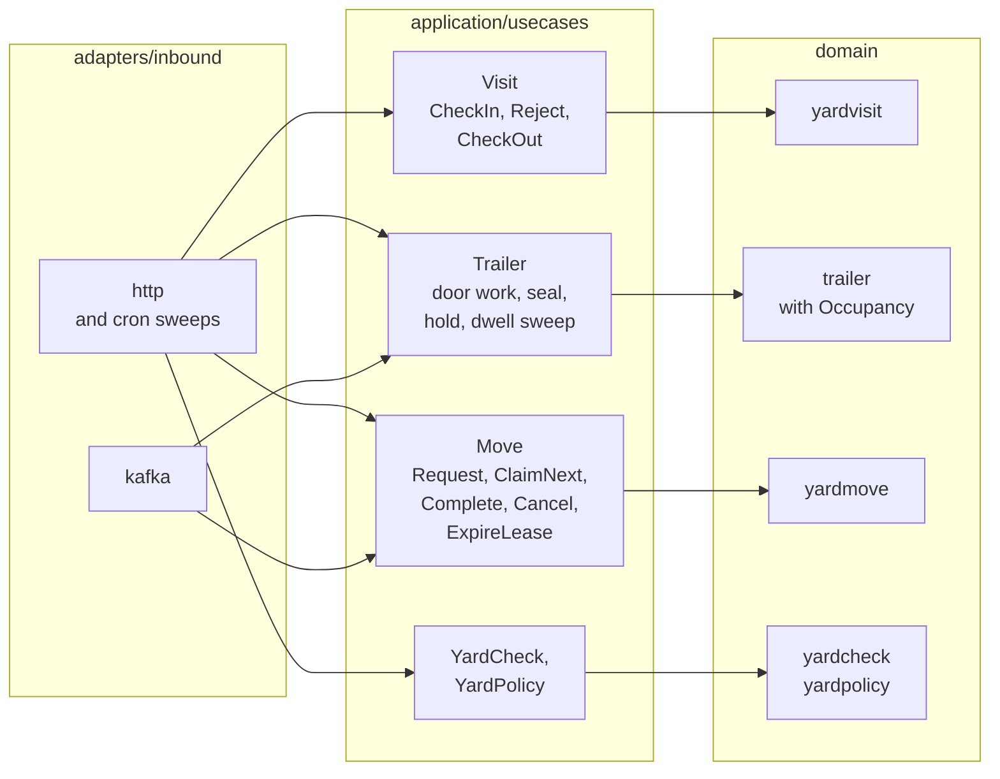
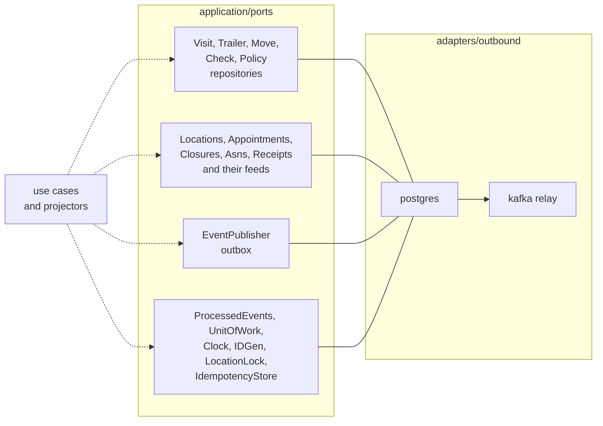

# Class Diagram

:::info[Built, released at v0.1.2, applied to k3s (reduced footprint)]
Built on develop (merged 2026-11-08) in [IQVO/yard-management](https://github.com/IQVO/yard-management), released at v0.1.2 (first release v0.1.0 on 2026-11-09) and applied to the k3s cluster on 2026-11-10 in a reduced footprint: dock-scheduling runs its API only (it relays inline); yard-management runs its API and relay. Their MCP servers, analytics projectors, report services and sweeps are registered in warehouse-infra but switched off until the cluster has room, so the KPI reports of yard-management ADR 0011 are released, not yet served. The page still derives from [`yard/model/model.yaml`](https://github.com/IQVO/warehouse-docs/blob/main/yard/model/model.yaml); where the as-built service differs, the model and this page say so (see the as-built notes).
:::

UML class diagrams of the `internal/domain/**` packages of the built service (`yardvisit`,
`trailer`, `yardmove`, `yardcheck`, `yardpolicy`, and `shared`), then the hexagonal ports and
adapters in the Go layout the fleet uses. Type and field names come from
`model.yaml`, whose Go identifiers were reconciled with the code (the aggregate roots are `yardvisit.Visit`,
`trailer.Trailer`, `yardmove.Move`, `yardcheck.Check`, `yardpolicy.Policy`); method names are the model's commands.
The drawings are not generated from the code, so a method or field may differ in detail. Fields are shown `-`
(unexported), methods `+`.

## 1. Trailer aggregate and the Occupancy service

Derived from: `model.yaml → contexts[yard-management].aggregates[Trailer]`
(`value_objects`, `states`, `commands`, `invariants`), `.publishes[TrailerDeparted].data`.

Omitted: the error variables (see
[Aggregate Design Canvas](/yard/contexts/yard-management/aggregate-design-canvas)),
`HoldReason` (`DAMAGED`, `SEAL_BROKEN`, `NOT_FOUND`, `QUALITY`, `SECURITY`) and
`SealState` (`INTACT`, `BROKEN`, `NONE`) enumerations, read accessors. `ArriveAt`
receives the facts it cannot know alone (closure, door flow, active slot) from the use
case; `Occupancy.CheckFree` runs under a per-location advisory lock, with a partial
unique index as backstop. `RecordArrival` is drawn as a constructor; it creates the trailer `IN_MOVE`
together with its first move (decision Y-1).

## 2. YardVisit and YardMove aggregates

Derived from: `model.yaml → contexts[yard-management].aggregates[YardVisit, YardMove]`
(`value_objects`, `states`, `commands`), `.publishes[YardMoveCompleted].data`.

Omitted: `Carrier{name, scac?}`, `TractorPlate`, `DriverRef`, `AppointmentRef`,
`RejectionReason` and `TrailerRef` (the shape of `TrailersIn[]` and `TrailersOut[]` is
given in the OpenAPI of the service: `checkInVisit` and `checkOutVisit`); the error variables.
`VisitingDriverMove` is drawn as a constructor named after the policy; the move is created `CLAIMED` with no lease and
the dock operator or gate clerk completes it (decisions Y-1, Y-3). `ClaimNextMove` is a method of the aggregate and its
selection is the repository's claim query: lowest band, then earliest `due_by`, then request time (decision Y-11). `released` is the fact
the use case computes from the trailers and moves.

## 3. YardCheck and YardPolicy aggregates

Derived from: `model.yaml → contexts[yard-management].aggregates[YardCheck, YardPolicy]`.

Omitted: `ErrYardCheckOpen`, `ErrLocationAlreadyObserved`, `ErrUnknownLocation`,
`ErrValidation`. `expected` in `CloseYardCheck` is the places the model holds for the
observed locations, passed in by the use case (the discrepancy rules are decision Y-11). A site with
no declared `YardPolicy` answers the defaults (`require_appointment` false, `seal_mismatch_action` `FLAG`,
`lease_seconds` 300).

### Repositories

One repository per aggregate root (the ports of the next view). `ClaimableFor` backs
`ClaimNextMove` (the order is decision Y-11); `OpenForTrailer` and `FindOpenByPlate`
back `ErrTrailerHasOpenMove` and `ErrVisitAlreadyOpen`.

## 4. Events and policies

Visit and trailer events:

Move, door-work and check events:

Derived from: `model.yaml → contexts[yard-management].publishes`, `.policies`.

Omitted: the CloudEvents envelope (see
[Domain Events](/yard/contexts/yard-management/domain-events)); the events not drawn
(`VisitCheckedOut`, `TrailerParked`, `DoorWorkStarted`, `TrailerDeparted`, `TrailerHeld`,
`TrailerHoldReleased`, `YardMoveLeaseExpired`) are raised directly by their commands, not by a policy, and carry
the fields listed there; the policies `VisitingDriverMove` and `LeaseExpirySweep` (the
sweep returns expired moves to `REQUESTED` and raises `YardMoveLeaseExpired`, decision Y-10). The seven
read models (`LocationView`, `AppointmentView`, `DoorClosureView`, `AsnContentView`,
`ReceiptAtDoorView`, `YardBoardView`, `YardKpiReport`) are projections, shown in the
ports view below.

## 5. Hexagonal ports and adapters

Inbound side: adapters, use cases and domain packages.

Outbound side: the ports every use case calls and their adapters.

Derived from: `model.yaml → contexts[yard-management].inbound`, `.consumes`,
`.read_models`, `.policies`, `conventions.integration_rules` (own database,
transactional outbox, idempotent consumers, Postgres and Kafka only).

All paths are under `internal/` (`internal/adapters/inbound/{http,kafka,mcp}`,
`internal/application/usecases`, `internal/domain`, `internal/application/ports`,
`internal/adapters/outbound/{postgres,kafka,analyticsstore,memory,system}`). The service has five binaries under
`cmd/` (`api`, `mcp`, `relay`, `yard-projector`, `yard-reports`); `http` is the `api` binary and `mcp` serves the
14 tools of the service's MCP server (8 reads, 6 L3 writes). The ports are named as in `ports.go`: the five
repositories, the read ports `Locations`, `Appointments`, `Closures`, `Asns` and `Receipts` with a feed each,
`LocationLock`, `EventPublisher`, `ProcessedEvents`, `IDGen`, `Clock`, `IdempotencyStore` and `UnitOfWork`. The
KPI reports read an analytics store (`analyticsstore`) fed from the analytics topic. The dashed arrows mean every use case
calls ports only: the repository of its aggregate, the event publisher (outbox), the
inbox, the unit of work and, for occupancy, the per-location lock. `http` drives the gate,
hostler, dock operator and supervisor commands and the two sweeps (a CronJob calls
`POST /dwell-sweeps` and `POST /move-lease-sweeps`, so there is no `scheduler` adapter),
`kafka` drives the event policies (`CallToDoor`, `AutoCompleteUnload`,
`NoShowFreesHolding`), which call the trailer and move use cases, and the read-model
projectors (updates of `LocationView`, `AppointmentView` and the other views, not drawn
as a node).

Omitted: the HTTP read path (the `GET` routes read the repositories and read models
directly); `Clock` has no adapter package. There are no outbound HTTP clients:
`sync_calls` is empty. A gate camera, ANPR or kiosk is a further inbound adapter that
issues `CheckInVisit`, not a new context.
