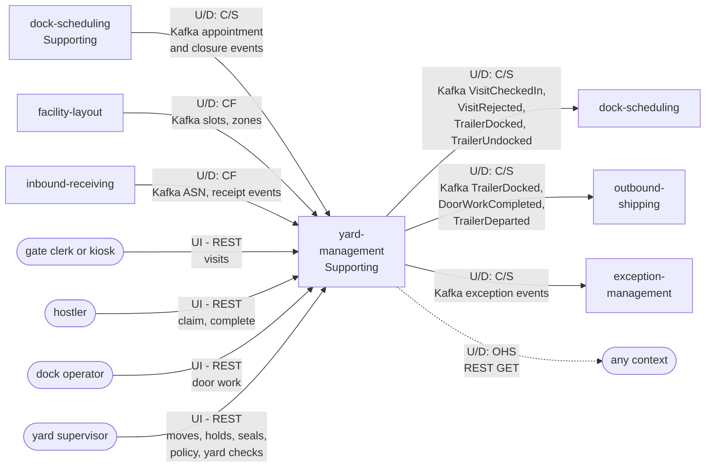

# Context Map

:::info[Built, released at v0.1.2, applied to k3s (reduced footprint)]
Built on develop (merged 2026-11-08) in [IQVO/yard-management](https://github.com/IQVO/yard-management), released at v0.1.2 (first release v0.1.0 on 2026-11-09) and applied to the k3s cluster on 2026-11-10 in a reduced footprint: dock-scheduling runs its API only (it relays inline); yard-management runs its API and relay. Their MCP servers, analytics projectors, report services and sweeps are registered in warehouse-infra but switched off until the cluster has room, so the KPI reports of yard-management ADR 0011 are released, not yet served. The page still derives from [`yard/model/model.yaml`](https://github.com/IQVO/warehouse-docs/blob/main/yard/model/model.yaml); where the as-built service differs, the model and this page say so (see the as-built notes).
:::

Following ddd-crew [Context Mapping](https://github.com/ddd-crew/context-mapping).
This is **yard-management's slice** of the
[yard context map](/yard/strategic-design/context-map): every relationship it
has, with the upstream (U) and downstream (D) side, the pattern and the
channel. Abbreviations: OHS = Open Host Service, PL = Published Language,
CF = Conformist, C/S = Customer/Supplier.

Derived from: `model.yaml → contexts[yard-management].inbound`,
`.publishes[*].consumers`, `.consumes`; the matching `inbound` rows of
`contexts[dock-scheduling]` (which list `yard-management` as a Customer/Supplier
source); `fleet_changes`.

Legend: arrows point from upstream to downstream. Solid = events or commands;
dotted = synchronous query. `dock-scheduling` appears twice because it is on both sides: it feeds
this context and consumes from it. `inbound-receiving` only feeds it: as built it does not consume
`TrailerDocked`.
People are rounded boxes.

Omitted: Kafka and Postgres as infrastructure; the analytics-only events
(`warehouse.yard-management.analytics`), which have no named consumer; the
fleet's other edges of `dock-scheduling` (`warehouse-planning`,
`process-path-management`), which this context has no message with. **Retail
network:** no edge at all. The model's `hard_boundary` forbids this context from
consuming any `retailnetwork.*` topic or calling a retail-network service; the
only channel to the network stays `network-fulfillment` and the Vendor API.

## Relationships

| Neighbour | Direction | Pattern | Channel | Messages | Why this pattern |
| --- | --- | --- | --- | --- | --- |
| `dock-scheduling` | Upstream | **Customer/Supplier** (this context is the Customer) | Kafka `warehouse.dock-scheduling.events` | `DockAppointmentBooked`, `DockAppointmentRescheduled`, `DockAppointmentCancelled`, `DockAppointmentNoShow`, `DoorClosureScheduled`, `DoorClosureLifted` | The model lists this context among the named consumers of these events. They feed `AppointmentView` and `DoorClosureView`, which gate check-in (`ErrAppointmentRequired`), direct a trailer to its door and refuse a closed door. |
| `dock-scheduling` | Downstream | **Customer/Supplier** (`dock-scheduling` is the Customer) | Kafka `warehouse.yard-management.events` | `VisitCheckedIn`, `VisitRejected`, `TrailerDocked`, `TrailerUndocked` | Physical facts win ([YD-0004](/yard/adr/yd-0004-physical-facts-win)): `dock-scheduling` applies arrival (`ArrivalFromGate`), the actual door (`ActualDoorWins`) and door release (`CompleteOnDoorRelease`) from them. Neither context writes into the other's aggregates. |
| `facility-layout` | Upstream | **Conformist** | Kafka `warehouse.facility.events` | `LocationSlotRegistered`, `LocationSlotDecommissioned`, `ZoneRegistered` | A registry for every context; it does not adapt to this one. Roles `Yard` and `Dock`, `dockFlow` and `zoneId` to `siteCode` are taken as given into `LocationView`. |
| `inbound-receiving` | Upstream | **Conformist** | Kafka `warehouse.inbound-receiving.events` | `ASNRegistered`, `ASNCancelled`, `ReceiptOpened`, `ReceiptClosed` | ASNs say what an inbound trailer holds (`AsnContentView`); receipts at a door close the unload (`AutoCompleteUnload`, via `ReceiptAtDoorView`). |
| `outbound-shipping` | Downstream | **Customer/Supplier** (this pack's reading) | Kafka `warehouse.yard-management.events` | `TrailerDocked`, `DoorWorkCompleted`, `TrailerDeparted` | Ship-confirm follows the physical departure: a closed load is confirmed shipped when its trailer leaves the site (`outbound-shipping` is merged on `develop` but not registered in warehouse-infra: no apps.yaml entry, no chart; the two door-work and departure events moved to the integration topic for it, service ADR 0010). The optional `inbound-receiving` consumer of `TrailerDocked` the model named was not built. |
| `exception-management` | Downstream | **Customer/Supplier** (this pack's reading) | Kafka `warehouse.yard-management.events` | `VisitRejected`, `SealExceptionRaised`, `TrailerDwellExceeded`, `YardCheckClosed` | The model lists it as consumer; `fleet_changes` records a new consumer that opens problem cases (one per yard-check discrepancy). |
| Gate clerk or kiosk | Upstream (person / device) | UI on this context's REST | REST `POST /visits`, `POST /visit-rejections`, `POST /visits/{visitId}/check-outs` | `CheckInVisit`, `RejectAtGate`, `CheckOutVisit` | The gate is operated by a person or issued by an adapter (kiosk, camera, ANPR) around `CheckInVisit`. |
| Hostler | Upstream (person, floor client) | UI | REST `POST /moves/claims`, `POST /moves/{moveId}/completions` | `ClaimNextMove`, `CompleteMove` | Hostlers pull work; nothing is pushed. |
| Dock operator | Upstream (person, floor client) | UI | REST `POST /trailers/{trailerId}/door-work-starts`, `.../door-work-completions` | `StartDoorWork`, `CompleteDoorWork` | Door work is recorded by the people doing it. |
| Yard supervisor | Upstream (person, console) | UI | REST moves, holds, seals, yard policy, yard checks | `RequestMove`, `CancelMove`, `PlaceHold`, `ReleaseHold`, `RecordSeal`, `DeclareYardPolicy`, `OpenYardCheck`, `RecordObservation`, `CloseYardCheck` | Supervision and exceptions. |
| Scheduler (cron) | Upstream (CronJob) | UI | REST `POST /dwell-sweeps`, `POST /move-lease-sweeps` | `DwellSweep`, `ExpireLease` | Time-driven rules; both sweeps are idempotent. |
| Any context | Downstream | **OHS** | REST `GET /visits`, `/trailers`, `/moves`, `/sites/{siteId}/yard-board`, `/sites/{siteId}/yard-policy`, `/reports/*` (served by `yard-reports`) | `ListVisits`, `GetVisit`, `ListTrailers`, `GetTrailer`, `ListMoves`, `GetYardBoard`, `GetYardPolicy` | Read access for tools and diagnostics; no context depends on it for a decision (decision paths use events). |
| `warehouse-console`, `warehouse-floor-client`, `warehouse-ops-agent` | Downstream clients | **OHS** (read) and UI (screens) | REST and MCP tools | Yard Board remote; gate, hostler and dock operator screens (the console and floor-client work is not checked here); the service's own MCP tools: 8 L1 reads and 6 L3 writes | `fleet_changes` first said the ops agent has no write tools; as built the service's MCP server has six L3 write tools that need a human approval. |

## Notes on the patterns

- **A mutual Customer/Supplier pair, not a Shared Kernel.** `dock-scheduling` and
  this context consume each other's events and share no tables, code or write
  path. The flows are independent (plan versus physical), and each keeps an
  event-fed local copy of what it needs.
- **Conformist upstream for registries.** `facility-layout` and `inbound-receiving`
  publish one language for all consumers; this context takes it as given.
- **No Anti-Corruption Layer.** All neighbours are in the same organization and
  share the [CloudEvents standard](/yard/strategic-design/event-standard-cloudevents);
  translation is limited to projecting events into local read models. A future
  `transport-visibility` context would add one (ACL to an external ETA feed) on
  the `dock-scheduling` side, not here.
- **No synchronous call in either direction** (`sync_calls: []`). The site of a
  door or spot comes from the `LocationView` join of `LocationSlotRegistered.zoneId`
  and `ZoneRegistered{zoneId, siteCode}`.
