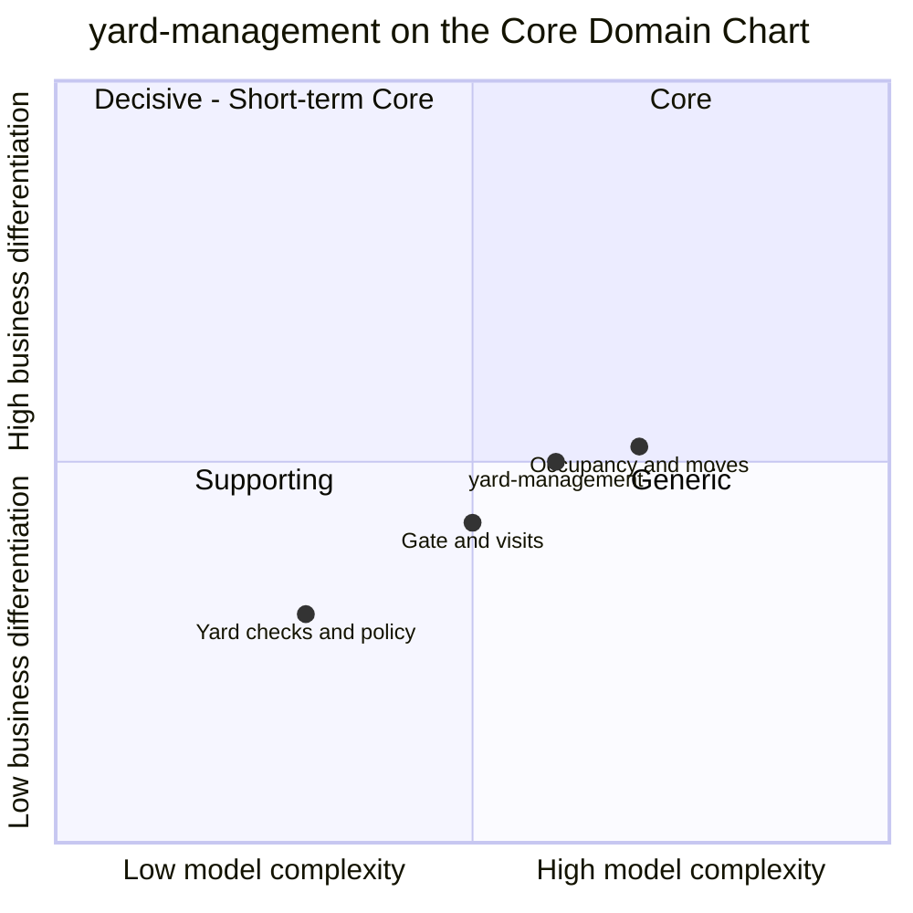

# Core Domain Chart

:::info[Built on develop, not deployed]
Built on develop (merged 2026-11-08) in [IQVO/yard-management](https://github.com/IQVO/yard-management), not deployed: registered nowhere in warehouse-infra. The page still derives from [`yard/model/model.yaml`](https://github.com/IQVO/warehouse-docs/blob/main/yard/model/model.yaml); where the as-built service differs, the model and this page say so (see the as-built notes).
:::

Following the ddd-crew [Core Domain Charts](https://github.com/ddd-crew/core-domain-charts):
business differentiation (y) against model complexity (x). The yard-wide
classification is on
[Subdomain Classification](/yard/strategic-design/subdomain-classification).

Derived from: `model.yaml → contexts[yard-management].chart`
(`complexity: 0.60`, `differentiation: 0.50`, `evolution: Custom-built`),
`.aggregates[Trailer, YardMove, YardVisit, YardCheck, YardPolicy]`.

Omitted: the other context, `dock-scheduling` (its own chart: complexity 0.45,
differentiation 0.40, Product). The three internal slices are **this pack's
reading** of the model, not values from `model.yaml`.

**The point sits on the chart's centre line.** The model classifies the context
`Supporting` with differentiation exactly 0.50 and complexity 0.60, which the
quadrant renderer draws on the middle of the y axis and right of the middle of
the x axis. The quadrant labels are a rendering convention; the classification
comes from the model (gap YM-G25, accepted: the chart sits on the line by design).

## Classification: Supporting

The model classifies the context `Supporting`, business model *Cost reducer
(detention, demurrage, lost trailers, idle dock labour) and throughput
enabler*.

**Differentiation is moderate (y = 0.50).** Every site with trucks needs a yard
record, and the rules that vary (seal policy, dwell thresholds, whether an
appointment is required) differ per operator rather than per product. The
platform does not win on them; see [Benchmarks](/yard/research/benchmarks). It
is higher than `dock-scheduling` (0.40), in this pack's reading, because the yard produces facts nobody
else has (dwell, door occupancy, yard-truck productivity) and drives the
`dock-scheduling` calendar with them (arrival, docking, door release).

**Model complexity is high-moderate (x = 0.60).** Five aggregates, the most
stateful of the two yard contexts: `Trailer` (four states plus door work),
`YardMove` (four states, a lease), `YardVisit` (three states), `YardCheck` and
`YardPolicy`. Twenty-four commands, nine policies and twenty-five invariants, one of which
spans two aggregates (a spot or door holds at most one trailer, under a
per-location advisory lock and a partial unique index). The hard parts are
concurrent and cross-aggregate: occupancy races, lease expiry, and events that
arrive out of order across partitions at `dock-scheduling`.

## Evolution

| Part | Evolution stage | Why |
| --- | --- | --- |
| Occupancy and moves (one place per trailer, claim-next with a lease) | **Custom-built** | The model's own invariant over trailers and moves; the pull-with-lease shape is copied from `fulfillment-execution`. |
| Gate, visits and seal check | **Custom-built** | Site-policy driven (appointment required or not, `FLAG` or `REJECT`). A kiosk or ANPR front-end is an adapter around it. |
| Yard checks and yard policy | **Custom-built → Product** | Audit and per-site settings are common yard-system functions; a product could replace them if it published the same events. |
| Plumbing (outbox, inbox, CloudEvents) | **Commodity** | The same building blocks as every context (see [CloudEvents standard](/yard/strategic-design/event-standard-cloudevents)). |

**Movement to watch.** If the platform competed on yard throughput itself
(trailer prioritisation by shortage or cross-dock content, nearest-to-door spot
selection, engineered move standards, autonomous yard trucks), the occupancy and
moves slice would move right and up, towards Core. The model defers all of those
(phase 2 or later; autonomous trucks are a reserved device-control seam, not a
context). Today `DirectOnCheckIn` picks the first free spot by location code.
