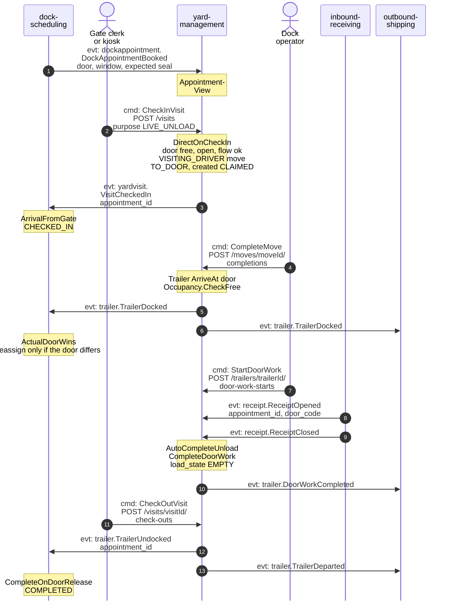
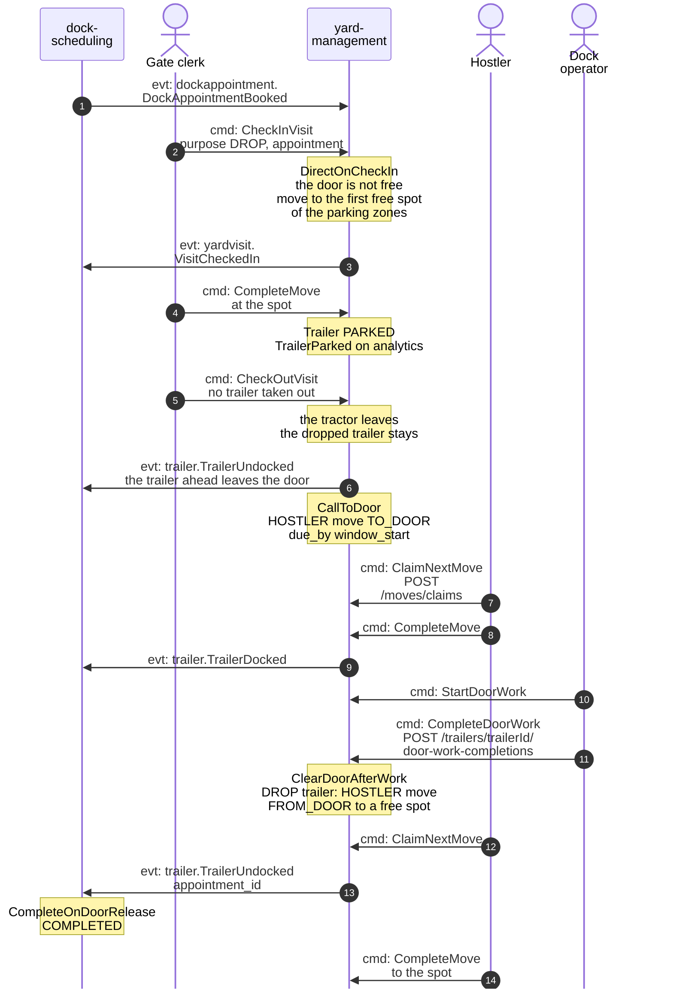
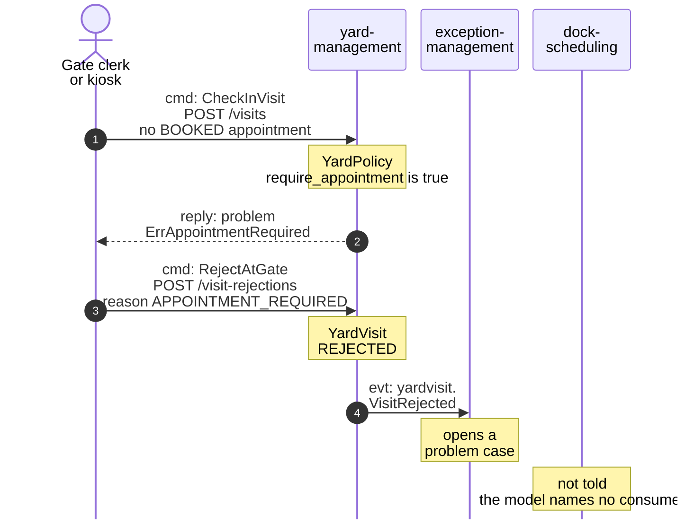
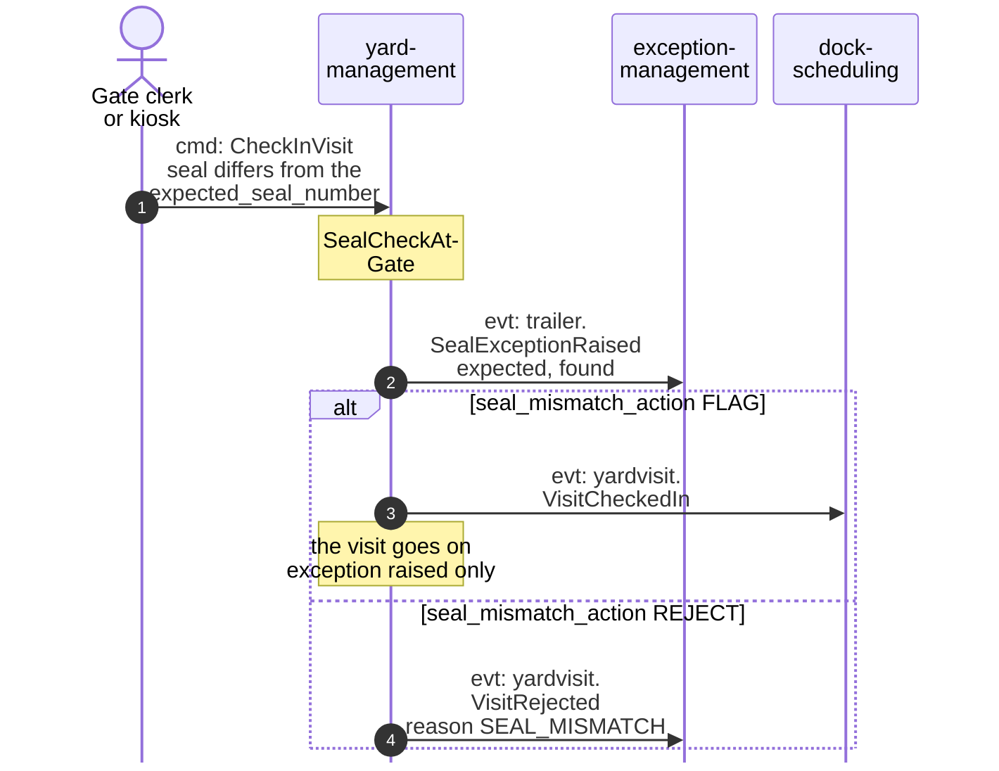
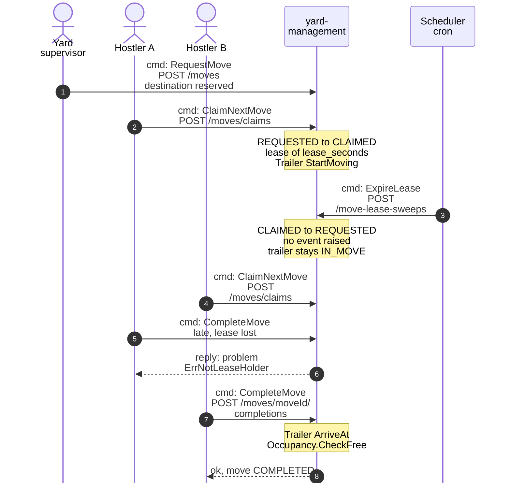
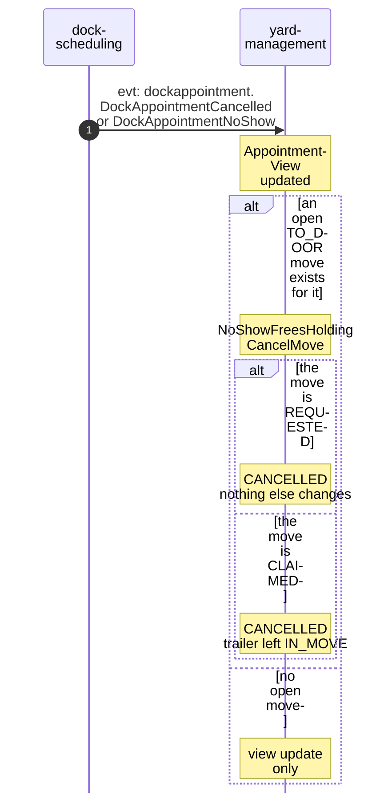

# Domain Message Flow

:::info[Built on develop, not deployed]
Built on develop (merged 2026-11-08) in [IQVO/yard-management](https://github.com/IQVO/yard-management), not deployed: registered nowhere in warehouse-infra. The page still derives from [`yard/model/model.yaml`](https://github.com/IQVO/warehouse-docs/blob/main/yard/model/model.yaml); where the as-built service differs, the model and this page say so (see the as-built notes).
:::

Following ddd-crew [Domain Message Flow Modelling](https://github.com/ddd-crew/domain-message-flow-modelling).
Participants are contexts and actors. Every arrow is a message from `model.yaml`,
prefixed `cmd:`, `qry:` or `evt:`. Events are written `entity.EventName`; the full
type is `com.warehouse.wms.<producer>.<entity>.<EventName>` (see
[Domain Events](/yard/contexts/yard-management/domain-events)). Route parameters are
written without braces. Events on the analytics topic only
(`warehouse.yard-management.analytics`) are not drawn as arrows. The yard-wide flows
are on [Strategic Design](/yard/strategic-design/).

## 1. Live unload: from booking to door release

Derived from: `model.yaml → contexts[yard-management].inbound`, `.policies[DirectOnCheckIn,
VisitingDriverMove, AutoCompleteUnload]`, `.publishes[VisitCheckedIn, TrailerDocked,
TrailerUndocked]`, `.consumes`; `contexts[dock-scheduling].policies[ArrivalFromGate,
ActualDoorWins, CompleteOnDoorRelease]`.

Omitted: analytics events (`VisitCheckedOut`, `DoorWorkStarted`, `YardMove*`); the `receipt` work itself
(`inbound-receiving`'s). `TrailerDocked`, `DoorWorkCompleted` and `TrailerDeparted` are read by `outbound-shipping`
(merged on `develop`); `inbound-receiving` is not a consumer of `TrailerDocked` as built. `ArriveAt` raises
`TrailerDocked`, and `CheckOutVisit` calls `Depart` for the trailer, which raises `TrailerUndocked` from the
door and then `TrailerDeparted` (decisions Y-6 and Y-2: a released trailer is parked, or docked with door work
`DONE`). The gate clerk or dock operator completes the visiting driver's move (decision Y-3). The order of
`StartDoorWork` and `ReceiptOpened` is not fixed; `AutoCompleteUnload` completes door work from `WAITING` or
`IN_PROGRESS` once every ASN on the trailer has a closed receipt (decision Y-7).

## 2. Drop, then the door call and the return to a spot

Derived from: `model.yaml → contexts[yard-management].policies[DirectOnCheckIn, CallToDoor,
ClearDoorAfterWork, VisitingDriverMove]`, `.aggregates[Trailer, YardMove, YardVisit]`,
`.publishes`; `contexts[dock-scheduling].policies[CompleteOnDoorRelease]`.

Omitted: `YardMoveRequested`, `YardMoveClaimed` and `YardMoveCompleted` (analytics only);
how `CallToDoor` chooses among several `PARKED` trailers (the next appointment of that
door by `window_start`). The appointment completes when `dock-scheduling` reads `TrailerUndocked`, and the trailer leaves the
door when the `FROM_DOOR` move is claimed (`StartMoving` from `DOCKED`; decision Y-6). A move to a plain
parking spot has the reason `TO_SPOT` (decision Y-4). A drop's trailer carries its `appointment_id`, set at
arrival (decision X3).

## 3. Gate rejection: an appointment is required

Derived from: `model.yaml → contexts[yard-management].aggregates[YardVisit]`
(`invariants`, `commands`), `.publishes[VisitRejected]`, `.reasons[RejectionReason]`,
`.business_decisions`; `fleet_changes[exception-management]`.

Omitted: the other reasons (`UNKNOWN_APPOINTMENT`, `TRAILER_ALREADY_ON_SITE`,
`SITE_REQUEST`). A refused `CheckInVisit` (`ErrAppointmentRequired`) creates nothing, and `RejectAtGate` records a
`REJECTED` visit; the two-step flow shown is decision Y-5. `dock-scheduling` consumes `VisitRejected` and
cancels a `BOOKED` appointment with the reason `TURNED_AWAY` (decision X2), so it no longer waits for the no-show
sweep.

### 3b. Seal mismatch at the gate

Derived from: `model.yaml → contexts[yard-management].policies[SealCheckAtGate]`,
`.aggregates[YardPolicy]` (`seal_mismatch_action`), `.reasons[RejectionReason]`,
`.publishes[SealExceptionRaised, VisitRejected]`.

Omitted: the other `Trailer` and `YardVisit` events of a normal check-in. The
seal number is recorded at the gate on the trailer entry of the check-in (a missing seal raises nothing) and
`RecordSeal` is the supervisor route; when the visit is then rejected (`REJECT` policy) the
`SealExceptionRaised` has a null `trailer_id` (decisions Y-5, Y-13; assumptions A9 and A10).

## 4. A hostler claims a move, the lease expires, another hostler completes it

Derived from: `model.yaml → contexts[yard-management].aggregates[YardMove]`
(`transitions`, `invariants`), `.policies[LeaseExpirySweep]`, `.inbound`, `.rest`.

Omitted: the analytics events `YardMoveRequested`, `YardMoveClaimed`,
`YardMoveLeaseExpired` and `YardMoveCompleted`; the result when nobody re-claims the move (a late `CompleteMove`
from `REQUESTED` is `ErrIllegalTransition`); `ErrHostlerBusy` when a hostler already
holds a `CLAIMED` move. The expiry returns the move to `REQUESTED` and `ReturnToOrigin` puts the trailer back where
`StartMoving` found it, in the same unit of work (decision Y-1); the expiry raises `YardMoveLeaseExpired`
(decision Y-10). There is no lease renewal.

## 5. An appointment is cancelled while a door call is open

Derived from: `model.yaml → contexts[yard-management].policies[NoShowFreesHolding]`,
`.consumes[dock-scheduling]`, `.aggregates[YardMove].transitions`.

Omitted: what the policy does for a `DockAppointmentRescheduled` to another door. The move is found
through the `appointment_id` that `YardMove` carries (decision X3, `YardMoveRequested` has the field). Cancelling
a `CLAIMED` hostler move runs `ReturnToOrigin` in the same unit of work, so the trailer goes back where it was
(decision Y-1); when that origin has been taken meanwhile the trailer stays `IN_MOVE` and the move
`REQUESTED` for the supervisor to re-plan (assumption A16). A `CHECKED_IN` appointment cancelled with the
trailer on site is settled by decision Y-14.
