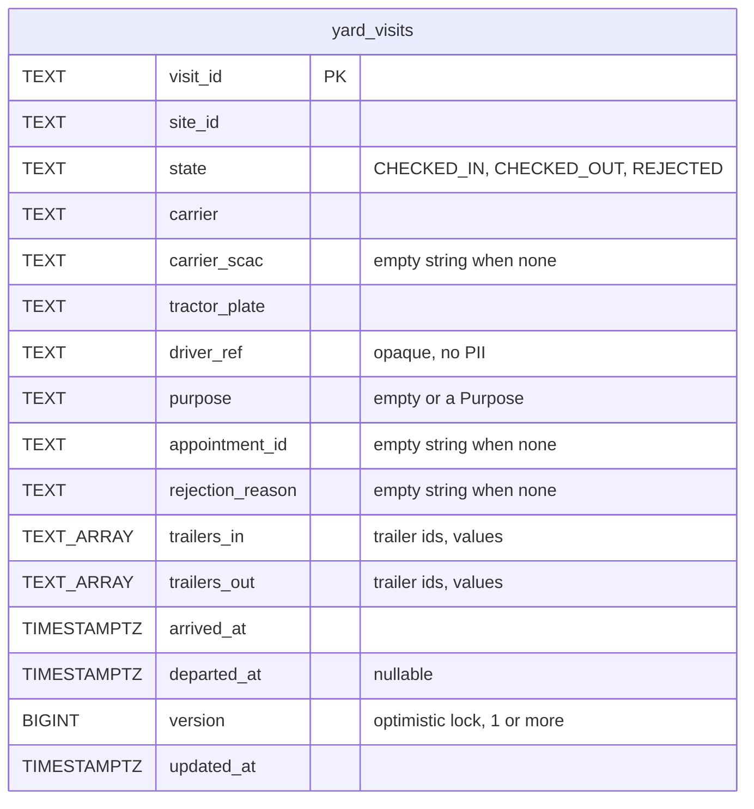
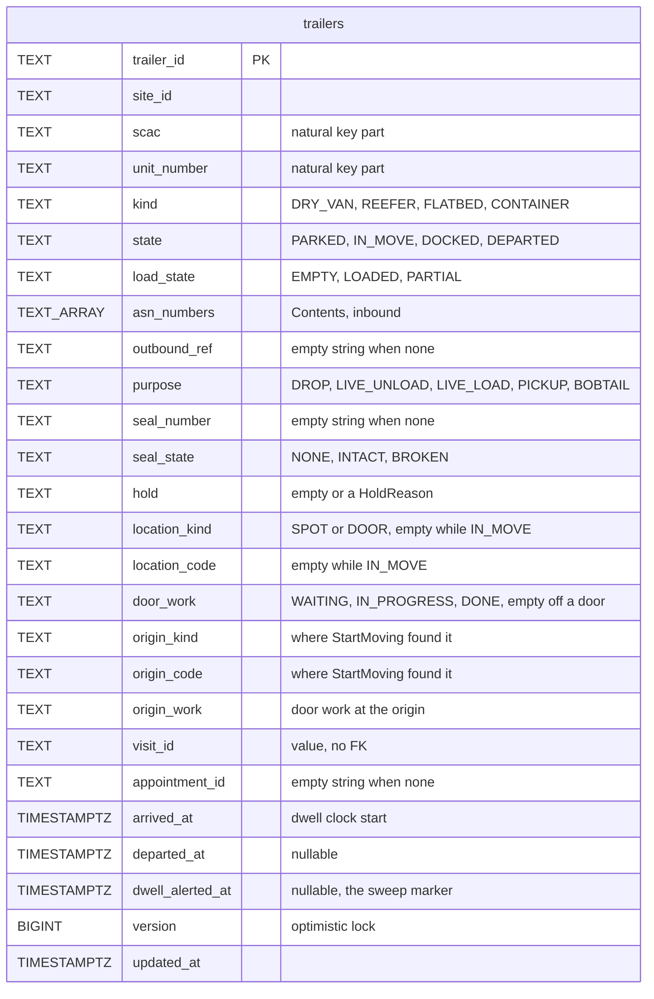
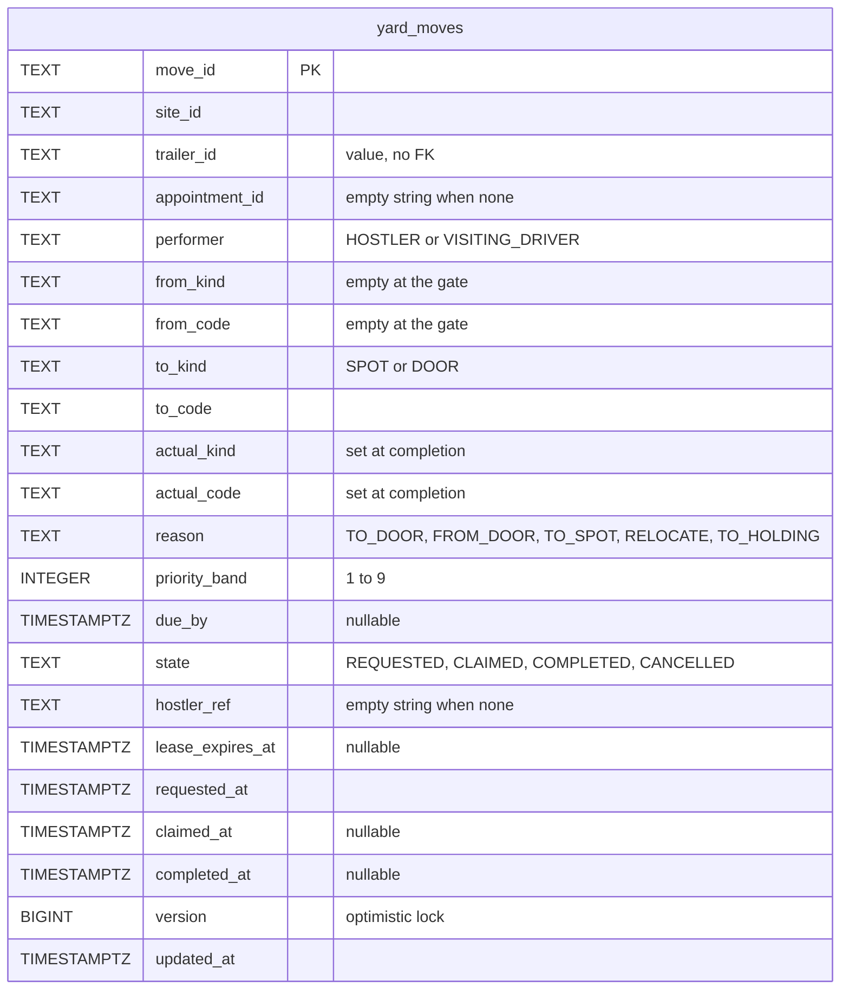
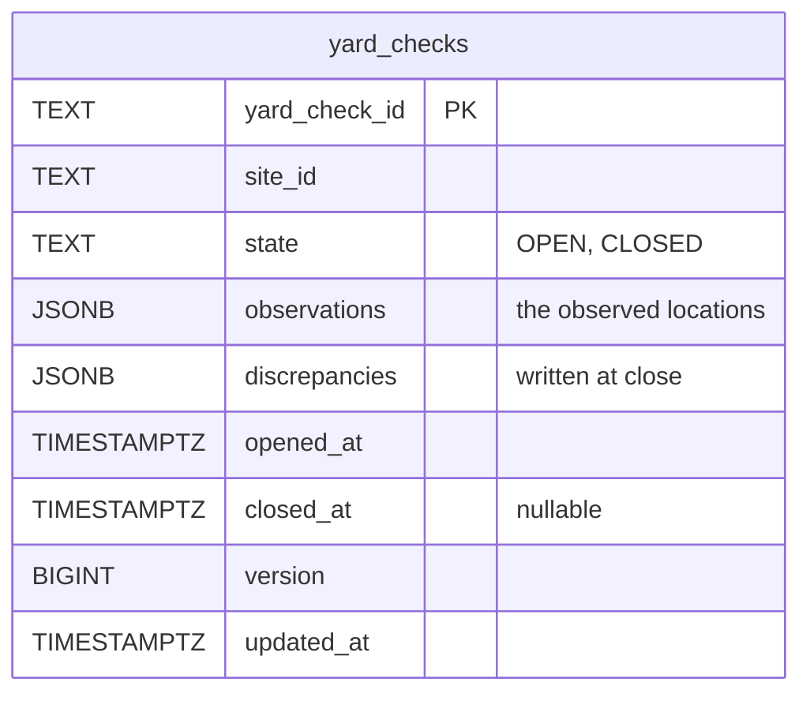
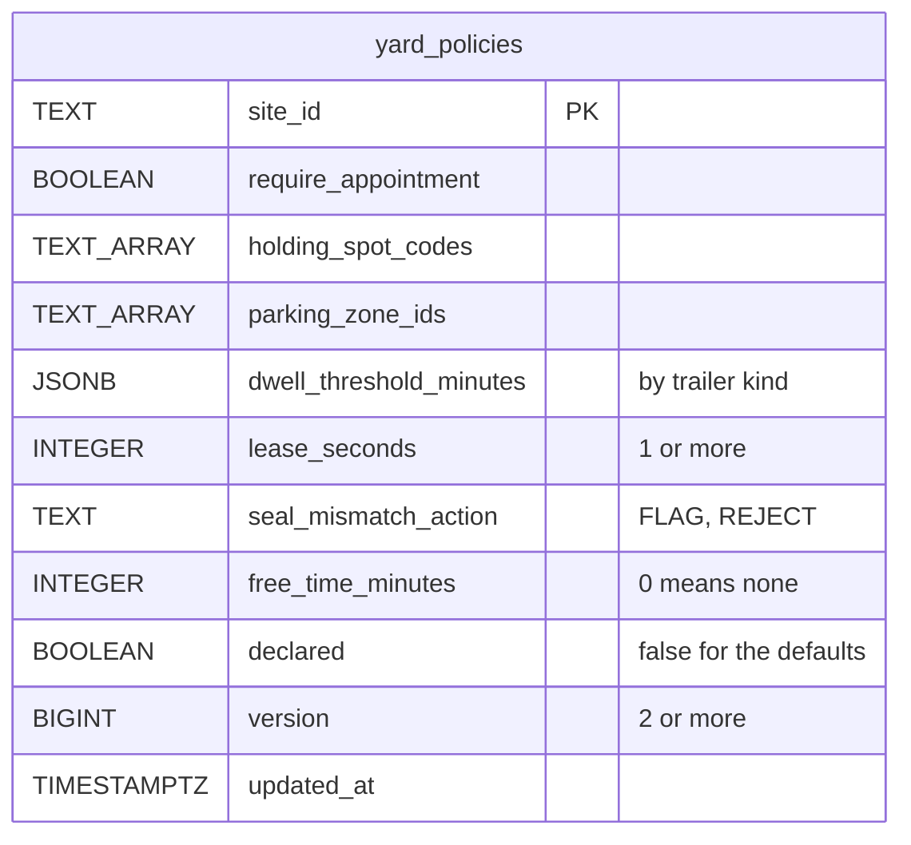
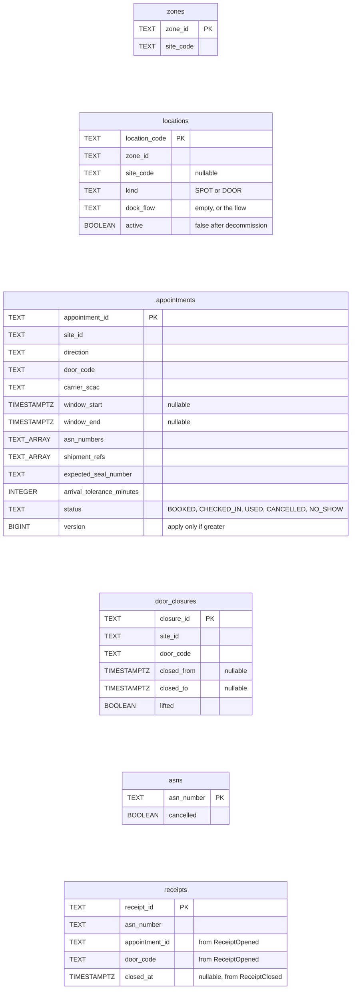
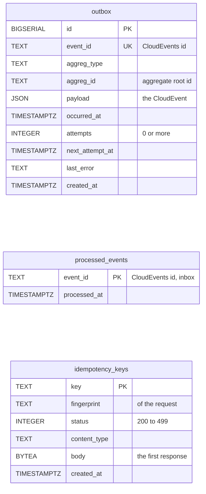
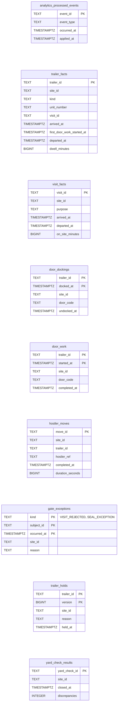

# Entity Relationship

:::info[Built on develop, registered in infra, not applied]
Built on develop (merged 2026-11-08) in [IQVO/yard-management](https://github.com/IQVO/yard-management), registered in warehouse-infra develop (apps.yaml entry, helm values, dashboards and alert rules, image pinned at v0.1.1), not applied to the k3s cluster (no pods). The page still derives from [`yard/model/model.yaml`](https://github.com/IQVO/warehouse-docs/blob/main/yard/model/model.yaml); where the as-built service differs, the model and this page say so (see the as-built notes).
:::

The Postgres schema **as built**, from the service's migrations `migrations/0001_yard-management` and
`0002_idempotency_keys` (OLTP) and `analytics/migrations/0001_yard_analytics` and `0002_kpi_standard` (the `analytics`
schema). This context owns its database; no table is shared with another context
(`conventions.integration_rules`). Postgres and Kafka are the only runtime. Columns are drawn with the types
of the migration, simplified (`COLLATE "C"` and defaults are left out). The earlier version of this page proposed a
different shape: child tables for the visit's trailers, the check's observations and the policy's lists, and a
`schema_migrations` table; as built those lists are array and `JSONB` columns of the root row, and the
outbox is a smaller table.

## Aggregate tables

### YardVisit

### Trailer

### YardMove

### YardCheck

### YardPolicy

Derived from: `model.yaml → contexts[yard-management].aggregates` (`YardVisit`,
`Trailer`, `YardMove`, `YardCheck`, `YardPolicy`: root ids, states, value objects,
invariants), `.publishes[*].data` and `.as_built.tables`.

Omitted: the rest of the indexes (`idx_*` lookups by site, arrival, appointment and expiry). The invariants a
database can hold are held by these:

| Invariant | Error | Index or lock as built |
| --- | --- | --- |
| A spot or door holds at most one trailer | `ErrLocationOccupied` | Per-location advisory lock inside `Occupancy.CheckFree` plus the partial unique index `uq_trailers_one_per_location` on `trailers (location_kind, location_code)` where the state is `PARKED` or `DOCKED` |
| The natural key is unique among trailers on site | `ErrTrailerAlreadyOnSite` | `uq_trailers_unit_on_site` on `trailers (site_id, scac, unit_number)` where state is not `DEPARTED` |
| A trailer has at most one open move | `ErrTrailerHasOpenMove` | `uq_yard_moves_one_open_per_trailer` on `yard_moves (trailer_id)` where state is `REQUESTED` or `CLAIMED` |
| No two open moves share a destination | `ErrDestinationReserved` | `uq_yard_moves_open_destination` on `yard_moves (to_kind, to_code)` where state is `REQUESTED` or `CLAIMED` |
| A hostler holds at most one `CLAIMED` move | `ErrHostlerBusy` | `uq_yard_moves_one_claim_per_hostler` on `yard_moves (site_id, hostler_ref)` where state is `CLAIMED` |
| At most one `CHECKED_IN` visit per plate per site | `ErrVisitAlreadyOpen` | `uq_yard_visits_one_open_per_plate` on `yard_visits (site_id, tractor_plate)` where state is `CHECKED_IN` |
| At most one `OPEN` yard check per site | `ErrYardCheckOpen` | `uq_yard_checks_one_open_per_site` on `yard_checks (site_id)` where state is `OPEN` |
| A location is observed once per check | `ErrLocationAlreadyObserved` | The use case, over the `observations` column (no table) |
| A parked or docked trailer has a place | none | `CHECK` on `trailers`: state `PARKED` or `DOCKED` if and only if `location_code` is not empty |
| `ClaimNextMove` finds the next move | none | `idx_yard_moves_claimable` on `yard_moves (site_id, priority_band, due_by NULLS LAST, requested_at, move_id)` where state is `REQUESTED` and performer is `HOSTLER` |
| Lease sweep | none | `idx_yard_moves_expiry` on `yard_moves (lease_expires_at)` where state is `CLAIMED` and performer is `HOSTLER` |

The location columns are empty while the trailer is `IN_MOVE`, so a moving trailer holds no place; the origin is
kept in `origin_*` for `ReturnToOrigin` (decision Y-1). `appointment_id` and `dwell_alerted_at` are columns of
`trailers` (decisions X3 and Y-13). The migration gives `yard_policies.version` a floor of 2 and the table a
`declared` flag: a site that never declared a policy is answered by the defaults, as version 1.

## Read-model tables

Derived from: `model.yaml → contexts[yard-management].read_models`, and the `data` of
the consumed events in `.consumes` (`LocationSlotRegistered`, `ZoneRegistered`, the
`dock-scheduling` events, `ASNRegistered`, `ReceiptOpened`, `ReceiptClosed`).

Omitted: the event fields not used by a decision here, and the lookup indexes. The site of a door or spot is
derived by joining `locations.zone_id` to `zones.zone_id` (`site_code` is
`facility-layout`'s `siteCode`, the `site_id` on every yard event; the migration also keeps a `site_code` on the
location); it is never parsed from a location code. The appointment copy marks itself `CHECKED_IN` from the yard's
own `VisitCheckedIn` and `USED` from its own `TrailerUndocked` (decision X4). The `asns` copy keeps only the number
and a cancelled flag; the ASN lines are not stored. `YardBoardView` has no table: it is a query
over `trailers` and `yard_moves`. The KPI reports are built from the analytics topic into the `analytics` schema
below, not from these tables.

## Infrastructure tables

Derived from: `model.yaml → conventions.integration_rules` (transactional outbox, idempotent consumers on the
CloudEvents id, `Idempotency-Key`), `conventions.cloudevents` (topics `warehouse.yard-management.events` and
`warehouse.yard-management.analytics`, key = aggregate root id).

**All three are infrastructure, not domain.** `outbox` is written in the same transaction as the aggregate and
drained by the `relay` binary to Kafka; `attempts`, `next_attempt_at` and `last_error` track the retries. The table
has no topic column; which topic an event goes to is decided by the relay, not by the schema (19 types on the
analytics topic, 9 of them also on the events topic). `processed_events` is the inbox: one row per consumed
CloudEvents `id`, written in the same transaction as the effect. `idempotency_keys` stores the first response to a
REST `Idempotency-Key`, with a request fingerprint. The migration tool's own bookkeeping table is not part of the SQL.

## Analytics schema

The KPI reports (service ADR 0011) read a separate `analytics` schema, written only by the `yard-projector` binary from
the analytics topic and read by `yard-reports` (that split is from the service's binary layout, not checked in the
code). The migrations grant read access to a `yard_analytics_reader` role when it exists.

Derived from: `model.yaml → contexts[yard-management].as_built.analytics_tables`.

Omitted: the indexes. No table here has a foreign key. Each is a projection of the analytics topic.

## Why no foreign key crosses an aggregate or a context

- **Across aggregates.** `yard_visits.trailers_in`, `yard_moves.trailer_id`, `trailers.visit_id`,
  `trailers.appointment_id` and `yard_visits.appointment_id` are values, not foreign keys, and the migration has no
  `REFERENCES` clause at all. `YardVisit`, `Trailer` and `YardMove` are separate consistency boundaries; the
  occupancy rule that spans them is held by a domain service, a lock and a partial
  unique index, not by a foreign key. A foreign key would couple lifecycles (a departed
  trailer could not be archived without its visit and moves).
- **To other contexts.** `site_id`, `appointment_id`, `door_code`, `asn_number`,
  `receipt_id` and the location codes name things owned by `facility-layout`,
  `dock-scheduling` and `inbound-receiving`. Those live in other databases; this context
  only holds event-fed copies (the read-model tables above).

## Table ≠ aggregate

| Table | Aggregate / role | Notes |
| --- | --- | --- |
| `yard_visits` | **YardVisit** (root) | One row per visit, including a rejected one; the trailers in and out are array columns. |
| `trailers` | **Trailer** (root) | One row per trailer; the occupancy and natural-key indexes live here. |
| `yard_moves` | **YardMove** (root) | One row per move; the open-move, destination and hostler indexes live here. |
| `yard_checks` | **YardCheck** (root) | One row per check; observations and discrepancies are `JSONB` columns. |
| `yard_policies` | **YardPolicy** (root) | One row per site that declared a policy; the lists are array and `JSONB` columns replaced as a set by `DeclareYardPolicy`. |
| `locations`, `zones` | read model `LocationView` | From `facility-layout`. |
| `appointments` | read model `AppointmentView` | From `dock-scheduling`. |
| `door_closures` | read model `DoorClosureView` | From `dock-scheduling`. |
| `asns` | read model `AsnContentView` | From `inbound-receiving`. |
| `receipts` | read model `ReceiptAtDoorView` | From `inbound-receiving`. |
| `outbox` | none (infrastructure) | Transactional outbox. |
| `processed_events` | none (infrastructure) | Inbox. |
| `idempotency_keys` | none (infrastructure) | REST replay store. |
| `analytics.*` (9 tables) | read model `YardKpiReport` | Projected from the analytics topic. |
