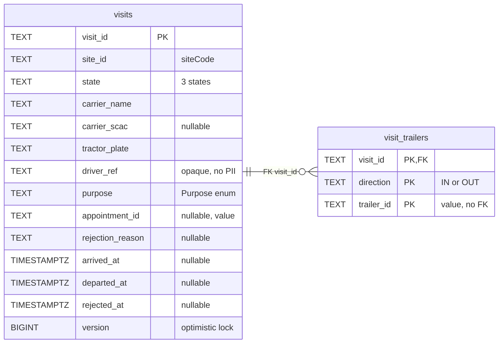
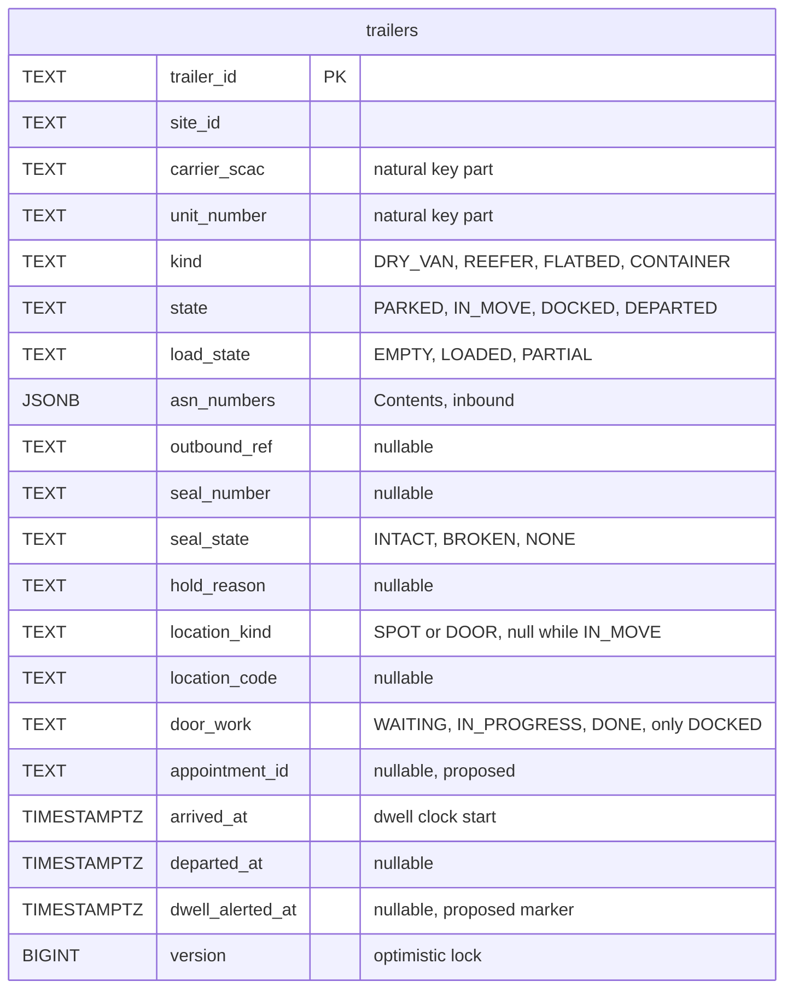
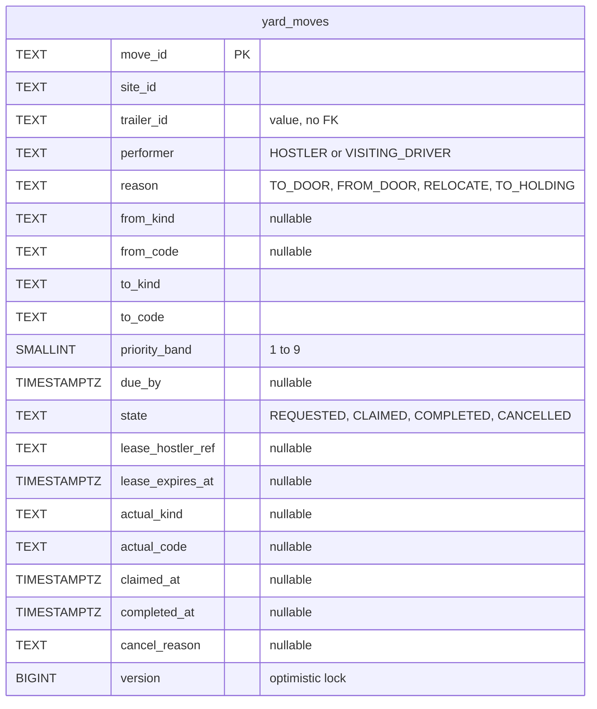
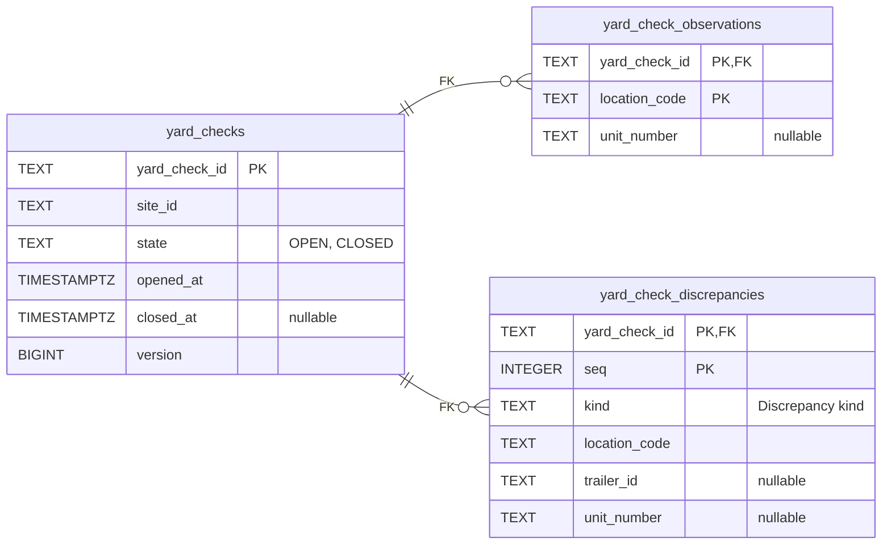
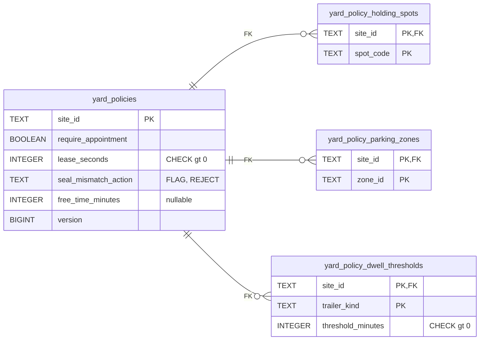
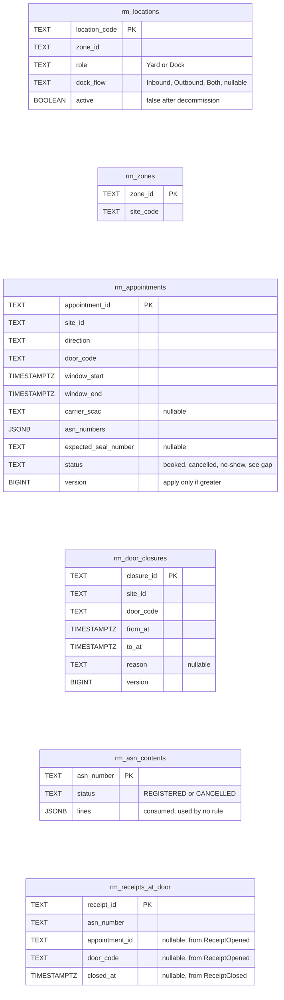
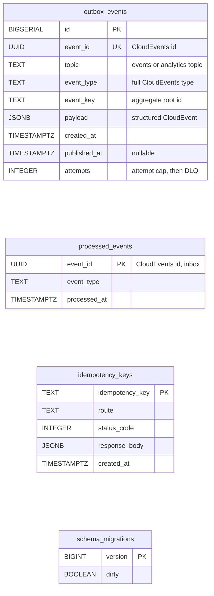

# Entity Relationship

:::info[Proposed design]
Derived from [`yard/model/model.yaml`](https://github.com/IQVO/warehouse-docs/blob/main/yard/model/model.yaml). This context's service is not built yet; identifiers (`Err...` names, REST paths, CloudEvents types) are the names the service will use.
:::

The **proposed** Postgres schema. This context owns its database; no table is shared
with another context (`conventions.integration_rules`). A relationship line is drawn
only where a foreign key would exist, and only inside one aggregate. Postgres and Kafka
are the only runtime: there is no in-memory mode. Everything not named in the model
(column names, types, the indexes other than the occupancy one) is **proposed**.

## Aggregate tables

### YardVisit

### Trailer

### YardMove

### YardCheck

### YardPolicy

Derived from: `model.yaml → contexts[yard-management].aggregates` (`YardVisit`,
`Trailer`, `YardMove`, `YardCheck`, `YardPolicy`: root ids, states, value objects,
invariants) and `.publishes[*].data`.

Omitted: the indexes. Proposed, enforcing the invariants where a database can:

| Invariant | Error | Proposed index or lock |
| --- | --- | --- |
| A spot or door holds at most one trailer | `ErrLocationOccupied` | Per-location advisory lock inside `Occupancy.CheckFree` (the model) plus a **partial unique index** on `trailers (site_id, location_kind, location_code)` where the state is `PARKED` or `DOCKED` (the model names the index, not its columns) |
| The natural key is unique among trailers on site | `ErrTrailerAlreadyOnSite` | Unique `trailers (site_id, carrier_scac, unit_number)` where state is not `DEPARTED` |
| A trailer has at most one open move | `ErrTrailerHasOpenMove` | Unique `yard_moves (trailer_id)` where state is `REQUESTED` or `CLAIMED` |
| No two open moves share a destination | `ErrDestinationReserved` | Unique `yard_moves (site_id, to_kind, to_code)` where state is `REQUESTED` or `CLAIMED` |
| A hostler holds at most one `CLAIMED` move | `ErrHostlerBusy` | Unique `yard_moves (lease_hostler_ref)` where state is `CLAIMED` |
| At most one `CHECKED_IN` visit per plate per site | `ErrVisitAlreadyOpen` | Unique `visits (site_id, tractor_plate)` where state is `CHECKED_IN` |
| At most one `OPEN` yard check per site | `ErrYardCheckOpen` | Unique `yard_checks (site_id)` where state is `OPEN` |
| A location is observed once per check | `ErrLocationAlreadyObserved` | The primary key of `yard_check_observations` |
| `ClaimNextMove` finds the next move | — | `yard_moves (site_id, priority_band, due_by)` where state is `REQUESTED` and performer is `HOSTLER`; read with `FOR UPDATE SKIP LOCKED` |
| Lease sweep | — | `yard_moves (lease_expires_at)` where state is `CLAIMED` |

`trailers.location_kind` and `location_code` are null while the trailer is `IN_MOVE`, so
a moving trailer holds no place (this pack's reading of "one place", gap YM-G11).
`trailers.appointment_id` and `dwell_alerted_at` are columns the model has no value object
for (gaps YM-G9, YM-G21). Comparison operators are written `gt` inside the diagrams.

## Read-model tables

Derived from: `model.yaml → contexts[yard-management].read_models`, and the `data` of
the consumed events in `.consumes` (`LocationSlotRegistered`, `ZoneRegistered`, the
`dock-scheduling` events, `ASNRegistered`, `ReceiptOpened`, `ReceiptClosed`).

Omitted: the event fields not used by a decision here. The site of a door or spot is
derived by joining `rm_locations.zone_id` to `rm_zones.zone_id` (`site_code` is
`facility-layout`'s `siteCode`, the `site_id` on every yard event); it is never parsed
from a location code. `rm_appointments.status` cannot hold `CHECKED_IN` or `COMPLETED`
from the consumed events alone (gap YM-G6). `YardBoardView` has no table: it is a query
over `trailers` and `yard_moves`. `YardKpiReport` is built from the analytics topic, not
from this database.

## Infrastructure tables

Derived from: `model.yaml → conventions.integration_rules` (transactional outbox with
attempt cap and DLQ, idempotent consumers on the CloudEvents id, `Idempotency-Key`),
`conventions.cloudevents` (topics `warehouse.yard-management.events` and
`warehouse.yard-management.analytics`, key = aggregate root id).

**All four are infrastructure, not domain.** `outbox_events` is written in the same
transaction as the aggregate and drained by the relay to Kafka; the `topic` column
separates the 7 integration events from the 11 analytics-only ones. `processed_events` is
the inbox: one row per consumed CloudEvents `id`, written in the same transaction as the
effect. `idempotency_keys` stores the first response to a REST `Idempotency-Key`.
`schema_migrations` is the migration tool's bookkeeping.

## Why no foreign key crosses an aggregate or a context

- **Across aggregates.** `visit_trailers.trailer_id`, `yard_moves.trailer_id`,
  `trailers.appointment_id` and `visits.appointment_id` are values, not foreign keys.
  `YardVisit`, `Trailer` and `YardMove` are separate consistency boundaries; the
  occupancy rule that spans them is held by a domain service, a lock and a partial
  unique index, not by a foreign key. A foreign key would couple lifecycles (a departed
  trailer could not be archived without its visit and moves).
- **To other contexts.** `site_id`, `appointment_id`, `door_code`, `asn_number`,
  `receipt_id` and the location codes name things owned by `facility-layout`,
  `dock-scheduling` and `inbound-receiving`. Those live in other databases; this context
  only holds event-fed copies (`rm_...`).

## Table ≠ aggregate

| Table | Aggregate / role | Notes |
| --- | --- | --- |
| `visits` | **YardVisit** (root) | One row per visit, including a rejected one. |
| `visit_trailers` | **YardVisit** (its in and out lists) | Values only. |
| `trailers` | **Trailer** (root) | One row per trailer; the occupancy and natural-key indexes live here. |
| `yard_moves` | **YardMove** (root) | One row per move; the open-move, destination and hostler indexes live here. |
| `yard_checks` | **YardCheck** (root) | One row per check. |
| `yard_check_observations`, `yard_check_discrepancies` | **YardCheck** (its children) | Written at record and at close. |
| `yard_policies` | **YardPolicy** (root) | One row per site. |
| `yard_policy_holding_spots`, `yard_policy_parking_zones`, `yard_policy_dwell_thresholds` | **YardPolicy** (its lists) | Replaced as a set by `DeclareYardPolicy`. |
| `rm_locations`, `rm_zones` | read model `LocationView` | From `facility-layout`. |
| `rm_appointments` | read model `AppointmentView` | From `dock-scheduling`. |
| `rm_door_closures` | read model `DoorClosureView` | From `dock-scheduling`. |
| `rm_asn_contents` | read model `AsnContentView` | From `inbound-receiving`. |
| `rm_receipts_at_door` | read model `ReceiptAtDoorView` | From `inbound-receiving`. |
| `outbox_events` | none (infrastructure) | Transactional outbox. |
| `processed_events` | none (infrastructure) | Inbox. |
| `idempotency_keys` | none (infrastructure) | REST replay store. |
| `schema_migrations` | none (infrastructure) | Migrations. |
