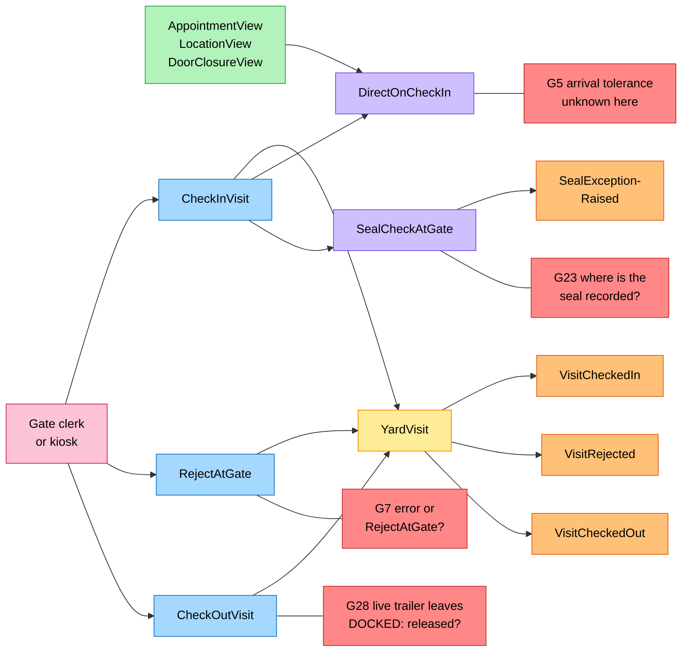
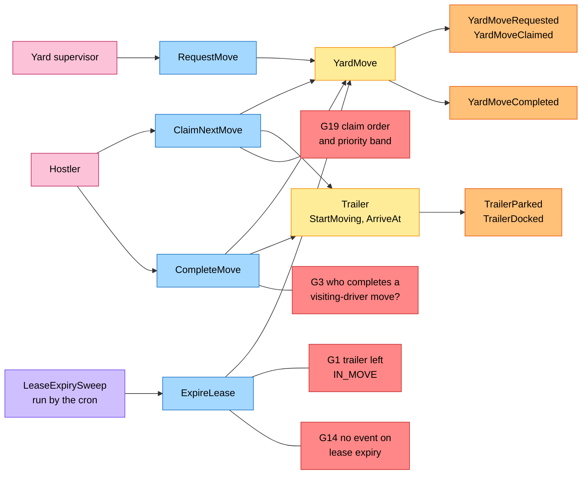
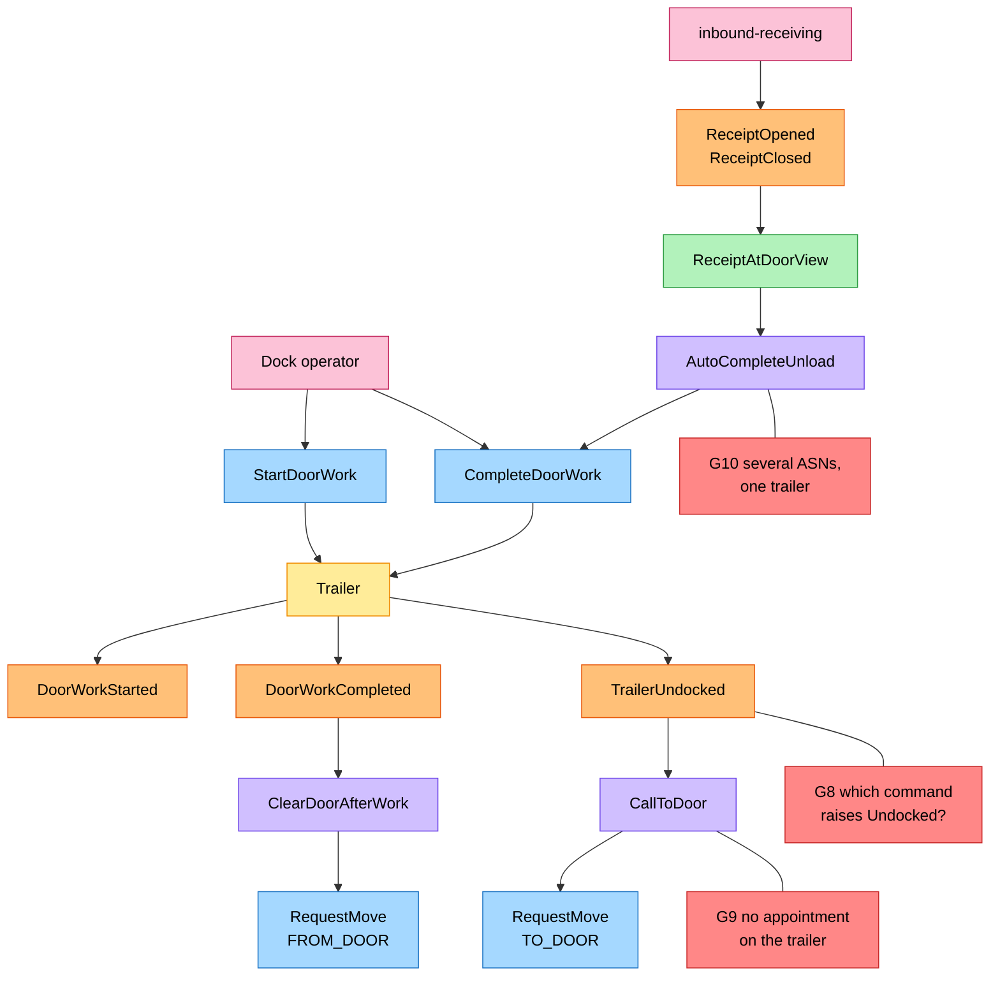
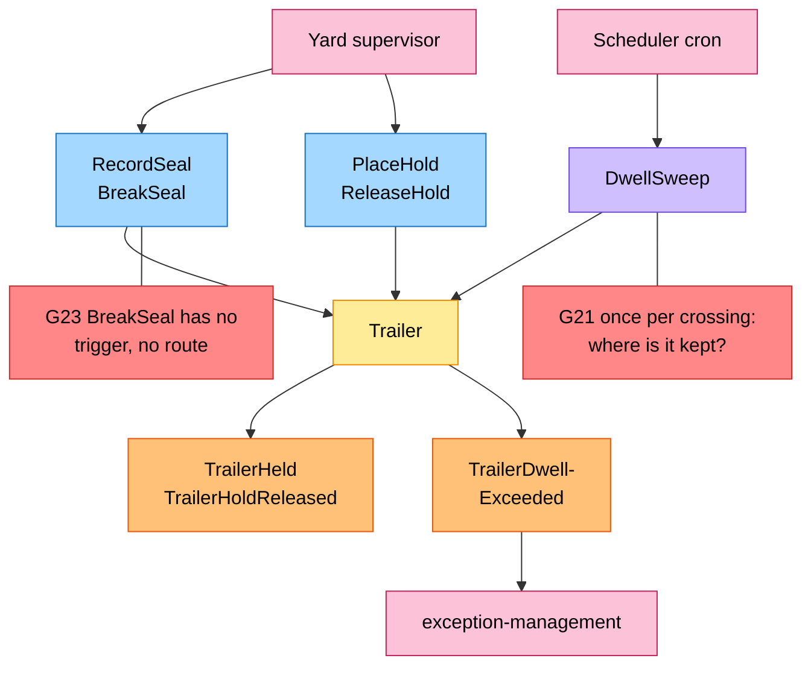
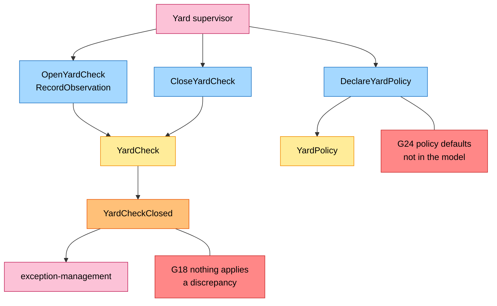

# EventStorming

:::info[Built on develop, registered in infra, not applied]
Built on develop (merged 2026-11-08) in [IQVO/yard-management](https://github.com/IQVO/yard-management), registered in warehouse-infra develop (apps.yaml entry, helm values, dashboards and alert rules, image pinned at v0.1.1), not applied to the k3s cluster (no pods). The page still derives from [`yard/model/model.yaml`](https://github.com/IQVO/warehouse-docs/blob/main/yard/model/model.yaml); where the as-built service differs, the model and this page say so (see the as-built notes).
:::

Process-level EventStorming in the ddd-crew
[EventStorming glossary & cheat sheet](https://github.com/ddd-crew/eventstorming-glossary-cheat-sheet)
notation. Every sticky comes from `model.yaml`. Hotspots were the genuine open questions
or risks in the model when this pack was written, tagged `G<n>` on the boards; the source of each is in the
[hotspot table](#hotspots), whose last column says how the built service settled it. The boards keep the
hotspot stickies as they were drawn. The yard-wide strategic pages are on
[Strategic Design](/yard/strategic-design/).

## Legend

| Colour | Sticky | Hex |
| --- | --- | --- |
| Blue | Command | `#a5d8ff` |
| Yellow | Aggregate | `#ffec99` |
| Orange | Domain Event | `#ffc078` |
| Lilac | Policy | `#d0bfff` |
| Green | Read Model | `#b2f2bb` |
| Pink | External System (a sibling context or an actor) | `#fcc2d7` |
| Red | Hotspot | `#ff8787` |

## 1. Gate and visits

Derived from: `model.yaml → contexts[yard-management].policies[DirectOnCheckIn,
SealCheckAtGate]`, `.aggregates[YardVisit]`, `.read_models`, `.inbound`.

Omitted: the refusals `ErrInvalidCarrier`, `ErrVisitAlreadyOpen`,
`ErrAppointmentRequired`, `ErrTrailerNotReleased`, `ErrSealRequired`; the moves that
`DirectOnCheckIn` creates (board 2); consumers of the events (see
[Domain Events](/yard/contexts/yard-management/domain-events)).

## 2. Moves

Derived from: `model.yaml → contexts[yard-management].aggregates[YardMove, Trailer]`
(`transitions`, `notes`), `.policies[LeaseExpirySweep, VisitingDriverMove]`, `.inbound`.

Omitted: the policies that call `RequestMove` (`DirectOnCheckIn`, `CallToDoor`,
`ClearDoorAfterWork`, board 3); `CancelMove` (supervisor, and `NoShowFreesHolding`, with `YardMoveCancelled`); the
refusals `ErrTrailerHasOpenMove`, `ErrDestinationReserved`, `ErrHostlerBusy`,
`ErrNotLeaseHolder`, `ErrUnexplainedDestination`, `ErrLocationOccupied`. Which of the
two trailer events `ArriveAt` raises depends on the destination being a spot or a door.

## 3. Door work and unload

Derived from: `model.yaml → contexts[yard-management].policies[AutoCompleteUnload,
ClearDoorAfterWork, CallToDoor]`, `.read_models[ReceiptAtDoorView]`,
`.aggregates[Trailer]`.

Omitted: `TrailerDocked` (board 2); `ErrDoorWorkOpen` on departure;
`dock-scheduling`'s reaction to `TrailerUndocked` (`CompleteOnDoorRelease`, see
[Domain Message Flow](/yard/contexts/yard-management/domain-message-flow));
a `LIVE` trailer, which stays at the door until its visit checks out.

## 4. Seals, holds, dwell and trailer exceptions

Derived from: `model.yaml → contexts[yard-management].aggregates[Trailer]`,
`.policies[DwellSweep]`, `.publishes[TrailerHeld, TrailerHoldReleased,
TrailerDwellExceeded]`.

Omitted: `SealExceptionRaised` (board 1); `ErrTrailerOnHold` and `ErrDoorFlowMismatch`
(a hold or a flow mismatch refuses docking; the flow-direction question is G12 in the
table below).

## 5. Yard checks and policy

Derived from: `model.yaml → contexts[yard-management].aggregates[YardCheck, YardPolicy]`,
`.publishes[YardCheckClosed]`.

Omitted: `ErrYardCheckOpen`, `ErrLocationAlreadyObserved`, `ErrUnknownLocation`,
`ErrValidation`; `YardPolicy` raises no event.

## Hotspots

Each was a gap in `model.yaml`, decided before the build (the decision ids Y-n and X-n are in the [Model Gap Register](/yard/strategic-design/model-gap-register), the numbered assumptions A-n in the service's ADR 0002). Severity:
S1 breaks an invariant or the state machine as written, S2 leaves a flow
under-specified, S3 an edge case or contract detail, S4 hygiene.

| # | Sev | Hotspot | Where it comes from in the model | As built (2026-11-09) |
| --- | --- | --- | --- | --- |
| G1 | S1 | `StartMoving` runs at claim, but a `CLAIMED` move can return to `REQUESTED` (lease expiry) or be `CANCELLED`, and `Trailer` has no transition out of `IN_MOVE` except `ArriveAt`. The trailer is then in no place. | `aggregates[Trailer].transitions`; `aggregates[YardMove].transitions`; `Trailer.notes` | Settled (Y-1): `ReturnToOrigin` takes the trailer from `IN_MOVE` back to `PARKED` or `DOCKED` in the unit of work of `ExpireLease` or `CancelMove`; when the origin has been taken meanwhile the trailer stays `IN_MOVE` and the move `REQUESTED` (A16). |
| G2 | S1 | The first move from the gate: `Trailer` has no initial state; `Location` is only `SPOT` or `DOOR`; `YardMove` and the UL say "or the gate" while `VisitingDriverMove` says "no move to the gate"; a `CLAIMED` move created without a transition. | `aggregates[Trailer].states`; `Location`; `aggregates[YardMove].description`; `ul[Yard Move]`; `policies[VisitingDriverMove]` | Settled (Y-1, A4): `RecordArrival` creates the trailer `IN_MOVE` with a `CLAIMED` `VISITING_DRIVER` move (from none, no lease); there is no move to the gate. |
| G3 | S2 | Who completes a `VISITING_DRIVER` move: the policy says dock operator or gate clerk, the inbound rows give `CompleteMove` to the hostler only; `ErrNotLeaseHolder` and `ErrHostlerBusy` have no meaning without a lease. | `policies[VisitingDriverMove]`; `inbound`; `YardMove.invariants`; `YardMoveCompleted.hostler_ref` | Settled (Y-3, A4): the gate clerk or dock operator completes a visiting-driver move through `POST /moves/{moveId}/completions`; the lease errors apply to hostler moves only. |
| G4 | S2 | `Reason` has no value for a move to a plain parking spot (`DirectOnCheckIn` "first free spot"). | `YardMove.value_objects[Reason]`; `policies[DirectOnCheckIn]` | Settled (Y-4): `TO_SPOT` is a move reason. |
| G5 | S2 | `DirectOnCheckIn` needs the arrival tolerance, a `dock-scheduling` setting that no consumed event carries. | `policies[DirectOnCheckIn]`; `dock-scheduling` `DockCalendar` settings | Settled (X1): `DockAppointmentBooked` and `Rescheduled` carry `arrival_tolerance_minutes`. |
| G6 | S2 | `AppointmentView` is fed by four events and cannot know `CHECKED_IN` or `COMPLETED`; `ErrAppointmentRequired` says `BOOKED`, `CallToDoor` says `BOOKED` or `CHECKED_IN`. | `read_models[AppointmentView]`; `YardVisit.invariants`; `policies[CallToDoor]` | Settled (X4, A15): the copy marks itself `CHECKED_IN` from its own `VisitCheckedIn` and `USED` from its own `TrailerUndocked`; statuses `BOOKED`, `CHECKED_IN`, `USED`, `CANCELLED`, `NO_SHOW`. |
| G7 | S2 | Rejection mechanics: refused `CheckInVisit` (an `Err`) versus `RejectAtGate`; `REJECTED` has no transition; `UNKNOWN_APPOINTMENT` has no `Err`; `SealExceptionRaised` names a trailer a rejected visit may not have. | `YardVisit.transitions`, `.commands`, `.invariants`; `reasons[RejectionReason]`; `policies[SealCheckAtGate]` | Settled (Y-5, A9): a refused check-in creates nothing; `RejectAtGate` records a `REJECTED` visit; `ErrUnknownAppointment` exists; `SealExceptionRaised.trailer_id` is null for a gate rejection. |
| G8 | S2 | No stated command raises `TrailerParked`, `TrailerDocked`, `TrailerUndocked`; `Depart`, `BreakSeal`, `RecordLoadState` have no route or policy; `DwellSweep` is on no aggregate. `dock-scheduling` completes only on `TrailerUndocked`. | `Trailer.events`, `.commands`; `inbound`; `policies[DwellSweep]` | Settled (Y-6): `ArriveAt` raises `TrailerParked` or `TrailerDocked`, leaving a door raises `TrailerUndocked`, `CheckOutVisit` calls `Depart` per trailer. |
| G9 | S2 | No appointment reference on `Trailer` or `YardMove`, yet events carry `appointment_id` and `CallToDoor`, `NoShowFreesHolding` match by appointment. | `Trailer.value_objects`; `YardMove.value_objects`; `YardMoveRequested.data`; `policies` | Settled (X3): `appointment_id` on `Trailer` and `YardMove` (`YardMoveRequested` carries it); one appointment covers exactly one trailer. |
| G10 | S2 | `AutoCompleteUnload`: `ReceiptClosed` lacks `appointment_id` and `door_code`; one receipt per `asn_number` but a trailer holds several; door-work transitions are not defined (is `WAITING → DONE` allowed?). | `policies[AutoCompleteUnload]`; `read_models[ReceiptAtDoorView]`; `Trailer.value_objects[DoorWork]` | Settled (Y-7, A11): join through `receipt_id` from `ReceiptOpened`; door work completes when every ASN on the trailer has a closed receipt, from `WAITING` or `IN_PROGRESS`. |
| G11 | S2 | Occupancy checks run at `ArriveAt` (completion), after the hostler is physically there; at request only `ErrDestinationReserved` is named; when the origin is released is not stated; `ErrDestinationReserved` and `ErrLocationOccupied` overlap. | `Trailer.invariants`; `YardMove.invariants`; `business_decisions` | Settled (Y-8, A3): the destination is validated at `RequestMove` and again at `ArriveAt` (an occupied location is refused, the move stays `CLAIMED`); the origin is released at `StartMoving`. |
| G12 | S3 | `ErrDoorFlowMismatch` speaks of a "LOADED inbound" and "an outbound one"; an `EMPTY` trailer for live loading has neither. | `Trailer.invariants`; `Contents`; `LoadState` | Settled (Y-9): inbound when ASN numbers are present; outbound when an outbound reference is set or the purpose is `LIVE_LOAD` or `PICKUP`. |
| G13 | S3 | `ErrSealRequired` refers to an "OUTBOUND purpose", but `Purpose` has no direction; the `CheckOutVisit` body is not specified. | `YardVisit.invariants`; `Purpose`; `rest` | Settled (Y-9, A20): `LIVE_LOAD` and `PICKUP` are the outbound purposes; the check-out body names only `trailerId`. |
| G14 | S3 | `ExpireLease` changes a move and its `version` but raises no event, against "every accepted change". | `YardMove.events`; `conventions.cloudevents.version_field` | Settled (Y-10): `YardMoveLeaseExpired`, analytics only. |
| G15 | S3 | `VisitRejected`, `SealExceptionRaised`, `TrailerDwellExceeded`, `YardCheckClosed` carry no `version`; the element shapes of `trailers` and `discrepancies` are not given; `YardMoveCompleted` has no destination or reason. | `publishes`; `conventions.cloudevents.version_field` | Settled (Y-10): the exemptions are documented, the shapes are in the AsyncAPI, and `YardMoveCompleted` carries `to_location` and `reason`. |
| G16 | S3 | HTTP status and problem slug are given only for four generic errors; every domain `Err...` status on these pages is proposed. | `conventions.errors` | Settled (D-10): 409 for a conflict with state, 422 for a value or reference rule, slug = kebab-case of the `Err` name. |
| G17 | S3 | `VisitRejected` has one consumer, `exception-management`; `dock-scheduling` never learns a booked visit was turned away (`TURNED_AWAY` unused). | `publishes[VisitRejected].consumers`; `dock-scheduling` `CancellationReason` | Settled (X2): `dock-scheduling` consumes `VisitRejected` and cancels with `TURNED_AWAY`. |
| G18 | S3 | `YardCheck` "reconciles with the model" but no command applies a discrepancy; unobserved locations and in-flight moves are not addressed; no event on open. | `YardCheck.description`, `.events` | Settled (Y-11, A13): closing only reports; a location not observed is `MISSING` when the model records a trailer there. |
| G19 | S3 | Claim order (band direction, `due_by`, tie-break), the mapping from `window_start` to a band, and the claim body are not given. | `YardMove.value_objects[Priority]`; `policies[CallToDoor]` | Settled (Y-11, A14): lowest band, then earliest `due_by`, then request time; claim body `{siteId, hostlerRef}`; `404 no-claimable-move` when nothing waits. |
| G20 | S3 | A closure or a decommissioned slot while a trailer is already there is not handled (`ErrDoorClosed` guards arrival only). | `read_models[DoorClosureView, LocationView]` | Open by decision (Y-12): handling a closed place or decommissioned slot under a trailer is phase 2. |
| G21 | S3 | `DwellSweep` "once per trailer and threshold crossing" needs a stored marker; `free_time_minutes` is used by no rule or event. | `policies[DwellSweep]`; `YardPolicy` | Settled (Y-13, A12): the trailer keeps `dwell_alerted_at`; detention is a KPI only (exposure over a threshold, service ADR 0011), `free_time_minutes` a policy setting. |
| G22 | S3 | No free spot, or a full holding area, at check-in has no outcome. | `policies[DirectOnCheckIn]` | Settled (Y-12): `ErrNoFreeSpot`, 409 `no-free-spot`. |
| G23 | S3 | Seal handling: where `CheckInVisit` records the seal, when it is compared, what `BreakSeal` triggers (`SEAL_BROKEN` hold?), whether a hold may be placed on a `DOCKED` trailer. | `policies[SealCheckAtGate]`; `Seal`; `HoldReason`; `Trailer.invariants[ErrTrailerOnHold]` | Settled (Y-13, A9, A10): the seal is compared at check-in; a `BROKEN` seal places a `SEAL_BROKEN` hold; a hold on a `DOCKED` trailer is allowed and door work waits for the release. |
| G24 | S3 | `YardPolicy` has no defaults in the model; `meta.status` calls D1-D8 proposals while the plan decision log marks them final. | `aggregates[YardPolicy]`; `meta.status` | Settled: defaults `require_appointment` false, `seal_mismatch_action` `FLAG`, `lease_seconds` 300, no free time, no dwell thresholds. |
| G25 | S4 | Chart values (differentiation 0.50, complexity 0.60) sit on the quadrant centre line, yet the context is `Supporting`. | `chart` | Accepted (S4): the chart sits on the line by design. |
| G26 | S4 | The model records no `type` strings of consumed events; `ASNRegistered.lines` is consumed but unused; the three `GET /reports/*` routes have no `inbound` row; the analytics `dataschema` form is not stated. | `consumes`; `read_models[AsnContentView]`; `inbound`, `rest`; `conventions.cloudevents` | Settled: the consumed types are read from the producers' AsyncAPI, the report routes have an `inbound` row, the analytics `dataschema` is `urn:warehouse:yard-management:analytics:<EventName>:v1`. |
| G27 | S3 | `NoShowFreesHolding` is named for freeing a holding spot but cancels a `TO_DOOR` move; a `CHECKED_IN` appointment cancelled with the trailer on site, and a reschedule to another door with a move open, are not covered. | `policies[NoShowFreesHolding]` | Settled (Y-14): on `DockAppointmentNoShow` or `DockAppointmentCancelled` an open `TO_DOOR` move for that appointment is cancelled. |
| G28 | S1 | `ErrTrailerNotReleased` says a trailer taken out is not `DOCKED`, while a live visit departs from the door (`DOCKED → DEPARTED`; `VisitingDriverMove`: "for a live visit, from the door"). The check-out rule and the live flow contradict. | `YardVisit.invariants[ErrTrailerNotReleased]`; `business_decisions`; `Trailer.transitions`; `policies[VisitingDriverMove]` | Settled (Y-2): released means no open move and either `PARKED`, or `DOCKED` with door work `DONE`; a live visit departs from the door. |
