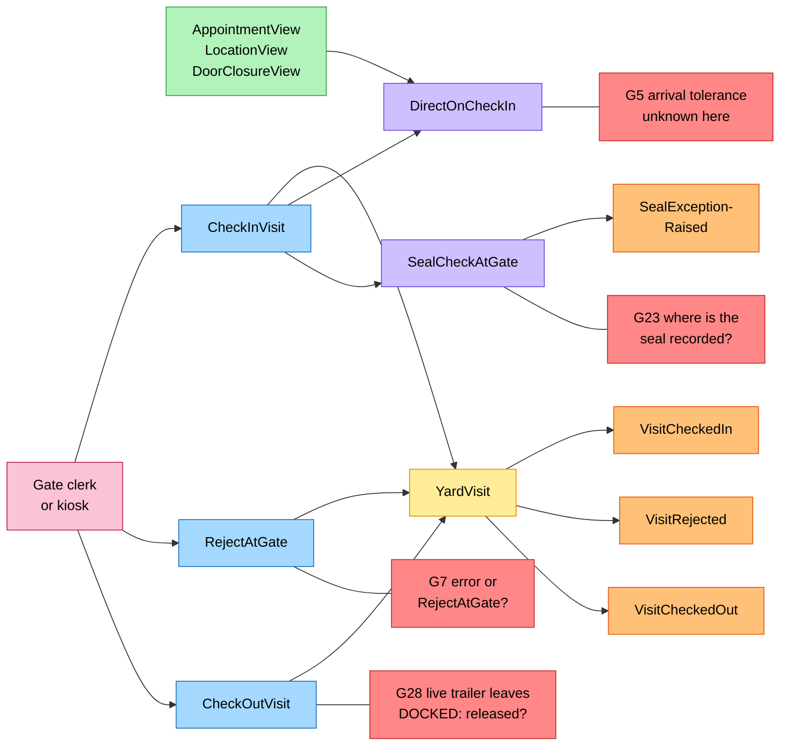
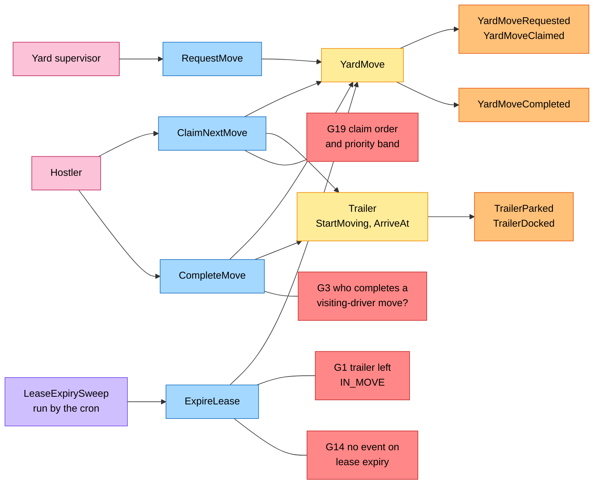
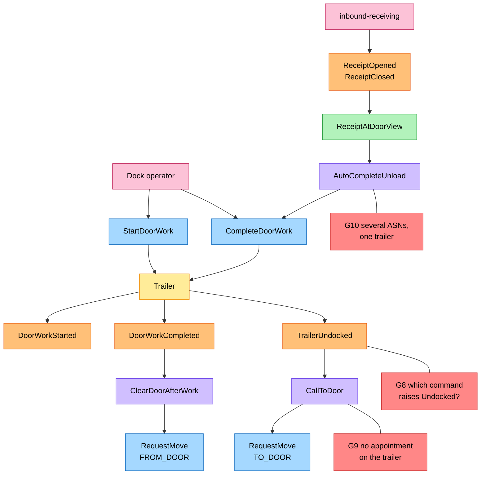
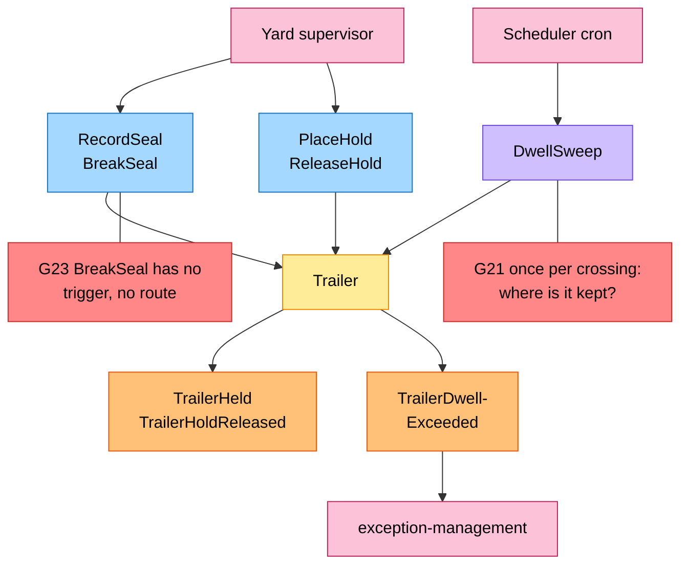
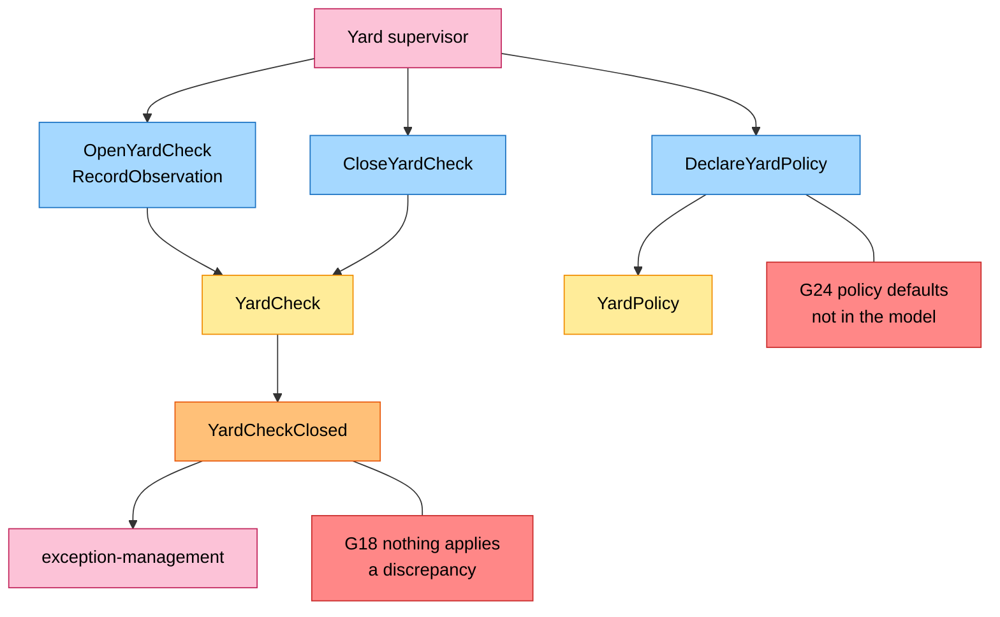

# EventStorming

:::info[Built on develop, not deployed]
Built on develop (merged 2026-11-08) in [IQVO/yard-management](https://github.com/IQVO/yard-management), not deployed: registered nowhere in warehouse-infra. The page still derives from [`yard/model/model.yaml`](https://github.com/IQVO/warehouse-docs/blob/main/yard/model/model.yaml); where the as-built service differs, the model and this page say so (see the as-built notes).
:::

Process-level EventStorming in the ddd-crew
[EventStorming glossary & cheat sheet](https://github.com/ddd-crew/eventstorming-glossary-cheat-sheet)
notation. Every sticky comes from `model.yaml`. Hotspots are genuine open questions
or risks in the model, tagged `G<n>` on the boards; the source of each is in the
[hotspot table](#hotspots). The yard-wide strategic pages are on
[Strategic Design](/yard/strategic-design/).

## Legend

| Colour | Sticky | Hex |
| --- | --- | --- |
| Blue | Command | `#a5d8ff` |
| Yellow | Aggregate | `#ffec99` |
| Orange | Domain Event | `#ffc078` |
| Lilac | Policy | `#d0bfff` |
| Green | Read Model | `#b2f2bb` |
| Pink | External System (a sibling context or an actor) | `#fcc2d7` |
| Red | Hotspot | `#ff8787` |

## 1. Gate and visits

Derived from: `model.yaml → contexts[yard-management].policies[DirectOnCheckIn,
SealCheckAtGate]`, `.aggregates[YardVisit]`, `.read_models`, `.inbound`.

Omitted: the refusals `ErrInvalidCarrier`, `ErrVisitAlreadyOpen`,
`ErrAppointmentRequired`, `ErrTrailerNotReleased`, `ErrSealRequired`; the moves that
`DirectOnCheckIn` creates (board 2); consumers of the events (see
[Domain Events](/yard/contexts/yard-management/domain-events)).

## 2. Moves

Derived from: `model.yaml → contexts[yard-management].aggregates[YardMove, Trailer]`
(`transitions`, `notes`), `.policies[LeaseExpirySweep, VisitingDriverMove]`, `.inbound`.

Omitted: the policies that call `RequestMove` (`DirectOnCheckIn`, `CallToDoor`,
`ClearDoorAfterWork`, board 3); `CancelMove` (supervisor, and `NoShowFreesHolding`, with `YardMoveCancelled`); the
refusals `ErrTrailerHasOpenMove`, `ErrDestinationReserved`, `ErrHostlerBusy`,
`ErrNotLeaseHolder`, `ErrUnexplainedDestination`, `ErrLocationOccupied`. Which of the
two trailer events `ArriveAt` raises depends on the destination being a spot or a door.

## 3. Door work and unload

Derived from: `model.yaml → contexts[yard-management].policies[AutoCompleteUnload,
ClearDoorAfterWork, CallToDoor]`, `.read_models[ReceiptAtDoorView]`,
`.aggregates[Trailer]`.

Omitted: `TrailerDocked` (board 2); `ErrDoorWorkOpen` on departure;
`dock-scheduling`'s reaction to `TrailerUndocked` (`CompleteOnDoorRelease`, see
[Domain Message Flow](/yard/contexts/yard-management/domain-message-flow));
a `LIVE` trailer, which stays at the door until its visit checks out.

## 4. Seals, holds, dwell and trailer exceptions

Derived from: `model.yaml → contexts[yard-management].aggregates[Trailer]`,
`.policies[DwellSweep]`, `.publishes[TrailerHeld, TrailerHoldReleased,
TrailerDwellExceeded]`.

Omitted: `SealExceptionRaised` (board 1); `ErrTrailerOnHold` and `ErrDoorFlowMismatch`
(a hold or a flow mismatch refuses docking; the flow-direction question is G12 in the
table below).

## 5. Yard checks and policy

Derived from: `model.yaml → contexts[yard-management].aggregates[YardCheck, YardPolicy]`,
`.publishes[YardCheckClosed]`.

Omitted: `ErrYardCheckOpen`, `ErrLocationAlreadyObserved`, `ErrUnknownLocation`,
`ErrValidation`; `YardPolicy` raises no event.

## Hotspots

Each is a gap in `model.yaml` reported to the orchestrator, not patched here. Severity:
S1 breaks an invariant or the state machine as written, S2 leaves a flow
under-specified, S3 an edge case or contract detail, S4 hygiene.

| # | Sev | Hotspot | Where it comes from in the model | Proposed resolution |
| --- | --- | --- | --- | --- |
| G1 | S1 | `StartMoving` runs at claim, but a `CLAIMED` move can return to `REQUESTED` (lease expiry) or be `CANCELLED`, and `Trailer` has no transition out of `IN_MOVE` except `ArriveAt`. The trailer is then in no place. | `aggregates[Trailer].transitions`; `aggregates[YardMove].transitions`; `Trailer.notes` | Add `IN_MOVE → PARKED` and `IN_MOVE → DOCKED` (return to origin) invoked by `ExpireLease` and `CancelMove` in the same unit of work. |
| G2 | S1 | The first move from the gate: `Trailer` has no initial state; `Location` is only `SPOT` or `DOOR`; `YardMove` and the UL say "or the gate" while `VisitingDriverMove` says "no move to the gate"; a `CLAIMED` move created without a transition. | `aggregates[Trailer].states`; `Location`; `aggregates[YardMove].description`; `ul[Yard Move]`; `policies[VisitingDriverMove]` | Define `RecordArrival` → `IN_MOVE`, `from` = none for the first move, and drop "or the gate" from description and UL. |
| G3 | S2 | Who completes a `VISITING_DRIVER` move: the policy says dock operator or gate clerk, the inbound rows give `CompleteMove` to the hostler only; `ErrNotLeaseHolder` and `ErrHostlerBusy` have no meaning without a lease. | `policies[VisitingDriverMove]`; `inbound`; `YardMove.invariants`; `YardMoveCompleted.hostler_ref` | Add inbound rows for gate clerk and dock operator; state that lease rules apply to `HOSTLER` moves; make `hostler_ref` nullable. |
| G4 | S2 | `Reason` has no value for a move to a plain parking spot (`DirectOnCheckIn` "first free spot"). | `YardMove.value_objects[Reason]`; `policies[DirectOnCheckIn]` | Add `TO_SPOT` or document `RELOCATE`. |
| G5 | S2 | `DirectOnCheckIn` needs the arrival tolerance, a `dock-scheduling` setting that no consumed event carries. | `policies[DirectOnCheckIn]`; `dock-scheduling` `DockCalendar` settings | Add `arrival_tolerance_minutes` to `DockAppointmentBooked`, or to `YardPolicy`. |
| G6 | S2 | `AppointmentView` is fed by four events and cannot know `CHECKED_IN` or `COMPLETED`; `ErrAppointmentRequired` says `BOOKED`, `CallToDoor` says `BOOKED` or `CHECKED_IN`. | `read_models[AppointmentView]`; `YardVisit.invariants`; `policies[CallToDoor]` | Consume `DockAppointmentCheckedIn` and `DockAppointmentCompleted`, or mark the copy from own `VisitCheckedIn` and `TrailerUndocked`. |
| G7 | S2 | Rejection mechanics: refused `CheckInVisit` (an `Err`) versus `RejectAtGate`; `REJECTED` has no transition; `UNKNOWN_APPOINTMENT` has no `Err`; `SealExceptionRaised` names a trailer a rejected visit may not have. | `YardVisit.transitions`, `.commands`, `.invariants`; `reasons[RejectionReason]`; `policies[SealCheckAtGate]` | A refused `CheckInVisit` creates nothing; `RejectAtGate` records `REJECTED`; `REJECT` policy rejects in the same call; add `ErrUnknownAppointment`; make `trailer_id` nullable. |
| G8 | S2 | No stated command raises `TrailerParked`, `TrailerDocked`, `TrailerUndocked`; `Depart`, `BreakSeal`, `RecordLoadState` have no route or policy; `DwellSweep` is on no aggregate. `dock-scheduling` completes only on `TrailerUndocked`. | `Trailer.events`, `.commands`; `inbound`; `policies[DwellSweep]` | `ArriveAt` raises Parked or Docked; `StartMoving` and `Depart` from `DOCKED` raise Undocked; `CheckOutVisit` calls `Depart`; `DwellSweep` is a `Trailer` command. |
| G9 | S2 | No appointment reference on `Trailer` or `YardMove`, yet events carry `appointment_id` and `CallToDoor`, `NoShowFreesHolding` match by appointment. | `Trailer.value_objects`; `YardMove.value_objects`; `YardMoveRequested.data`; `policies` | Add `AppointmentRef` to `Trailer` (set at arrival) and to `YardMove`. |
| G10 | S2 | `AutoCompleteUnload`: `ReceiptClosed` lacks `appointment_id` and `door_code`; one receipt per `asn_number` but a trailer holds several; door-work transitions are not defined (is `WAITING → DONE` allowed?). | `policies[AutoCompleteUnload]`; `read_models[ReceiptAtDoorView]`; `Trailer.value_objects[DoorWork]` | Join via `receipt_id`; complete when every ASN on the trailer has a closed receipt; define the door-work transitions. |
| G11 | S2 | Occupancy checks run at `ArriveAt` (completion), after the hostler is physically there; at request only `ErrDestinationReserved` is named; when the origin is released is not stated; `ErrDestinationReserved` and `ErrLocationOccupied` overlap. | `Trailer.invariants`; `YardMove.invariants`; `business_decisions` | Validate known slot, closure, flow and hold at `RequestMove` too; refuse `CompleteMove` at an occupied location and keep it `CLAIMED`; release the origin at `StartMoving`. |
| G12 | S3 | `ErrDoorFlowMismatch` speaks of a "LOADED inbound" and "an outbound one"; an `EMPTY` trailer for live loading has neither. | `Trailer.invariants`; `Contents`; `LoadState` | Inbound if `asn_numbers` is non-empty; outbound if `outbound_ref` is set or the visit purpose is `LIVE_LOAD` or `PICKUP`. |
| G13 | S3 | `ErrSealRequired` refers to an "OUTBOUND purpose", but `Purpose` has no direction; the `CheckOutVisit` body is not specified. | `YardVisit.invariants`; `Purpose`; `rest` | Define `LIVE_LOAD` and `PICKUP` as outbound; specify `trailers_out`. |
| G14 | S3 | `ExpireLease` changes a move and its `version` but raises no event, against "every accepted change". | `YardMove.events`; `conventions.cloudevents.version_field` | Add an analytics event `YardMoveLeaseExpired`, or exempt it. |
| G15 | S3 | `VisitRejected`, `SealExceptionRaised`, `TrailerDwellExceeded`, `YardCheckClosed` carry no `version`; the element shapes of `trailers` and `discrepancies` are not given; `YardMoveCompleted` has no destination or reason. | `publishes`; `conventions.cloudevents.version_field` | Document the exemption; spell out the shapes. |
| G16 | S3 | HTTP status and problem slug are given only for four generic errors; every domain `Err...` status on these pages is proposed. | `conventions.errors` | Add a status and slug column to the model. |
| G17 | S3 | `VisitRejected` has one consumer, `exception-management`; `dock-scheduling` never learns a booked visit was turned away (`TURNED_AWAY` unused). | `publishes[VisitRejected].consumers`; `dock-scheduling` `CancellationReason` | Add `dock-scheduling` as consumer, cancelling with `TURNED_AWAY`. |
| G18 | S3 | `YardCheck` "reconciles with the model" but no command applies a discrepancy; unobserved locations and in-flight moves are not addressed; no event on open. | `YardCheck.description`, `.events` | State that closing reports only; define `MISSING` for unobserved locations. |
| G19 | S3 | Claim order (band direction, `due_by`, tie-break), the mapping from `window_start` to a band, and the claim body are not given. | `YardMove.value_objects[Priority]`; `policies[CallToDoor]` | Define: lowest band first, then `due_by`, then request time. |
| G20 | S3 | A closure or a decommissioned slot while a trailer is already there is not handled (`ErrDoorClosed` guards arrival only). | `read_models[DoorClosureView, LocationView]` | Raise an exception and request a `RELOCATE` move. |
| G21 | S3 | `DwellSweep` "once per trailer and threshold crossing" needs a stored marker; `free_time_minutes` is used by no rule or event. | `policies[DwellSweep]`; `YardPolicy` | Add a raised-marker; say that detention is a KPI only. |
| G22 | S3 | No free spot, or a full holding area, at check-in has no outcome. | `policies[DirectOnCheckIn]` | Add `ErrNoFreeSpot` or a gate queue. |
| G23 | S3 | Seal handling: where `CheckInVisit` records the seal, when it is compared, what `BreakSeal` triggers (`SEAL_BROKEN` hold?), whether a hold may be placed on a `DOCKED` trailer. | `policies[SealCheckAtGate]`; `Seal`; `HoldReason`; `Trailer.invariants[ErrTrailerOnHold]` | Record the seal in `trailers_in`; `BreakSeal` places a `SEAL_BROKEN` hold. |
| G24 | S3 | `YardPolicy` has no defaults in the model; `meta.status` calls D1-D8 proposals while the plan decision log marks them final. | `aggregates[YardPolicy]`; `meta.status` | Write the confirmed defaults into the model. |
| G25 | S4 | Chart values (differentiation 0.50, complexity 0.60) sit on the quadrant centre line, yet the context is `Supporting`. | `chart` | Document the thresholds. |
| G26 | S4 | The model records no `type` strings of consumed events; `ASNRegistered.lines` is consumed but unused; the three `GET /reports/*` routes have no `inbound` row; the analytics `dataschema` form is not stated. | `consumes`; `read_models[AsnContentView]`; `inbound`, `rest`; `conventions.cloudevents` | Add the missing rows and strings. |
| G27 | S3 | `NoShowFreesHolding` is named for freeing a holding spot but cancels a `TO_DOOR` move; a `CHECKED_IN` appointment cancelled with the trailer on site, and a reschedule to another door with a move open, are not covered. | `policies[NoShowFreesHolding]` | State the intended effects. |
| G28 | S1 | `ErrTrailerNotReleased` says a trailer taken out is not `DOCKED`, while a live visit departs from the door (`DOCKED → DEPARTED`; `VisitingDriverMove`: "for a live visit, from the door"). The check-out rule and the live flow contradict. | `YardVisit.invariants[ErrTrailerNotReleased]`; `business_decisions`; `Trailer.transitions`; `policies[VisitingDriverMove]` | For a live visit, "released" means door work `DONE` and no open move; only a trailer in a spot or in a move must satisfy "not docked". |
