# Sequence Diagrams

:::info[Built on develop, not deployed]
Built on develop (merged 2026-11-08) in [IQVO/yard-management](https://github.com/IQVO/yard-management), not deployed: registered nowhere in warehouse-infra. The page still derives from [`yard/model/model.yaml`](https://github.com/IQVO/warehouse-docs/blob/main/yard/model/model.yaml); where the as-built service differs, the model and this page say so (see the as-built notes).
:::

Two parts. **Part A** has the four scenarios the pack must show, each as one story
across several use cases: inbound adapter → use cases → aggregates → outbox → relay →
Kafka → neighbour. **Part B** has one diagram per significant command use case of
[Use Cases](/yard/contexts/yard-management/use-cases), in the proposed hexagonal layout:
inbound adapter → use case → aggregate → repository → outbox (same transaction) → relay →
Kafka. The relay and Kafka share one lifeline ("relay to Kafka") to keep each diagram at
six participants or fewer. `alt` blocks show error branches, optimistic-concurrency
`version` checks and idempotency (REST `Idempotency-Key`, Kafka inbox on the CloudEvents
`id`). Error names are the model's; HTTP statuses of domain errors are proposed (see
[Use Cases](/yard/contexts/yard-management/use-cases#conventions-for-every-use-case)).
Route parameters are written without braces. The relay publishes integration events to
`warehouse.yard-management.events` and analytics-only events to
`warehouse.yard-management.analytics`, keyed by the aggregate root id.

## Part A: the four scenarios

### A1. Live unload

An inbound carrier with a booked door: check-in, the visiting driver's move to the door,
docking, door work closed by the receipt, check-out.

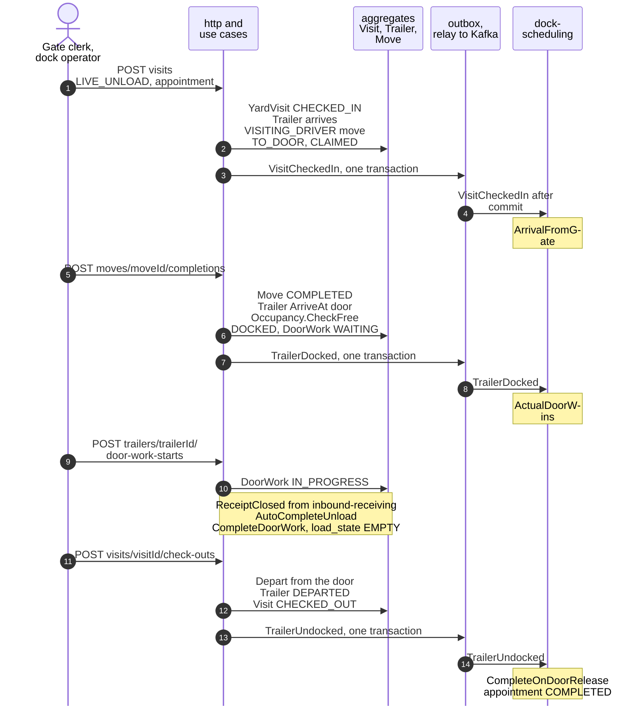

Derived from: `model.yaml → contexts[yard-management].policies[DirectOnCheckIn,
VisitingDriverMove, AutoCompleteUnload]`, `.aggregates[YardVisit, Trailer, YardMove]`,
`.publishes`; `contexts[dock-scheduling].policies`.

Omitted: the failure branches (Part B), the analytics events (`VisitCheckedOut`,
`TrailerDeparted`, `DoorWorkStarted`, `DoorWorkCompleted`, `YardMove*`), and
`inbound-receiving`'s own receipt flow. The model names no command that departs a
trailer or raises `TrailerUndocked`; `Depart` from the door under `CheckOutVisit` is this
pack's reading (gaps YM-G8, YM-G28). The completion of the first move by the dock operator
follows the policy text, not an inbound row (gap YM-G3).

### A2. Drop, then a later door call

A carrier drops a trailer whose door is busy; the trailer waits in a spot; when the door
frees, a hostler moves it in; after unloading it is returned to a spot.

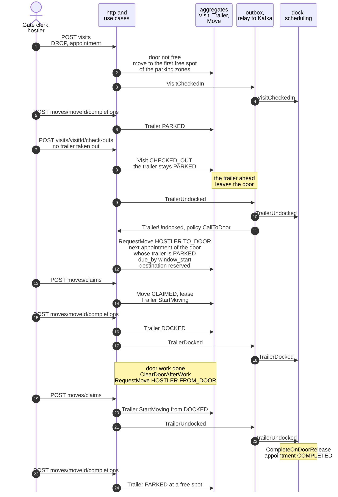

Derived from: `model.yaml → contexts[yard-management].policies[DirectOnCheckIn, CallToDoor,
ClearDoorAfterWork]`, `.aggregates[Trailer, YardMove]`, `.publishes[TrailerUndocked,
TrailerDocked]`; `contexts[dock-scheduling].policies[CompleteOnDoorRelease]`.

Omitted: the door work commands (A1), `YardMoveRequested`, `YardMoveClaimed`,
`YardMoveCompleted` and `TrailerParked` (analytics only), the idempotency and inbox rows.
`CallToDoor` reacts to the own `TrailerUndocked`; this pack reads that as a consumer of
the own topic, as `dock-scheduling` consumes it. Which command raises `TrailerUndocked`
for a trailer leaving by a `FROM_DOOR` move is not stated (gap YM-G8); the trailer is
linked to its appointment by a reference the model does not give `Trailer` (gap YM-G9);
the reason of the first move to a plain spot has no value in `Reason` (gap YM-G4).

### A3. Gate rejection

A walk-in at a site that requires appointments; then a seal mismatch under both policies.

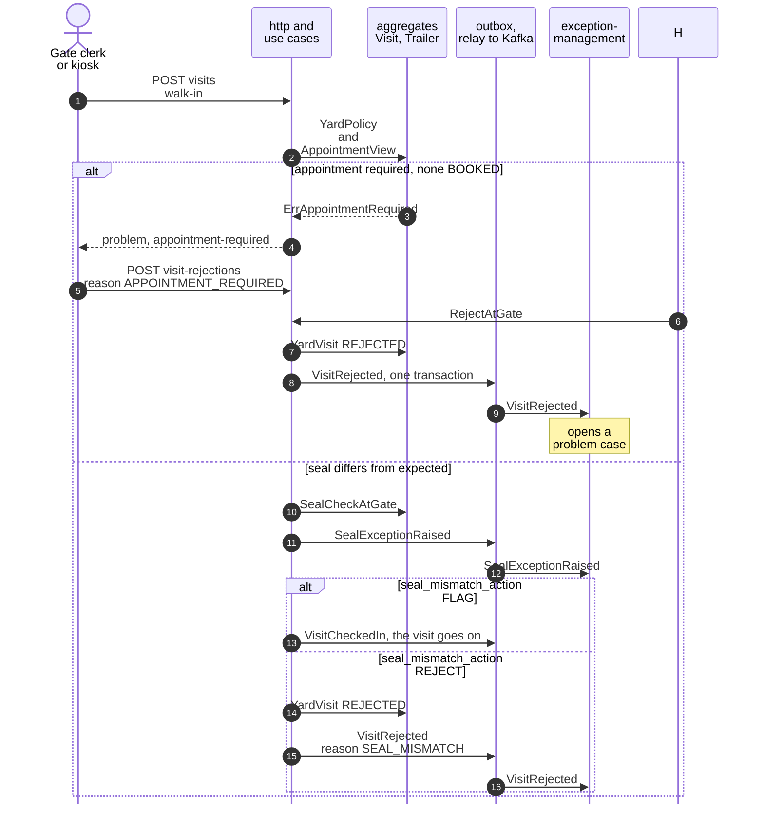

Derived from: `model.yaml → contexts[yard-management].aggregates[YardVisit]`
(`invariants`, `commands`), `.policies[SealCheckAtGate]`, `.aggregates[YardPolicy]`,
`.reasons[RejectionReason]`, `.publishes[VisitRejected, SealExceptionRaised]`;
`fleet_changes[exception-management]`.

Omitted: `ErrTrailerAlreadyOnSite` (reason `TRAILER_ALREADY_ON_SITE`), `UNKNOWN_APPOINTMENT`
and `SITE_REQUEST` rejections; `dock-scheduling`, which receives neither event (gap
YM-G17). The model has both an error on `CheckInVisit` and a command that records a
rejection; the two-step flow is this pack's reading (gap YM-G7). Where the seal is
recorded at the gate and which trailer a rejected visit's exception names are not stated
(gap YM-G23).

### A4. A hostler claims a move, the lease expires, another hostler completes it

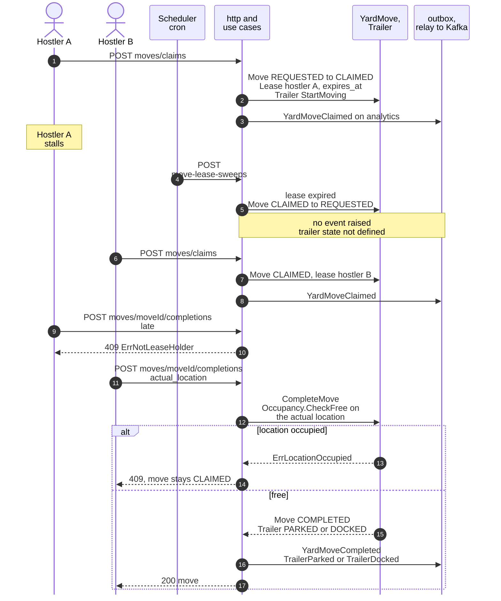

Derived from: `model.yaml → contexts[yard-management].aggregates[YardMove, Trailer]`
(`transitions`, `invariants`, `notes`), `.policies[LeaseExpirySweep]`, `.inbound`, `.rest`.

Omitted: the `Idempotency-Key` rows; `ErrHostlerBusy` when a hostler already holds a
`CLAIMED` move; the late completion after expiry when nobody has re-claimed the move,
which is `ErrIllegalTransition` (the move is `REQUESTED`). The model returns the move to
`REQUESTED` on expiry, has no transition that brings the trailer back from `IN_MOVE` (gap
YM-G1), raises no event for the expiry (gap YM-G14) and has no lease renewal. A refusal at
`ArriveAt` happens when the hostler is already at the location (gap YM-G11).

## Part B: one diagram per significant command

Commands not drawn follow a pattern shown here: `RejectAtGate` (A3); `RecordArrival`,
`DirectOnCheckIn` inside B1; `StartMoving` inside B4; `ArriveAt` inside B5; `Depart`
inside B2; `RecordSeal`, `BreakSeal`, `RecordLoadState`, `ReleaseHold` as B9 (load, check
state, mutate, version check, optional outbox row); `OpenYardCheck`, `RecordObservation`
and `DeclareYardPolicy` as B11 without the outbox.

### B1. CheckInVisit

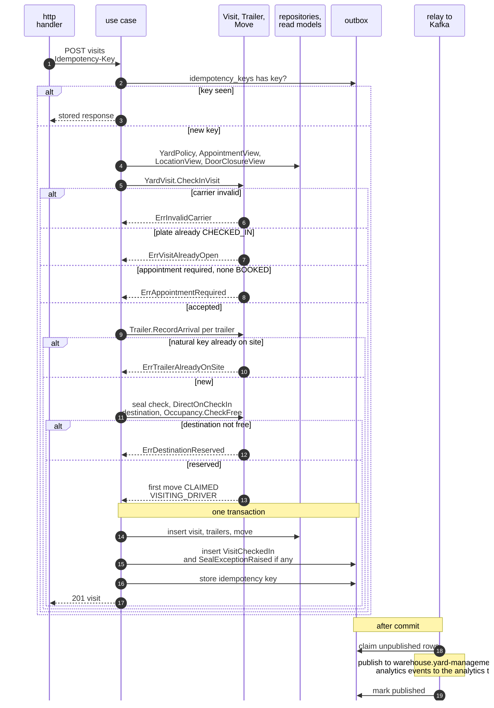

Derived from: `model.yaml → contexts[yard-management].aggregates[YardVisit, Trailer]`
(`commands`, `invariants`), `.policies[DirectOnCheckIn, VisitingDriverMove,
SealCheckAtGate]`, `conventions.integration_rules`.

Omitted: the `REJECT` seal outcome (A3); the choice of door, holding spot or parking spot
(A2); each domain error is answered `409` or `422` as proposed. The first move's events
(`YardMoveRequested`, `YardMoveClaimed`) go to the analytics topic; which of them a move
born `CLAIMED` raises is not stated (gap YM-G2).

### B2. CheckOutVisit

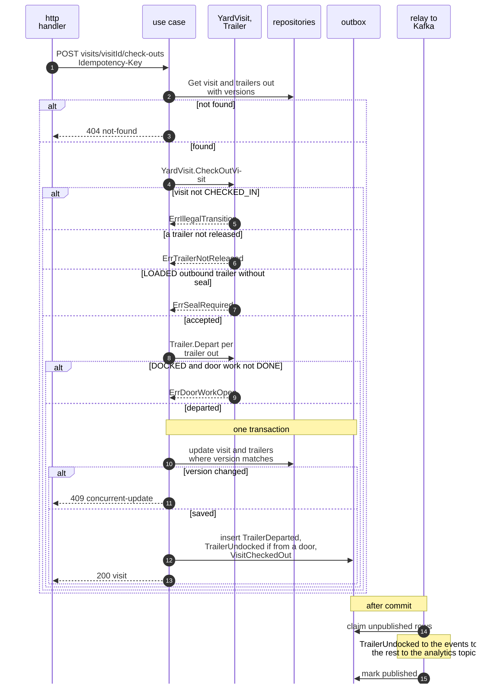

Derived from: `model.yaml → contexts[yard-management].aggregates[YardVisit, Trailer]`
(`invariants`, `transitions`), `.publishes[VisitCheckedOut, TrailerDeparted,
TrailerUndocked]`.

Omitted: the idempotency-key check (as in B1). `Depart` is not named as a use case by the
model; calling it from here is this pack's reading (gap YM-G8). For a live visit the
trailer leaves from the door while `ErrTrailerNotReleased` says "not docked" (gap YM-G28).

### B3. RequestMove

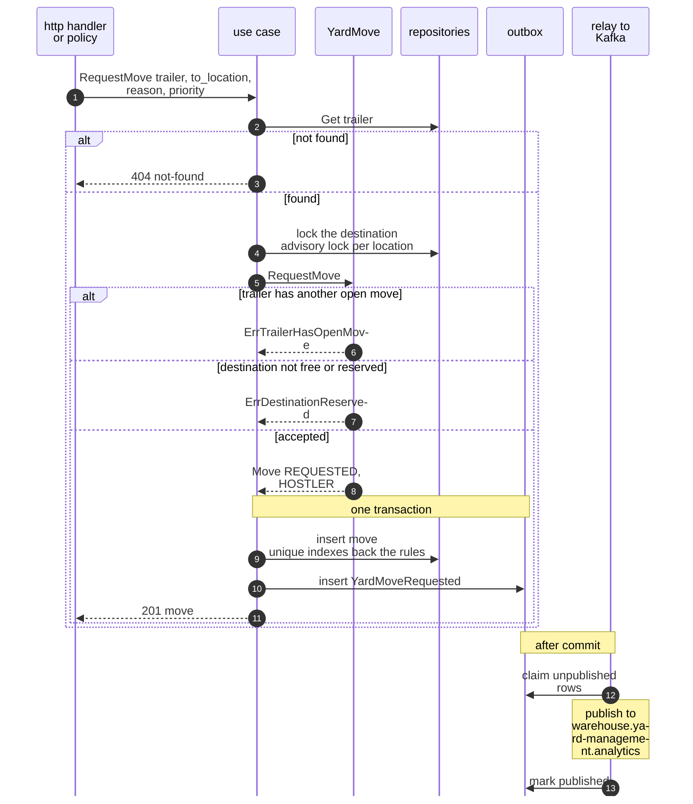

Derived from: `model.yaml → contexts[yard-management].aggregates[YardMove]`
(`invariants`, `commands`), `.policies[CallToDoor, ClearDoorAfterWork]`.

Omitted: the idempotency-key check; the Kafka inbox row when a policy is the caller. Only
`ErrDestinationReserved` and `ErrTrailerHasOpenMove` are named for the request; closure,
flow and hold are checked at arrival in the model (gap YM-G11).

### B4. ClaimNextMove

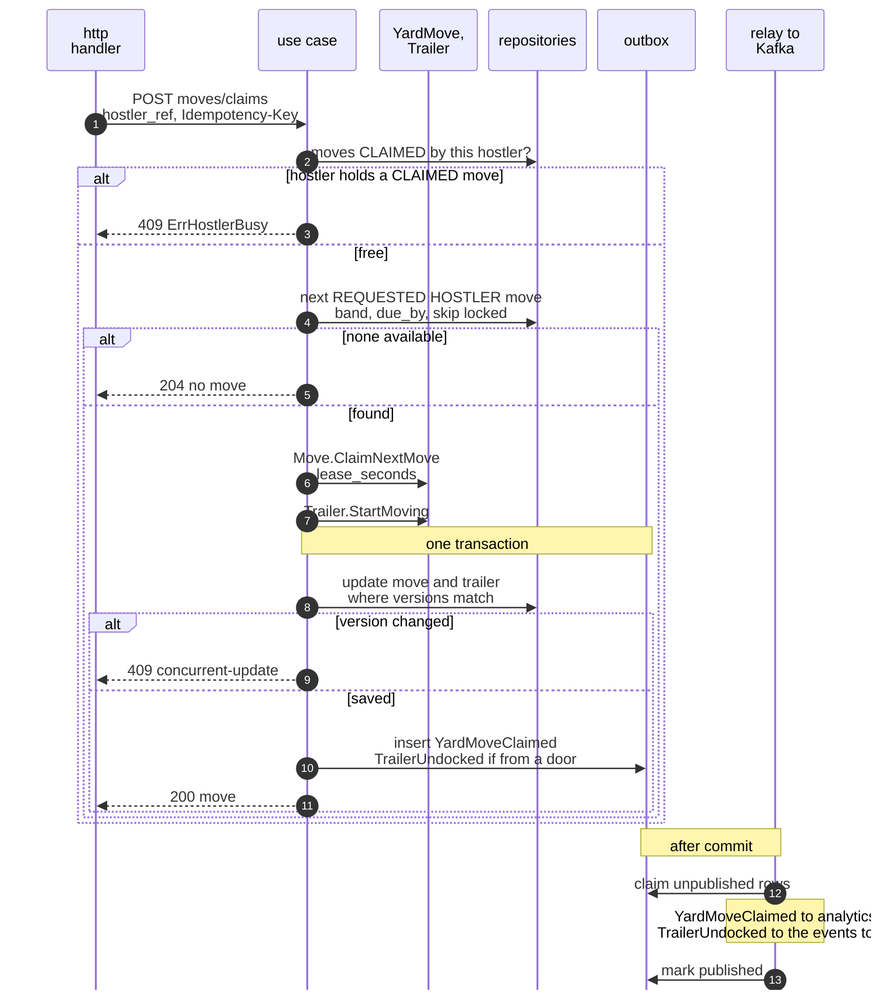

Derived from: `model.yaml → contexts[yard-management].aggregates[YardMove, Trailer]`
(`invariants`, `transitions`, `notes`), `.business_decisions`.

Omitted: the idempotency-key check. The claim order (band, then `due_by`), the `204`
answer and `TrailerUndocked` on a claim from a door are proposed (gaps YM-G19, YM-G8).

### B5. CompleteMove

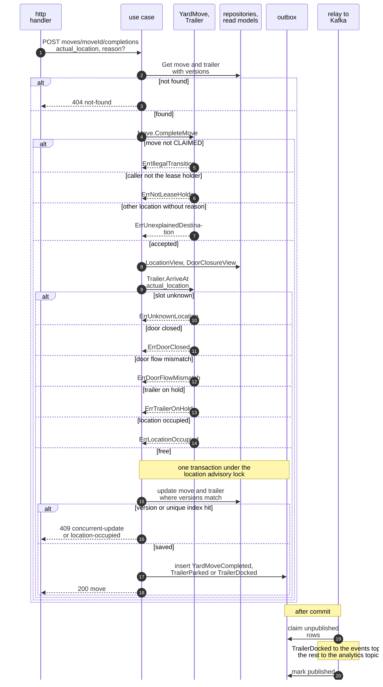

Derived from: `model.yaml → contexts[yard-management].aggregates[YardMove, Trailer]`
(`invariants`, `notes`), `.read_models[LocationView, DoorClosureView]`.

Omitted: the idempotency-key check. For a `VISITING_DRIVER` move there is no lease; who
may complete it is not an inbound row (gap YM-G3). The partial unique index on active
occupancy is the race-safe backstop for `ErrLocationOccupied`.

### B6. ExpireLease

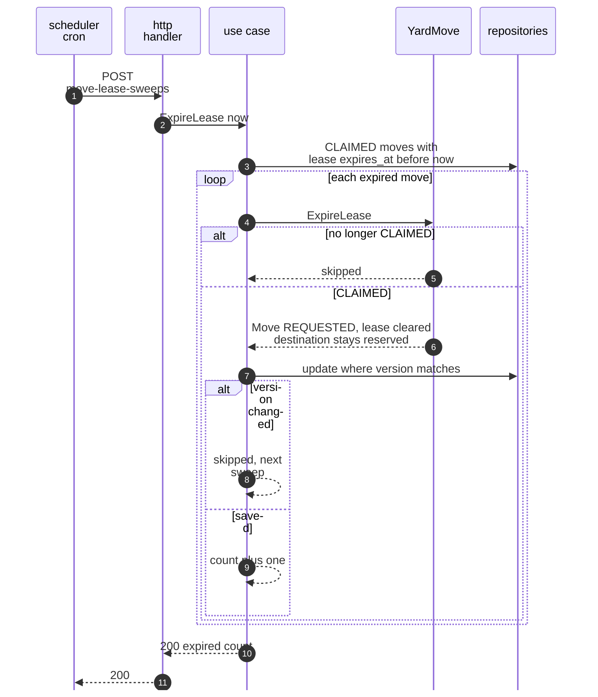

Derived from: `model.yaml → contexts[yard-management].policies[LeaseExpirySweep]`,
`.aggregates[YardMove].transitions`.

Omitted: no outbox, relay or Kafka: the model lists no event for `ExpireLease` (gap
YM-G14). The trailer is not touched; the model has no transition for it (gap YM-G1). Each
move is its own transaction, so one conflict does not stop the sweep.

### B7. CancelMove

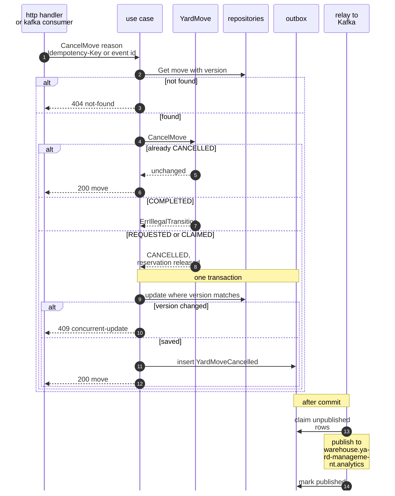

Derived from: `model.yaml → contexts[yard-management].aggregates[YardMove].transitions`,
`.policies[NoShowFreesHolding]`.

Omitted: the idempotency check and the inbox row. A cancelled `CLAIMED` move leaves the
trailer `IN_MOVE` in the model (gap YM-G1); how the policy finds the move of an
appointment is not stated (gaps YM-G9, YM-G27).

### B8. StartDoorWork and CompleteDoorWork

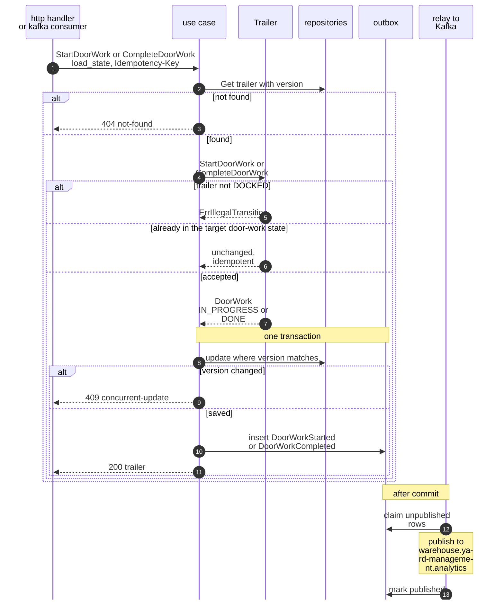

Derived from: `model.yaml → contexts[yard-management].aggregates[Trailer]`
(`value_objects[DoorWork]`, `commands`), `.policies[AutoCompleteUnload,
ClearDoorAfterWork]`, `.publishes[DoorWorkStarted, DoorWorkCompleted]`.

Omitted: the `AutoCompleteUnload` caller (a `ReceiptClosed` consumer: inbox row instead of
the idempotency key, joining `ReceiptAtDoorView` to the trailer, gap YM-G10) and the
follow-up `RequestMove` of `ClearDoorAfterWork` for a `DROP` trailer (B3). The
door-work transitions themselves are this pack's reading (gap YM-G10).

### B9. PlaceHold

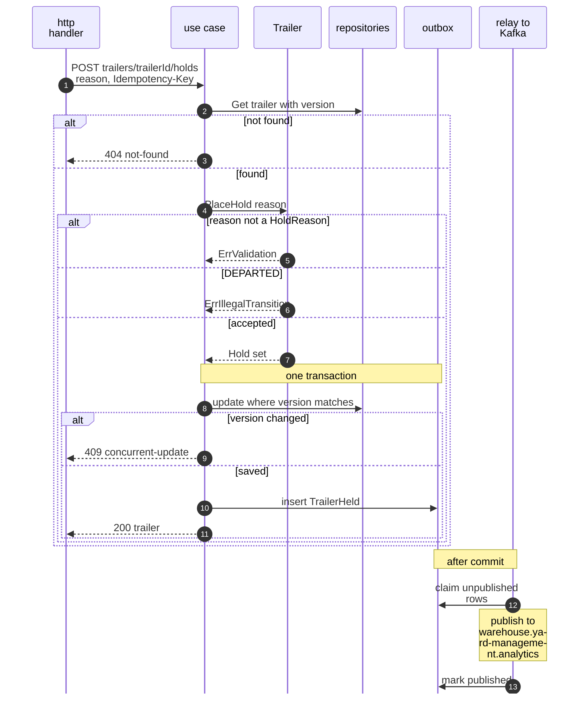

Derived from: `model.yaml → contexts[yard-management].aggregates[Trailer]`
(`invariants[ErrTrailerOnHold]`, `commands`), `.reasons[HoldReason]`.

Omitted: the idempotency-key check. A hold on an already `DOCKED` trailer is not addressed
by the model (gap YM-G23); a held trailer is refused docking at `ArriveAt` (B5).

### B10. DwellSweep

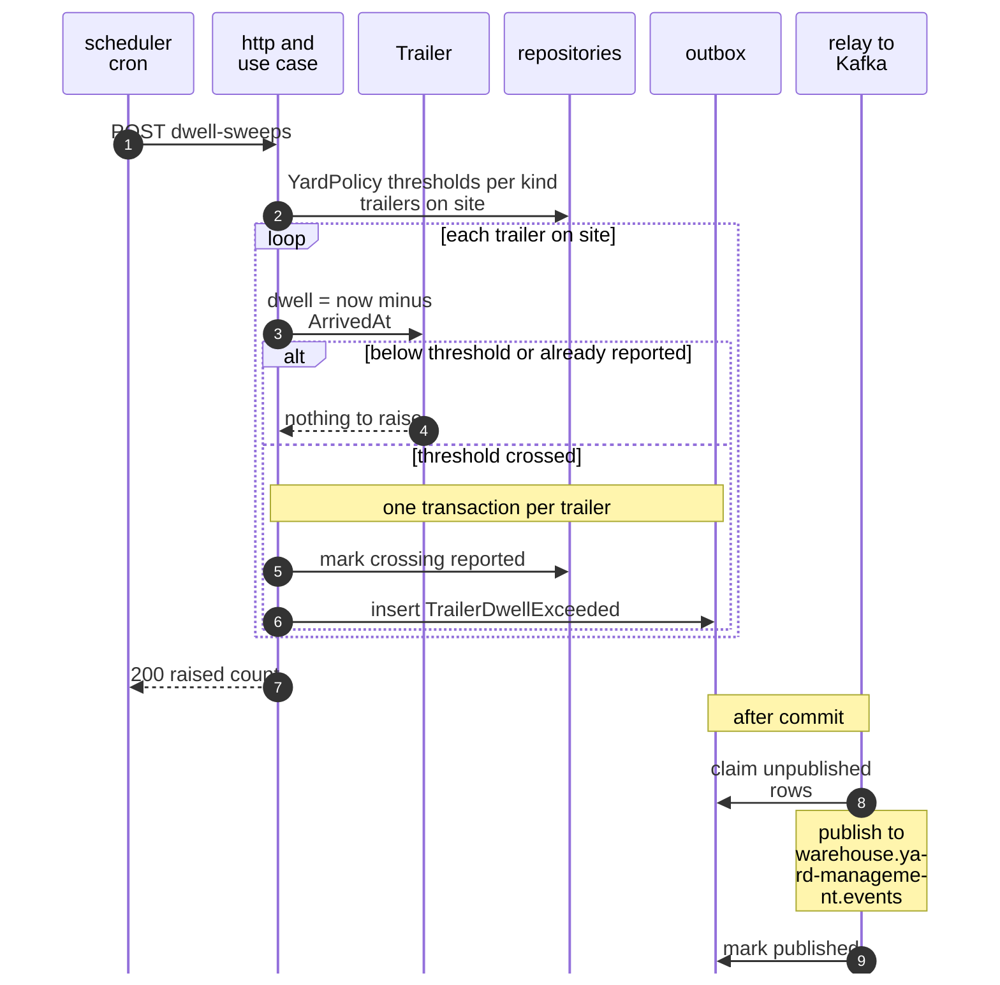

Derived from: `model.yaml → contexts[yard-management].policies[DwellSweep]`,
`.aggregates[YardPolicy]` (`dwell_threshold_minutes`), `.publishes[TrailerDwellExceeded]`.

Omitted: a kind with no threshold (skipped). The marker that makes the sweep "once per
trailer and threshold crossing" is not in the model's value objects (gap YM-G21), and the
model attaches `DwellSweep` to no aggregate command (gap YM-G8).

### B11. CloseYardCheck

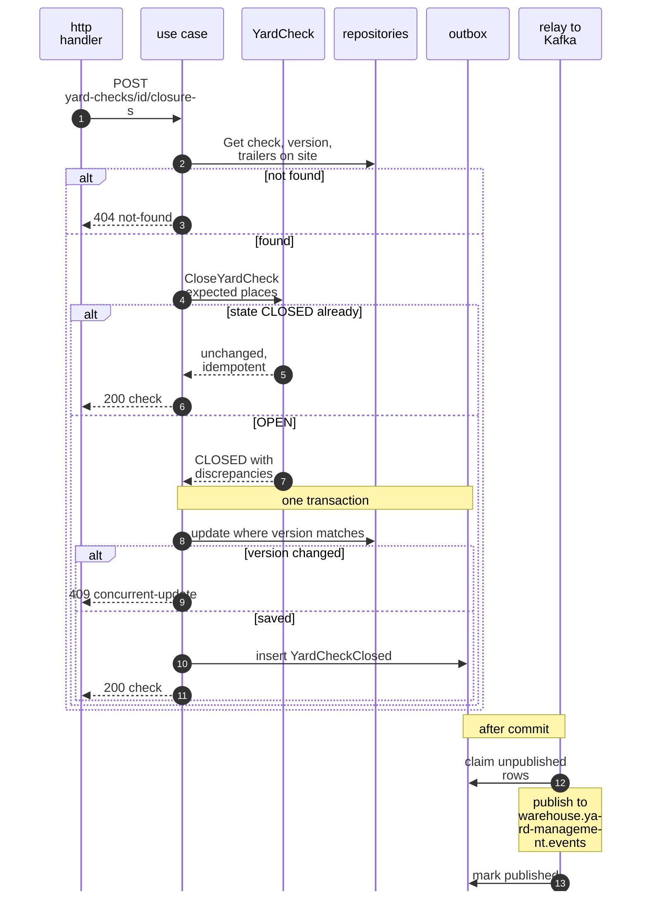

Derived from: `model.yaml → contexts[yard-management].aggregates[YardCheck]`,
`.publishes[YardCheckClosed]`.

Omitted: the idempotency-key check. `OpenYardCheck` and `RecordObservation` are the same
shape without the outbox row (`ErrYardCheckOpen` and `ErrLocationAlreadyObserved` as the
guards). The discrepancy rules and the fact that nothing applies a discrepancy to a trailer
are not stated (gap YM-G18); `exception-management` opens one case per discrepancy.
