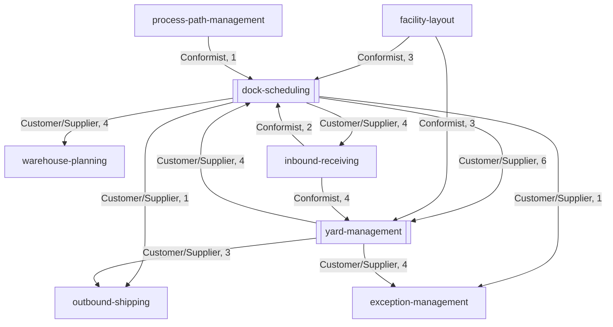

# Context Map

:::info[Generated from the model]
This page is generated from [`model/model.yaml`](https://github.com/IQVO/warehouse-docs/blob/main/yard/model/model.yaml) by `scripts/gen_pages.py`. Edit the model, then regenerate; CI fails when the page and the model disagree.
:::

## Map

Solid arrows are event flows (upstream to downstream). The label is the relationship pattern and the number of event types.

## Edges

| Upstream | Downstream | Pattern | Events |
| --- | --- | --- | --- |
| `dock-scheduling` | `yard-management` | Customer/Supplier | `DockAppointmentBooked`, `DockAppointmentRescheduled`, `DockAppointmentCancelled`, `DockAppointmentNoShow`, `DoorClosureScheduled`, `DoorClosureLifted` |
| `dock-scheduling` | `warehouse-planning` | Customer/Supplier | `DockAppointmentBooked`, `DockAppointmentRescheduled`, `DockAppointmentCancelled`, `DockAppointmentNoShow` |
| `dock-scheduling` | `inbound-receiving` | Customer/Supplier | `DockAppointmentBooked`, `DockAppointmentRescheduled`, `DockAppointmentCancelled`, `DockAppointmentDoorReassigned` |
| `dock-scheduling` | `outbound-shipping` | Customer/Supplier | `DockAppointmentBooked` |
| `dock-scheduling` | `exception-management` | Customer/Supplier | `DockAppointmentNoShow` |
| `yard-management` | `dock-scheduling` | Customer/Supplier | `VisitCheckedIn`, `VisitRejected`, `TrailerDocked`, `TrailerUndocked` |
| `yard-management` | `exception-management` | Customer/Supplier | `VisitRejected`, `SealExceptionRaised`, `TrailerDwellExceeded`, `YardCheckClosed` |
| `yard-management` | `outbound-shipping` | Customer/Supplier | `TrailerDocked`, `DoorWorkCompleted`, `TrailerDeparted` |
| `facility-layout` | `dock-scheduling` | Conformist | `LocationSlotRegistered`, `LocationSlotDecommissioned`, `ZoneRegistered` |
| `inbound-receiving` | `dock-scheduling` | Conformist | `ASNRegistered`, `ASNCancelled` |
| `process-path-management` | `dock-scheduling` | Conformist | `CPTScheduleChanged` |
| `facility-layout` | `yard-management` | Conformist | `LocationSlotRegistered`, `LocationSlotDecommissioned`, `ZoneRegistered` |
| `inbound-receiving` | `yard-management` | Conformist | `ASNRegistered`, `ASNCancelled`, `ReceiptOpened`, `ReceiptClosed` |

## Changes in existing contexts

| Context | Kind | Summary |
| --- | --- | --- |
| `inbound-receiving` | ownership-transfer | DockAppointment moves to dock-scheduling (strangler A-E). BUILT on develop (its ADR 0019): the appointment write routes are retired, an appointments local copy fed by dock-scheduling DockAppointmentBooked, Cancelled, Rescheduled and DoorReassigned validates Receipt.Open(appointment_id) and stamps the door; closing a receipt no longer completes the appointment (yard door release does). The optional TrailerDocked consumer was not built. Infra: helm-values/inbound-receiving.yaml sets dockAppointmentConsumerGroup inbound-receiving-dock-appointments, so the edge is wired in infra (dock-scheduling runs on k3s since 2026-11-10; the edge is live when this consumer runs too). |
| `warehouse-planning` | consumer-source-switch | BUILT on develop (its ADR 0020), the helm values read dock-scheduling. ADR 0017 inbound demand switches from inbound-receiving DockAppointmentBooked/Cancelled to dock-scheduling DockAppointmentBooked/Rescheduled/Cancelled/NoShow; it gains site_id and direction, closing ADR 0017's no-site limitation. Infra: helm-values/warehouse-planning.yaml sets dockAppointments.consumerGroup warehouse-planning-dock-appointments, so the edge is wired in infra (dock-scheduling runs on k3s since 2026-11-10; live when this consumer runs too). |
| `exception-management` | new-consumer | BUILT on develop (its yard and dock-scheduling consumers). Open problem cases from VisitRejected, SealExceptionRaised, TrailerDwellExceeded, YardCheckClosed (one per discrepancy) and DockAppointmentNoShow; routing per source type. Infra: helm-values/exception-management.yaml pins yardManagementExceptionsConsumerGroup (exception-management-yard-management) and dockSchedulingExceptionsConsumerGroup (exception-management-dock-scheduling) (warehouse-infra PR 195; the chart defaults supplied the same ids before), and both producers run on k3s, so the edges are wired in infra; whether the running exception-management image carries the two consumers was not checked. |
| `facility-layout` | additive-ask | Yard slot attribute spotKind (PARKING, HOLDING, REEFER_PLUG, STAGING_LANE) on LocationSlotRegistered; until then holding spots live in yard-management's YardPolicy. |
| `warehouse-ops-agent` | read-only-client | MCP tools of both contexts. AS BUILT each service ships its own MCP server (cmd/mcp): dock-scheduling 5 L1 read tools and 4 L3 write tools (book, reschedule, cancel, report_eta), yard-management 8 L1 read tools and 6 L3 write tools (request_move, cancel_move, place_hold, release_hold, record_seal, open_yard_check); every L3 call needs a human approval and initiated_by. Arrival and door release (physical facts) and the calendar changes and sweeps are not exposed. NOT WIRED (checked 2026-11-10): warehouse-ops-agent develop has no client for either service (no mcpclient file, no *_MCP_ENDPOINT in its config) and helm-values/warehouse-ops-agent.yaml in warehouse-infra develop has no upstreams entry for them; both services also have mcp.enabled false in their helm values (the Kong MCP route is on). |
| `outbound-shipping` | new-consumer | BUILT on develop (IQVO/outbound-shipping), not registered in warehouse-infra (no apps.yaml entry, no chart). Ship-confirm follows the physical departure: consumes yard-management TrailerDocked, DoorWorkCompleted and TrailerDeparted (the last two reached the integration topic with yard-management ADR 0010) and dock-scheduling DockAppointmentBooked. |
| `warehouse-console` | new-remote | Yard Board MFE (spot and door map, arrivals, at-risk appointments) and Dock Calendar MFE. |
| `warehouse-floor-client` | new-screens | Gate clerk check-in/out, hostler claim/complete move, dock operator door work. |

## Boundary rules

- dock-scheduling owns the FUTURE of a door (booked time); yard-management owns the PRESENT of the yard (who and what is physically where). Neither records the other's facts; each keeps an event-fed local copy of what it needs.
- No yard context consumes a retailnetwork.* topic or calls a retail-network service; the only channel to the network stays network-fulfillment and the Vendor API. Outbound carrier pickups are known from the fleet's own CPT schedule (process-path-management CPTScheduleChanged), which the network integration page defines as the network's pickup cutoff.
- Every context owns its database; no shared tables.
- Every published event leaves through a transactional outbox (attempt cap, DLQ).
- Every consumer is idempotent on the CloudEvents id (inbox table) and dispatches on the full type string.
- Sibling data used in a decision is a local, event-fed read model; no synchronous sibling call at request time, in either direction.
- Postgres and Kafka are the only runtime (no in-memory mode, real-wiring rule).
- Every state-changing POST/PUT takes an Idempotency-Key; mutable aggregates carry an optimistic-concurrency version (ETag / If-Match).
- REST follows the fleet guideline (sub-resource nouns for actions, problem+json errors).
